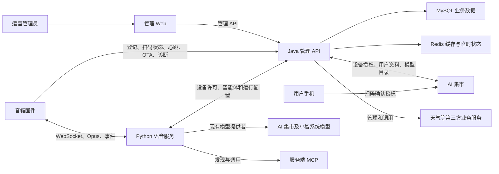

# 小智智能音箱

小智管理后台、语音服务和音箱固件组成一套接入元筑 AI 集市的智能音箱系统。运营管理员在后台管理用户、设备、模型和角色。用户在音箱上发起扫码，由手机浏览器打开集市授权页，绑定后在音箱上使用语音和本地应用。

## 总体架构

管理 Web 使用 Vue 2 和 Element UI。Java 21 管理 API 管理业务数据与权限，Python 语音服务运行对话。服务端源自[小智上游服务端](docs/archive/upstream/upstream-baseline.md)，配套音箱固件以小智官方 v2.6.0 为基线，在固件工程中独立维护。

## 服务端模块

| 模块 | 职责及源码入口 |
| --- | --- |
| 管理页面 | [`main/manager-web/`](main/manager-web/) 提供用户、设备、固件、诊断、智能体、模型、MCP 和系统设置。页面使用现有路由、API 模块、列表和弹框组件。 |
| 管理 API | [`main/manager-api/`](main/manager-api/) 管理后台登录与权限、设备和用户关系、业务配置及内部运行配置。Java 是管理数据和设备归属的权威来源。 |
| 用户、设备和集市授权 | Java [`modules/speaker/`](main/manager-api/src/main/java/xiaozhi/modules/speaker/) 中的 `SpeakerEnrollment`、`SpeakerDevices`、`SpeakerLogins`、`SpeakerMarket`、`SpeakerCustomers` 和 `SpeakerGrants` 分别处理设备登记、设备状态、扫码事务、集市接口和账号授权。管理员可查看用户资料、组织、积分、绑定设备与在线状态。 |
| 智能体 | Java [`modules/agent/`](main/manager-api/src/main/java/xiaozhi/modules/agent/) 管理智能体的创建、复制和编辑。设备使用管理员选定的全局默认智能体，由 [`SpeakerAgents`](main/manager-api/src/main/java/xiaozhi/modules/speaker/SpeakerAgents.java) 和 [`SpeakerAgentConfiguration`](main/manager-api/src/main/java/xiaozhi/modules/speaker/SpeakerAgentConfiguration.java) 管理选择和运行配置。角色包含提示词、模型、音色和工具等配置。 |
| 模型配置与集市模型 | Java [`modules/model/`](main/manager-api/src/main/java/xiaozhi/modules/model/) 管理小智系统与 AI 集市两组配置。[集市模型模块](main/manager-api/src/main/java/xiaozhi/modules/model/market/) 负责目录、筛选、引用校验、运行参数和用户应用专用 Key。Python [`core/providers/`](main/xiaozhi-server/core/providers/) 负责按协议执行模型请求。 |
| 设备固件和 OTA | Java [`modules/device/`](main/manager-api/src/main/java/xiaozhi/modules/device/) 的 `OTAController`、`OTAMagController` 与 `OtaServiceImpl` 使用原版固件目录，按上报板型和版本提供更新。设备固件负责检查、下载、校验、写入和重启。 |
| 设备诊断 | Java [`SpeakerDiagnostics`](main/manager-api/src/main/java/xiaozhi/modules/speaker/SpeakerDiagnostics.java) 提供管理员按设备限时开启与查询的入口。固件通过通用诊断接口上报分段语音耗时、TTS 收发与播放、屏幕欠载等指标。新增同类指标沿用通用结构。 |
| MCP | Java [`SpeakerMcp`](main/manager-api/src/main/java/xiaozhi/modules/speaker/SpeakerMcp.java) 管理服务地址、认证和智能体关联。Python [`server_mcp/`](main/xiaozhi-server/core/providers/tools/server_mcp/) 发现、注册并调用工具，模型根据工具描述和参数选择调用。音箱提供的设备 MCP 工具经现有语音连接公布，由固件执行音量、亮度、记事等本机动作。 |
| 系统设置与第三方服务 | Java [`modules/sys/`](main/manager-api/src/main/java/xiaozhi/modules/sys/) 负责系统参数、字典和服务配置。[第三方服务模块](main/manager-api/src/main/java/xiaozhi/modules/speaker/SpeakerThirdPartyServices.java) 统一维护供应商配置和认证。待机天气由 [`SpeakerWeather`](main/manager-api/src/main/java/xiaozhi/modules/speaker/SpeakerWeather.java) 调用高德，设备通过认证接口获取整理后的展示数据。供应商是否启用由当前配置决定。 |

## 语音与智能体运行链路

1. 音箱按设备身份向管理 API 获取语音许可及短期连接票据。联网认证心跳独立运行。唤醒后音箱沿用现有 WebSocket 协议建立会话，发送 Opus 音频和控制事件。
2. Python 的 [WebSocket 入口](main/xiaozhi-server/core/websocket_server.py) 和 [设备会话模块](main/xiaozhi-server/core/device_session.py) 处理连接、设备许可及配置更新。[原有会话处理](main/xiaozhi-server/core/connection.py) 建立当前智能体的运行上下文。
3. [音频接收模块](main/xiaozhi-server/core/handle/receiveAudioHandle.py) 接收音频，经 VAD 和 ASR 得到文本。会话根据配置执行意图、记忆、对话和工具调用。启用工具调用时，MCP 工具结果按现有流程交回模型继续处理。
4. TTS 通过现有语音提供者合成答复。[音频发送模块](main/xiaozhi-server/core/handle/sendAudioHandle.py) 发送音频帧及播报事件。音箱沿用原有播放、打断和状态切换。管理员更换默认智能体时，当前回答先完成，下一轮加载新角色并清空旧角色上下文。

## AI 集市接入

**应用接入**采用设备授权。全新音箱配网后自动登记，向 Java 申请登录事务，显示授权二维码和核对码。手机浏览器完成集市授权，Java 轮询授权结果、维护用户令牌和音箱归属。解绑针对本台设备。集市负责用户身份、授予范围、积分与模型计费，小智负责本台设备的接入和归属。

**模型接入**用独立目录客户端访问集市。管理端按模型用途、协议、能力及其验证结果筛选，管理员选择后保存配置。运行时按已认证会话和设备归属取得用户应用专用 Key，交由对应语音提供者调用。扫码绑定完成与模型 Key 的领取分开处理。

| 用途 | 当前集市适配条件 |
| --- | --- |
| ASR | `spark_zh_iat_new`，`xfyun_asr_v2` 流式语音识别 |
| TTS | `super-smart-tts`，`xfyun_super_tts` 流式语音合成 |
| 主大模型 | OpenAI 兼容协议，已验证聊天、流式输出和工具调用 |
| 视觉大语言模型 | OpenAI 兼容协议，已验证视觉及图片输入方法 |
| 意图与记忆 | OpenAI 兼容聊天和流式输出。意图识别模型还须支持已验证的 JSON 结构化输出 |
| VAD、RAG | 使用小智系统的配置与实现 |

兼容性以 [`MarketModelCompatibility`](main/manager-api/src/main/java/xiaozhi/modules/model/market/MarketModelCompatibility.java) 的校验为准。实际启用的模型由生产或开发环境的智能体配置决定。

## 开发边界

- **架构与主链路**。管理 Web、Java 管理 API、Python 语音服务和固件的职责，以及现有语音、智能体运行链路是开发基线。功能在所属模块内新增与优化。新增独立职责时可新增模块，使用既有边界和接口。涉及跨端协议、语音或智能体运行流程、鉴权和整体架构的变更，须先提出方案并获得明确确认。
- **界面与业务**。管理页面经 Java API 访问业务数据。新模型沿用现有目录筛选与提供者扩展点。新 MCP 服务经后台登记、授权和关联，沿用 Python 的工具发现与执行。新增外部业务服务使用服务端对应模块与凭据管理，再按现有接口向音箱返回结果。
- **密钥**。集市客户端 Secret、用户模型 Key、第三方 API Key、MCP 凭据和系统密钥由服务端按现有方式保管。生产私有配置置于受限目录，业务凭据沿用现有加密和按需取用机制。Web 与音箱收到各自所需的数据和授权状态。音箱仅按协议持有本台独立设备凭据及短期语音票据。仓库、固件镜像和日志禁止包含真实业务密钥或共享秘密。
- **验证**。按实际改动核对所属模块及调用方。开发检查、生产发布验证和真机验收分别记录。开发环境与生产数据、凭据和服务独立。

## 音箱固件

当前产品为 Waveshare ESP32-P4X 4.3 寸集市版，采用 800×480 横屏和 LVGL。固件负责配网、设备身份、扫码显示、账号与积分、语音收发和播放、设备 MCP 及 OTA。板级模块管理开机、首页、屏保、全屏对话及设置。本地模块提供周日历和语音记事、番茄钟、SD 卡音乐与录音。

配套固件源码使用同一 Git 仓库的独立固件引用及工作目录，按[固件源码获取说明](docs/development/README.md#固件源码)检出。固件工程的 `README.md` 定义板型、构建和模块边界，`docs/speaker-market.md` 说明 P4X 运行行为，`docs/ui/README.md` 收录深蓝定稿和 UI 规范。固件按模块扩展，沿用现有系统设置、音频队列、状态机和 OTA 契约。外部业务服务由小智服务端统一对接。

## 术语

| 术语 | 含义 |
| --- | --- |
| 客户、运营管理员 | 客户使用集市账号绑定并使用音箱。运营管理员使用小智管理后台。 |
| 设备身份、归属账号 | 设备身份标识并认证本台物理设备。归属账号是后台维护的该设备当前绑定用户。 |
| 设备授权客户端、模型目录客户端、用户应用专用 Key | 依次用于扫码身份授权、服务端查询模型目录（`models:read`）以及按归属用户调用模型。 |
| 设备在线、语音会话在线 | 前者依据设备独立认证心跳，后者依据可用的语音连接。 |
| 固件发布、实机安装 | 发布是按板型使固件出现在 OTA 目录。实机安装以设备运行版本、心跳和实际验收为准。 |
| 服务端 MCP、设备 MCP | 前者由服务端发现和调用，后者由音箱声明并在本机执行。 |

## 部署与协作

在开发环境构建发布包，由生产部署机校验并导入镜像。首次部署使用全量离线包，日常升级按受影响组件打包和切换。服务端、网关、持久数据、发布包和备份分别存放。固件通过已有的管理后台和 OTA 目录独立发布。详细流程见[生产部署规范](deploy/production/README.md)，版本、业务入口和证据见[当前部署记录](docs/deployment/current.md)。

开发者按各自适用的环境说明构建和验证。参考[团队协作与安全回退](CONTRIBUTING.md)、[架构决策记录](docs/adr/)和[项目文档导航](docs/README.md)。
