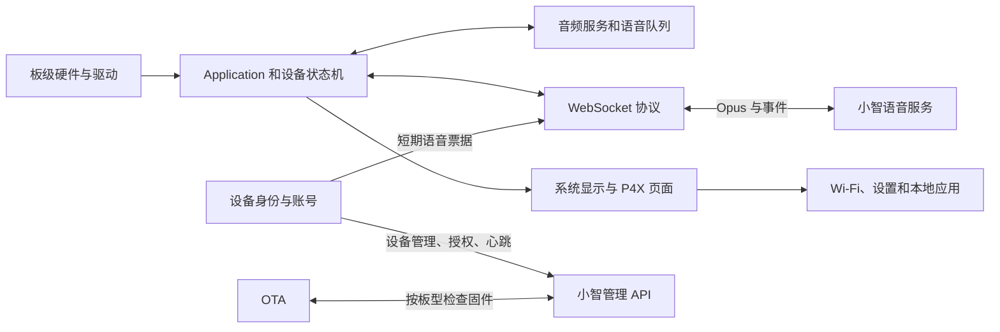

# 小智音箱固件

本工程在小智官方 [v2.6.0](https://github.com/78/xiaozhi-esp32/releases/tag/v2.6.0) 的板级、语音和 OTA 基础上维护筑音 AI 集市版。当前产品为 Waveshare ESP32-P4X 4.3 寸，采用 800×480 横屏及 LVGL。小智管理 API 提供设备登记、扫码授权、用户归属、OTA 和必要业务数据，Python 语音服务负责模型对话。音箱负责设备交互、语音收发和本地应用。

## 固件架构



| 层或模块 | 源码与职责 |
| --- | --- |
| 应用与系统状态 | [`main/application.cc`](main/application.cc) 和 [`main/device_state_machine.cc`](main/device_state_machine.cc) 管理系统事件、唤醒、对话和状态转换。 |
| 板级支持 | [`main/boards/`](main/boards/) 定义芯片、引脚、屏幕、触摸、音频及网络。P4X 产品页面和应用位于 [Waveshare 板型目录](main/boards/waveshare/esp32-p4-wifi6-touch-lcd/)。 |
| 音频 | [`main/audio/`](main/audio/) 管理采集、唤醒、编解码、播放和队列。本地音乐与录音经现有音频服务协调资源。 |
| 通信与 OTA | [`main/protocols/`](main/protocols/) 管理原版传输与消息，[`main/ota.cc`](main/ota.cc) 负责固件检查、下载、校验和安装。 |
| 身份与管理 | [`main/speaker_account/`](main/speaker_account/) 管理自动登记、设备凭据、扫码状态、心跳、账号和诊断。 |
| 界面及本地应用 | [P4X 板型目录](main/boards/waveshare/esp32-p4-wifi6-touch-lcd/) 内按 `speaker_*` 模块维护导航、开机、首页、屏保、对话、设置、配网、日历、番茄钟、计算器、音乐和录音。 |
| 设备 MCP | [`main/mcp_server.cc`](main/mcp_server.cc) 管理设备工具的发现与分发。板级功能模块声明和执行各自的本机工具。 |

[P4X 产品说明](docs/speaker-market.md)列出具体模块、功能和开发检查。[UI 规范与定稿](docs/ui/README.md)说明页面、组件和交互。服务端工程 `README.md` 维护服务架构与模块边界，`deploy/production/README.md` 维护生产与固件发布规范。

## 开发边界

- **稳定链路**。沿用现有板级初始化、设备状态机、语音协议和音频队列、智能体交互契约、OTA 与系统设置架构。影响这些基线的变更先单独提案并取得明确确认。
- **按模块扩展**。把功能和页面放在对应应用模块，通过现有导航和状态接入。新的独立应用可新增模块。复用公共控件、主题、硬件接口与音频服务。保持已有设置、NVS 数据、账号和本地数据的兼容性。
- **系统资源**。应用通过 `Application` 调度共享状态，网络与文件操作放在现有工作任务。保持语音、音乐与录音的音频优先级。按 [UI 规范](docs/ui/README.md) 核对触摸、布局和渲染刷新。
- **凭据及外部请求**。集市、模型、MCP、天气及其他第三方业务凭据由服务端管理。固件按既有认证机制持有本台设备的独立凭据和短期语音票据。固件源码、公共配置、镜像和日志禁止携带共享秘密。设备通过小智服务端获取第三方业务数据。

## 构建与验证

P4X 产品构建使用 ESP-IDF 6.1，已验证工具链提交为 `f0114250e205e33a945e2f3e7ec40085c5a029a2`。在开发环境加载工具链后，于固件工程运行：

```sh
idf.py --version
cp locks/esp32p4-v2.6.0.lock dependencies.lock
python scripts/build.py waveshare/esp32-p4-wifi6-touch-lcd \
  --name esp32-p4x-wifi6-touch-lcd-4.3-market --language zh-CN
```

OTA 使用 `build/xiaozhi.bin`。经授权准备 USB 整包时使用 `--zip`，生成的合并镜像包在 `releases/`。构建变体和 OTA 上报板型的区别见[P4X 产品说明](docs/speaker-market.md)。

开发时检查镜像的板型、版本、分区大小及相应模块。触屏和布局可用 800×480 LVGL 模拟核对，网络、音频、显示和 OTA 安装以对应真机结果验收。设备生产发布采用服务端的发布规范。

## 上游与许可证

固件基线为上游提交 `4de00aed740595a8713b01f8332b9b2cf30685bc`。板型扩展、协议和工具的通用参考见[自定义板型](docs/custom-board.md)、[WebSocket](docs/websocket.md)和[MCP 协议](docs/mcp-protocol.md)。许可证与上游版权声明见 [LICENSE](LICENSE)。
