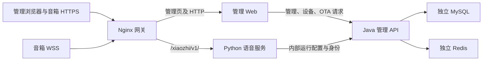

# 小智生产部署规范

适用于服务端、网关和音箱固件的正式发布。发布输入在开发环境构建并校验，生产服务器负责接收、备份、导入镜像和运行服务。生产操作须取得明确授权。当前版本、公开业务入口和验收记录见[当前部署状态](../../docs/deployment/current.md)。

## 部署架构



| 组件 | 部署边界 |
| --- | --- |
| Nginx 网关 | 独立 Compose，由公网 HTTPS 入口接收请求。对 `/xiaozhi/v1/` 转发 WebSocket 到 `voice:8000`。其他 HTTP 路径转发给管理 Web。 |
| 管理 Web | 管理页面与 HTTP 代理。Web 配置把 `/xiaozhi/` 转发到 `api:8002`。宿主机回环管理访问使用 `127.0.0.1:18052`，以 Compose 的 `WEB_PORT` 为准。 |
| Java 管理 API | 使用内部数据库、缓存和私有配置。设备 HTTP 管理、授权、心跳、OTA 和诊断由 Java 处理。 |
| Python 语音服务 | 安装独立镜像。通过容器服务名获取 Java 的运行配置和许可。 |
| MySQL 与 Redis | 小智独立服务。使用内部网络和本项目持久目录。 |

网关及 Web 的转发以 [Nginx 模板](nginx/default.conf)和 [Web 代理模板](xiaozhi/web.conf)为准。网络、运行 UID/GID 和数据卷以[应用模板](xiaozhi/compose.yaml)与[网关模板](nginx/compose.yaml)为准。部署视图可记载业务 IP、端口和运行用户。登录身份、登录命令、跳转链路、私有访问文件和认证材料由运维保管。

## 目录与归档

| 目录 | 用途 |
| --- | --- |
| `/data/apps/xiaozhi/` | 小智 Compose、运行配置、`mysql/data/`、`redis/data/`、上传文件和服务日志。 |
| `/data/apps/nginx/` | 网关 Compose、站点路由和 TLS 材料。 |
| `/data/packages/xiaozhi/<源码版本>/` | 传入的服务发布包、清单、校验值、固件应用包及其发布记录。 |
| `/data/backup/xiaozhi/` | 按发布日期或版本保存的配置、数据备份、前一版 OTA 目录记录和恢复证据。 |
| `/data/bin/xiaozhi/`、`/data/bin/systemd/` | 运行、初始化脚本和 systemd 单元的归档。 |
| `/data/` | 部署视图、运维说明和更新日志。 |

普通传包、目录与配置准备使用约定的部署用户。Docker 管理、安装 systemd 单元和其他系统操作使用已授权的权限。容器的 Java 与 Python 进程沿用 `RUN_UID` 和 `RUN_GID`。

- **部署视图**记录服务、所属目录、网络、端口、镜像或固件版本、存储位置和启动方式。
- **运维说明**记录启动、停止、状态检查、日志位置、备份和恢复方式。
- **更新日志**记录时区和发布时间、源码提交、变更范围、产物校验、备份位置、验证结果和回退处理。只把实际完成的检查记为通过。

## 发布提交基线

每次生产发布先确定目标 Git 提交，使用完整提交 SHA 记录基线。分支名、镜像短标签和固件版本号可用于检索，发布记录同时保存完整提交与产物 SHA-256 的对应关系。

| 发布对象 | 基线与核对方式 |
| --- | --- |
| 服务端 | 按组件记录更新前后的完整提交、镜像 ID 和镜像层。镜像的 `org.opencontainers.image.revision` 与发布清单中的提交对应。部署模板从本次提交导出。各组件可以运行在不同提交，部署视图分别记录。 |
| 固件 | 记录本次更新前后的固件版本和提交、上游基线、构建变体、OTA 板型和应用包 SHA-256。发布后用目录版本、下载校验和设备版本心跳分别确认对应状态。 |

产物与发布记录放在对应的 `/data/packages/xiaozhi/<源码版本>/` 目录。发布后更新部署视图、更新日志和[当前部署记录](../../docs/deployment/current.md)。只发布服务端或固件时，保留另一端最近核验的基线。回退也记录回退前后的基线及结果。

## 首次部署

首次部署使用全量离线包。已有环境升级按[日常更新、验证与回退](#日常更新验证与回退)执行。

### 全量离线包

1. 在开发环境从同一发布提交构建 Java API、管理 Web 和 Python 语音镜像，取该提交的 Dockerfile、Web 代理配置和部署模板。开发入口与依赖按各自的开发环境文档执行。构建平台与目标机一致。
2. 将三种应用镜像及模板指定的 MySQL、Redis、Nginx 镜像一起导出到 `images.tar`。生成记录完整提交、平台、镜像标签、ID 和镜像层的 `images.manifest`。用 `git archive` 导出目标提交的 `deploy/production/` 作为 `deployment.tar.gz`，对三个文件生成 `SHA256SUMS`。
3. 上传到该版本的包目录。在生产核对空间和平台，执行 `sha256sum -c SHA256SUMS`，用已有 Docker 执行 `docker image load -i images.tar`，对照清单核对已导入镜像。将模板解到暂存目录后再安装。私有 `.env`、凭据和证书按[配置说明](#环境变量及配置示例)准备。

### 首次初始化

1. 将校验通过的应用、网关模板和运维脚本安装到下表位置。按[配置模板](xiaozhi/speaker.properties.example)准备环境配置、TLS 和服务端凭据。
2. 在空数据目录使用 [`init-config.sh`](bin/init-config.sh) 初始化小智自己的 MySQL、Redis、管理员及应用加密配置。将生产专用的设备授权客户端和模型目录客户端配置到 Java 私有配置。初始化完成后按现有流程移除管理员的临时引导文件。
3. 在小智应用目录启动 MySQL、Redis、API 和 Web，先确认存储健康与 Java 初始化完成。使用 [`init-voice.sh`](bin/init-voice.sh) 生成内部语音配置，然后启动语音。
4. 在后台设置默认智能体、模型和所需第三方服务。确认语音配置能够读取后，启动 Nginx 网关并检查管理 HTTPS、设备 API、OTA 和 WSS。
5. 将归档的 [`xiaozhi-production.service`](bin/xiaozhi-production.service) 安装到 `/etc/systemd/system/`。确认 `/data/bin/xiaozhi/services.sh` 可执行后，执行 `systemctl daemon-reload` 并启用该单元。[`services.sh`](bin/services.sh) 提供 `start`、`stop` 和 `status`，启动时先应用后网关，停止时先网关后应用。

| 解包后的文件 | 安装位置与要求 |
| --- | --- |
| `xiaozhi/` 下的应用模板 | 放到 `/data/apps/xiaozhi/`，保持文件名。 |
| `nginx/compose.yaml`、`nginx/.env.example` | 放到 `/data/apps/nginx/`，根据示例另行准备私有 `.env`。 |
| `nginx/default.conf` | 放到 `/data/apps/nginx/conf.d/default.conf`，由网关挂载。TLS 文件分别放到 `/data/apps/nginx/tls/fullchain.pem` 和 `/data/apps/nginx/tls/privkey.pem`。 |
| `bin/` 下的三个 `.sh` 脚本 | 使用 `install -m 0755` 安装到 `/data/bin/xiaozhi/`。 |
| `bin/xiaozhi-production.service` | 使用 `0644` 权限归档到 `/data/bin/systemd/`，启用时从此处安装。 |

### 环境变量及配置示例

- 小智应用目录的 `.env` 由 [`init-config.sh`](bin/init-config.sh) 在首次初始化生成。包含 `RELEASE_TAG`、`RUN_UID`、`RUN_GID` 以及独立 MySQL 和 Redis 密码。初次执行前保留空数据目录，由脚本创建 `.env`。后续升级按发布范围更新版本。
- 网关目录的 `.env` 参照 [Nginx 示例](nginx/.env.example)填写。使用部署主机的业务绑定地址 `GATEWAY_BIND`，按实际需求配置端口 `GATEWAY_PORT`。网关与应用使用同一个 `EDGE_NETWORK`。
- [应用参数模板](xiaozhi/speaker.properties.example)分别说明设备接入、集市设备授权、目录客户端和业务地址。Secret 与应用加密密钥使用容器内的私有文件路径，由运维保管真实值。Python 语音的私有配置由初始化脚本生成，智能体、模型和第三方服务由管理后台配置。

## 日常更新、验证与回退

### 确定本次升级范围

对照各组件的现网提交与目标提交，列出需要更新的组件、配置和数据库迁移。记录运行镜像标签和完整层摘要、存储健康状态、可用空间和回退条件。只构建、打包和切换涉及的组件。日常升级沿用现有目录、私有配置与数据，首次初始化脚本只用于空环境。固件按[固件构建与 OTA 发布](#固件构建与-ota-发布)独立处理。

### 构建和打包

- **应用层升级包**。应用产物可以在已验证的现网镜像上完整替换、且运行依赖兼容时，从目标提交构建该组件的产物。以对应现网镜像为 `FROM`，将完整的新产物装到原运行路径，镜像标签使用目标提交简写，并在 `org.opencontainers.image.revision` 标记完整目标提交。逐项核对需删除的旧文件、运行权限和代理配置。API 原路径为 `/app/app.jar`，Web 静态文件原路径为 `/usr/share/nginx/html/`。API 的完整 JAR 和 Web 的完整构建产物一并归入各自的新层；新增层可以直接由 Docker 加载。
- **独立镜像升级包**。变更基础镜像、系统或运行依赖时，按目标提交的 Dockerfile 完整构建受影响的镜像，并用 `docker image save` 导出这些镜像。现网镜像层与记录不符时，先重新核对发布基线，也可选择这种包。数据库、缓存或网关有变更时，单独列出其版本、兼容性检查与回退步骤。

在开发环境使用 `docker image save` 导出候选镜像供[升级包工具](tools/upgrade-images.py)读取。下面示例是 API 和 Web 同时更新时的应用层包，`API_BASE_IMAGE` 和 `WEB_BASE_IMAGE` 填各自已核对的现网镜像标签，`PACKAGE` 指向本次新建的包目录。

```bash
docker image save -o "$WORK/candidates.tar" \
  "xiaozhi-release-api:${REVISION:0:12}" "xiaozhi-release-web:${REVISION:0:12}"
python3 deploy/production/tools/upgrade-images.py pack \
  --revision "$REVISION" --archive "$WORK/candidates.tar" --output "$PACKAGE" \
  --base "api=$API_BASE_IMAGE" --base "web=$WEB_BASE_IMAGE"
```

将 `services.tar`、`release-manifest.json`、`SHA256SUMS` 和与目标提交对应的配置模板（仅在本次需要应用配置变更时）传到 `/data/packages/xiaozhi/<源码版本>/`。清单含基线与目标镜像层、目标镜像 ID 和目标提交。模板有变更时，从目标提交导出并把使用的模板包加入 `SHA256SUMS`。传输完成后先校验，目录和校验记录保留供回退排查。

### 导入、切换与核验

1. 在包目录执行 `sha256sum -c SHA256SUMS`。应用层包在小智应用目录运行下列检查与导入步骤，基线检查失败时停在导入前。独立镜像包按清单核对导入后的平台、镜像 ID、层和提交。

   ```bash
   cd /data/apps/xiaozhi
   python3 "$UPGRADE_TOOL" verify-base "$PACKAGE/release-manifest.json"
   docker image load -i "$PACKAGE/services.tar"
   python3 "$UPGRADE_TOOL" verify-target "$PACKAGE/release-manifest.json"
   ```

   `UPGRADE_TOOL` 指向经过核对的版本库发布工具副本。基线检查、导入和候选镜像核验阶段都在服务切换前完成。应用层包采用现网 Docker Engine 经典镜像存储支持的导入格式，检查工具使用 Python 3.8 或更新版本。更换 Docker 镜像存储类型时，先验证导入兼容性，或使用对应引擎导出的独立镜像包。

2. 在 `/data/backup/xiaozhi/` 备份将要替换的 Compose、相关配置和镜像基线，保留可用旧镜像。涉及结构或数据变更时先备份必要业务数据并准备回退。现行首版备份排除对话正文，也不得通过整库、卷或日志快照间接保留正文。备份和恢复验收须核对排除结果。详见[备份数据边界](../../docs/adr/0006-exclude-conversation-content-from-backups.md)。
3. 对暂存的 Compose 执行 `docker compose config --quiet`，检查实际变更只涉及发布范围，再应用。使用 `docker compose up -d --no-deps --no-build --pull never api web` 切换目标服务，此例更新 API 和 Web。其余服务沿用原配置、镜像和实例。更新网关等独立服务时使用其自己的 Compose。
4. 核对运行镜像、启动日志和数据库与缓存健康。按范围检查管理入口、目标 API、设备鉴权、内部配置和语音 WSS。对未更新服务核对容器 ID。实机结果单独记录设备型号、固件版本与实测项。
5. 检查失败立即恢复已备份的 Compose 和配置，用同样的 Compose 命令切回受影响服务的旧镜像，再核对入口与存储。若涉及数据库结构或数据变更，按发布前确认的兼容条件及数据恢复计划处理。通过或回退后更新部署视图和更新日志，记下各组件基线、产物校验、备份、可复核结果与发布时间。

## 固件构建与 OTA 发布

1. **确认目标和基线**。从明确的固件提交构建，按[发布提交基线](#发布提交基线)记录来源。P4X 中文集市版构建变体为 `esp32-p4x-wifi6-touch-lcd-4.3-market`，现行 OTA 识别板型为 `waveshare-esp32-p4-wifi6-touch-lcd-4.3`。两者各有用途。
2. **构建与检查**。按固件 README 的锁定工具链和板型入口构建，核对芯片、芯片修订适用范围、应用版本、镜像校验、大小和最小应用分区余量。OTA 使用 `build/xiaozhi.bin` 应用镜像。USB 整包用于经授权的整机烧录和恢复，包含 bootloader、分区表、应用及资源等内容。
3. **传包和备份**。将应用包及 SHA-256 放到该提交的包目录。发布前备份目标板型当前的 OTA 目录项、原固件及其校验对应关系，确认旧包在需要恢复时可用。
4. **发布**。在小智管理后台「设备管理 → 固件管理」按精确板型发布更高版本。核对目录展示的版本、大小和板型，从生产本机和设备公网路径下载并比对 SHA-256。只发布应用包时沿用现有后台与服务。
5. **确认实机**。设备联网启动后检查 OTA。后台放出新版本与设备已安装分别记录。以设备启动后上报的版本和心跳，以及本次要求的真机操作为验收依据。
6. **暂停与恢复**。出现问题时先停止继续下发本版，并按备份恢复适用的目录记录。已升级设备使用经过验证的兼容修复固件或授权的恢复流程。记录受影响的板型与版本。

发布包、备份和现场运维记录存放在约定的生产目录。模型、设备、集市和第三方凭据使用现有私有配置与运行时管理。
