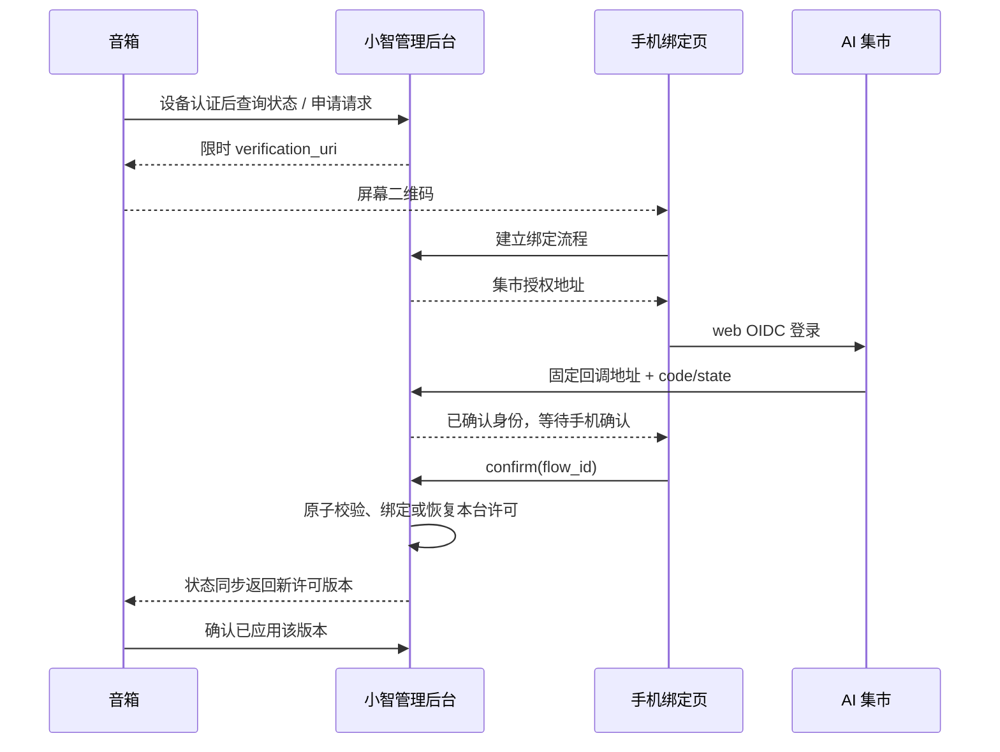

# 音箱二维码绑定与设备控制协议 v1

约定日期：2026-11-09。用途：固件与服务器并行实现 [#13](https://github.com/yanghan24/xiaozhi/issues/13)，衔接 #11、#14、#15、#18。本文规定新接口，不表示接口、二维码或真实登录已实现。产品范围和验收以对应 Issue 为准；双方更改本文的路径、字段、单位或状态含义时，必须同时更新 Schema、示例和另一端。

机器字段见 [JSON Schema](device-binding-v1.schema.json)，完整报文见 [示例](device-binding-v1.examples.json)，服务器交接见 [实施说明](../handoff/device-binding-v1-server.md)。`version: 1` 是本协议版本，与固件版本、OIDC 协议、语音协议版本分别管理。

## 1. 已定行为与职责

- 首次绑定只需手机完成集市 web OIDC 登录并明确确认，无需音箱端点击确认。OIDC 回调成功本身不建立归属。
- 只有预登记并持有效独立设备接入凭据的音箱可申请请求；一个账号可绑定多台，一台同时只有一个归属账号。
- 绑定请求从创建起有效 **600 秒**。扫描、开始登录、轮询均不延长或占用请求；最终确认仍须校验有效期。并发首个合法提交取得唯一归属，其余不能覆盖。
- 手机页面的退出只停用目标设备，保留归属及设备接入凭据；其他音箱继续按各自许可使用。恢复只作用于本次设备请求，不隐式唤醒其他已退出设备。
- 单台退出/解绑不撤销或删除共享集市 Key、Refresh Token、应用授权，不调用 OIDC 全局登出。真实集市撤销、账号停用和权限失效继续按实际影响范围执行。
- 固件只持有小智设备接入凭据和设备专用语音令牌；集市 Secret、Token、Key 留在受控后端。绑定不以规范通权限或余额为前提；“本地许可允许”不保证某次集市资源调用成功。



## 2. 地址、认证和封装

### 2.1 公网地址

后端配置完整 `PUBLIC_ORIGIN`，例如 `https://speaker.example.com:8443`；这里的域名和 8443 都是示例。外网端口由运维确定，可映射到内部 HTTPS 443，不能从内部监听端口或未验证的请求 Host 推算公网地址。

2026-11-09 的实际联调来源已确定为 `https://bridge.hncig.cn:18443`，TCP 映射到 Ubuntu `192.168.168.114:443`，设备 HTTPS/WSS 已验证。登录回调和后通道通知按下表固定路径组成[精确预登记地址](../handoff/ai-market-registration-2026-11-09.md)，这两个路径当前尚未部署，不能将入口连通当作 OIDC 验收。

| 用途 | 固定路径 | 调用方 |
| --- | --- | --- |
| 设备控制基址 | `/xiaozhi/device-control/v1/` | 固件 |
| 二维码网页 | `/xiaozhi/bind/{request_handle}` | 手机 |
| 客户 JSON 接口基址 | `/xiaozhi/customer/v1/` | 手机网页 |
| OIDC 登录回调 | `/xiaozhi/customer/oidc/callback` | 手机经集市跳转 |
| OIDC 后通道注销通知 | `/xiaozhi/customer/oidc/backchannel-logout` | 集市服务器 |
| 现有 OTA / 语音 | `/xiaozhi/ota/`、`/xiaozhi/v1/` | 固件 |

所有外部 HTTPS/WSS URL 保留实际端口；域名、端口、回调路径及末尾斜杠按最终配置精确登记。集市身份 issuer 仍为 `https://aimarket.hncig.cn/oidc`；访问规范通的集市 `:4090` 不随本项目入站映射变化。

新固件在 OTA 响应中发现以下顶层扩展，原有 `server_time / firmware / websocket / activation` 结构不套新封装：

```json
{
  "device_control": {
    "version": 1,
    "base_url": "https://speaker.example.com:8443/xiaozhi/device-control/v1/"
  }
}
```

`base_url` 必须以 `/` 结束；固件只追加本版本规定的 `state`、`requests`、`state-acks`，不自行改域名或端口。新固件在 OTA 请求体中增加 `device_control_capabilities: [1]`。这是能力声明，不能代替设备认证。无此扩展、版本不支持或 TLS 校验失败时，不启用产品语音。

**可信引导要求：** 携带设备接入凭据前，发现响应必须来自已由受控交付/维护配置授权、证书校验成功的 HTTPS OTA；控制目标必须同 origin，或已在受控配置中明确授权该 origin（scheme、域名和端口）。合法 HTTPS 证书本身不代表任意新域名有权接收设备凭据。旧 HTTP OTA 响应不能用于建立此信任或授权新目标，产品功能保持关闭，先受控迁移已有 NVS 地址。控制请求不自动跟随重定向，不向重定向目标转发 Authorization。具体可信配置存储与凭据交付一起落实。

### 2.2 两种身份

设备控制接口要求 HTTPS，并使用：

```http
Authorization: Bearer <DEVICE_CREDENTIAL>
Device-Id: <REGISTERED_DEVICE_ID>
Content-Type: application/json
```

`REGISTERED_DEVICE_ID` 由小智预登记档案确定，不能用擦除后随机重建的 Client-Id 替代。服务器必须从设备凭据定位唯一设备，再核对声明的 Device-Id，拒绝跨设备使用。MAC、Client-Id、板型和版本只可作标识或诊断信息。此 Bearer 只用于专用设备控制接口，不能当作集市 Key、运营令牌或语音令牌；不允许在 URL/query 中传凭据。

本版本确定上述传输方式和身份约束。凭据应不可猜测、逐台独立、可撤销/补发，服务端保存受保护的校验材料；不在此指定尚未验证的 NVS 分区、eFuse 烧录地址或量产工具。固件与交付方在真实联调前必须落实实际写入、持久化及恢复方案。测试设备也必须预登记，不能设置“仅报 MAC 即放行”的替代模式。

手机接口使用独立客户浏览器会话：OIDC 验证 `iss + sub`，CSRF 防护及 Secure/HttpOnly Cookie；不能使用运营管理员令牌或触发首次用户管理员逻辑。每个流程的 `flow_id` 与当前浏览器、设备请求和 OIDC 事务关联，支持同浏览器多标签页，不使用“最后一次扫描的设备”作为全局目标。

### 2.3 JSON 规则

新设备控制和客户 JSON 接口的成功响应固定为：

```json
{"version":1,"code":"OK","data":{}}
```

失败固定为 `{"version":1,"code":"REQUEST_EXPIRED","message":"请重新扫码"}`，并使用正确 HTTP 状态。固件/网页按 `code` 分支，不解析中文提示。成功内容按各端点定义；不把这一新封装套到 OTA、现有管理 Result 或语音 `hello/tts/binary` 协议。

时间戳为 UTC Unix 毫秒整数，版本为单调递增且不超过 `9007199254740991` 的 JSON 安全整数。所有 JSON 响应 `Cache-Control: no-store`，不包含完整归属账号标识、集市凭据或设备接入秘密。二维码 URL 最长 512 个 ASCII 字节，后端须校验部署地址及生成结果满足该上限。

## 3. 状态与版本

`GET state` 的 `data` 包含：

| 字段 | 类型与含义 |
| --- | --- |
| `device_id` | 预登记档案标识；必须与认证设备相同 |
| `revision` | 此设备控制快照版本；可见状态或请求创建/过期/消费时递增，心跳不递增 |
| `permission_version` | 此设备许可版本；归属、许可、准入凭据代际或相关授权有效性变化时递增，创建二维码不递增 |
| `server_time_ms` | 本次响应生成时的服务端时间，不能用长轮询开始时间代替 |
| `binding_state` | `unbound` 或 `bound` |
| `use_permission` | `allowed` 或 `blocked`；只表示本地设备许可 |
| `reason` | 下表的机器原因 |
| `binding_request` | 本设备当前有效请求，或 `null` |
| `lease` | 本地语音/播放许可的短期租约；仅 allowed 时非空 |
| `voice` | 本设备的语音连接参数；仅 allowed 时非空 |

合法组合：

| 情况 | binding_state | use_permission | reason | 默认屏幕 |
| --- | --- | --- | --- | --- |
| 未绑定 | unbound | blocked | unbound | 申请并显示绑定码 |
| 已绑定、本地可用 | bound | allowed | ready | 正常使用；进入“账号与绑定”菜单才显示账号页码 |
| 单台主动退出 | bound | blocked | user_signed_out | 申请并显示原账号恢复码 |
| 需要重新授权 | bound | blocked | market_auth_required | 申请并显示原账号恢复码 |
| 设备禁用 | unbound 或 bound | blocked | device_disabled | 停用说明，不申请绑定码 |

所有 blocked 状态的 `lease`、`voice` 必须为 `null`。未取得、格式错误或未知状态不能作为 allowed。无规范通权限、余额不足或普通网络错误不能直接被分类成账号退出或解绑。

`lease` 为 `{permission_version, expires_at_ms, expires_in_ms}`。首版每个 allowed 响应均从**响应生成时**新发 60000 ms 租约，`expires_in_ms` 固定 60000，绝对到期为 server_time_ms + 60000；blocked 不发租约。它是技术上的失联保护，与账号登录寿命无关。设备收到响应时，用单调时钟计算期限，并扣除本次完整请求耗时，得到保守剩余时间；不依赖未校准的设备墙上时钟。不能由缓存、ACK 或失败响应续租。

`voice` 为 `{url, token, expires_at_ms, protocol_version, permission_version}`。`url` 为完整 WSS URL，`protocol_version` 首版为现有语音 v1。token 是设备专用、用途受限、最长 300 秒的短期凭据，关联设备身份/准入代际和当前许可版本；不能以持有 token 绕过当前状态。心跳可重用尚有效 token，不必每次签发。音箱不把此 token 传入客户二维码或设备控制接口。

后端在 token 剩余不超过 60000 ms 时轮换；固件以 `voice.expires_at_ms - server_time_ms - 本次完整请求耗时` 计算保守握手期限，不足以握手时先用 wait_ms=0 同步。token 的 300 秒寿命约束**新握手**，不会单凭到期切断已建立的语音 v1 连接，也不要求连接内刷新；已有连接继续受当前设备许可、准入、实际业务授权和本地租约控制，任一失效仍须停用。

## 4. 设备侧三个接口

### 4.1 读取和持续同步：GET state

`GET {base_url}state?after_revision=27&wait_ms=20000`。首次不带参数，立即返回当前快照。后续 `wait_ms` 范围为 0–20000；有新 revision 时立即返回，否则最多等待后返回当时快照并续发适用租约，**不返回无正文 304/204**。请求到期、权限变更和设备禁用应唤醒等待者，跨实例亦然。

固件只保留一个控制请求在途；以单调时钟设置**整个请求**的 25000 ms 截止时间，涵盖连接、TLS、响应头和响应体。当前库 SetTimeout 是分阶段等待，单独设置它不能证明满足整体截止；实现须在截止时取消/终止请求。后台任务执行网络，UI 更新经主线程调度与显示锁，不在 LVGL 锁内阻塞网络。重连先获取快照；账号菜单等本地动作可中断当前长轮询，再串行发起下一请求，不并发复用同一个 HTTP 对象。

存在有效租约时，实际 wait_ms 不超过 `min(20000, max(0, 本地租约剩余毫秒 - 30000))`，为整体截止和调度留余量；二维码接近到期也应缩短等待。首次应用新许可版本才须 ACK，心跳不重复 ACK。续租优先于非必要 ACK 重试或菜单请求；剩余时间不足时先 wait_ms=0 同步。租约计时和到期停播独立于阻塞网络任务执行，不能等待 HTTP 超时后才停播。

同 revision 允许更新 server_time_ms、请求的 expires_in_ms、lease，以及同 permission_version 下 voice.token/expires_at_ms；这些是按本次响应生成的临时值。设备标识、归属/许可/原因、请求身份/用途/绝对期限、voice.url/protocol_version 等稳定字段发生变化须推进 revision。若稳定字段矛盾或版本回退，丢弃响应并重新同步，不回退已应用许可。401/403、未知版本/状态、格式错误使本地许可立即关闭；普通网络/5xx 可在原有剩余租约内恢复，不能续租。旧 NVS token、启动按键或唤醒不能绕过许可闸门。

### 4.2 创建或复用二维码：POST requests

请求：

```http
Idempotency-Key: <每次逻辑操作唯一的随机值>
```

```json
{"intent":"auto","expected_permission_version":3}
```

| intent | 后端依据认证设备的实际状态决定 purpose |
| --- | --- |
| `auto` | 未绑定为 `bind`；退出/需重新授权为 `resume`；已允许使用返回 409 `REQUEST_NOT_NEEDED` |
| `account` | 已绑定设备的“账号与绑定”页面，为 `account`；未绑定返回 409 `STATE_CHANGED` |

`data` 为 `{revision, permission_version, server_time_ms, binding_request}`。请求对象字段固定为：

```json
{
  "request_id": "req_example",
  "purpose": "bind",
  "verification_uri": "https://speaker.example.com:8443/xiaozhi/bind/OPAQUE_HANDLE",
  "created_at_ms": 1794182400000,
  "expires_at_ms": 1794183000000,
  "expires_in_ms": 600000
}
```

真实 request_id/handle 必须不可猜测，handle 至少 128 位随机熵；示例值不是可用凭据。`verification_uri` 是二维码完整内容，固件原样编码，不重建、不拼设备号、不把它当 OAuth device grant 的 verification URL。它只允许进入本次网页流程，不能独自绑定、退出或读取设备秘密。

expected_permission_version 与当前版本不一致时返回 409 STATE_CHANGED，不创建、复用或替换请求。**每台设备仅一个当前请求**；相同设备、用途、许可版本的重复申请复用请求及原到期时间；切换用途须原子替换并作废旧请求，但不能覆盖已完成归属。`GET state` 显示当前有效请求，过期后为 null 并更新 revision。

屏幕用单调时钟计算 expires_in_ms 减本次完整请求耗时后的保守剩余时间；同 request_id 的重复响应不能延后已知期限。归属提交始终以服务器时间为准。

同一幂等键、同内容返回同一业务结果；同键不同内容返回 409 `IDEMPOTENCY_CONFLICT`。请求身份、created_at_ms 和 expires_at_ms 不变，但每次响应重新计算 server_time_ms/expires_in_ms，不能逐字节重放旧倒计时。至少保存 24 小时的操作结果；幂等重试重新验证当前凭据、许可和请求用途。已过期旧创建操作返回 410，已消费/被替换或版本变化返回 409；不能返回可继续显示的旧码或悄悄创建新码。固件隐藏旧码后用新逻辑操作/幂等键申请。凭据撤销、归属或许可版本变化使旧请求不可提交。

### 4.3 应用状态确认：POST state-acks

```json
{"revision":28,"permission_version":4,"audio_stopped":true}
```

非 allowed 状态下，固件先关声道、清录音/生成/播放队列、丢弃旧轮次，再发送 `audio_stopped: true`。allowed 状态允许 false；ACK 不创建或恢复调用许可。重复相同 ACK 幂等返回 `data: {accepted:true, revision:28, permission_version:4}`。

服务端可保留旧 ACK 作历史记录，但不能降低当前版本或把旧版本停播 ACK 当作新一次退出的完成证据。只有退出操作对应的当前许可版本已停用且收到匹配 ACK，页面才能显示“音箱已确认停播”；其后版本已变更时该旧操作应显示“已被后续操作替代”。

## 5. 手机网页与 OIDC

以下 JSON 接口均在 `/xiaozhi/customer/v1/` 下。匿名流程也须与浏览器会话绑定并防 CSRF；授权 URL 由后端使用正式 OIDC 库生成。完整 URI 的 path/port 与登记一致。

| 方法、路径 | 请求/结果与校验 |
| --- | --- |
| `GET /xiaozhi/bind/{request_handle}` | 返回网页及有限设备展示信息；未知/过期分别 404/410。扫描只读，不消费、不锁定、不更改许可 |
| `POST binding-flows` | body `{request_handle}`；返回 `data: {flow_id, authorization_url}`。创建与本浏览器、请求、用途、设备许可版本关联的 OIDC state/nonce/PKCE 事务 |
| `GET /xiaozhi/customer/oidc/callback` | 标准 code/state 或 error/state 回调；核对浏览器及一次性事务，按下述规则兑换和验证。身份只记录在服务端，返回对应 flow_id 的手机结果页面，等待手机确认，不自动 bind/resume |
| `POST /xiaozhi/customer/oidc/backchannel-logout` | 集市服务器以 `application/x-www-form-urlencoded` 提交 `logout_token`；独立执行通知验签与会话定位，成功返回 HTTP 200/204，不套客户 JSON 封装 |
| `POST binding-flows/{flow_id}/confirm` | body `{}`，客户身份、CSRF、Idempotency-Key；只接受 bind/resume。目标设备和账号分别取自服务端流程记录及验证身份，不接受 body 自报 device_id/账号。成功 `data: {device_session_id, revision, permission_version}` |
| `POST binding-flows/{flow_id}/open-account` | body `{}`，客户身份、CSRF、Idempotency-Key；只接受 account。原子校验请求未过期/未被替换、凭据代际及许可版本未变、身份仍为原归属账号，消费请求并建立本台页面上下文；不改变归属或调用许可。成功字段同 confirm |
| `POST device-sessions/{device_session_id}/sign-out` | body `{}`，原归属身份、CSRF、Idempotency-Key；仅停目标设备。成功 `data: {operation_id, permission_version, execution:"stored"}`，包括离线设备。不是集市全局登出 |
| `GET device-operations/{operation_id}` | 原归属客户会话，只读；`execution` 为 stored/device_acknowledged/superseded，附 permission_version；不能查看别人的操作 |

**登录事务与回调：** web 后端采用授权码、PKCE S256 和 `client_secret_basic`；issuer 为 `https://aimarket.hncig.cn/oidc`。`state`、`nonce`、verifier 仅保存在服务端，与发起浏览器、flow、设备请求、用途及许可版本关联；技术登录事务最长 **300 秒**，不能超过所关联设备请求的剩余期限。授权码按集市文档有效 60 秒且只能兑换一次。这两个期限均不等于 600 秒设备请求或客户本地会话期限。

成功与错误回调均先核对 state、原浏览器和事务有效期；拒绝缺失/错配、跨浏览器、过期和已处理事务，不盲目重试已使用或结果不明的 code。成功兑换使用原始精确 redirect_uri 和本事务 verifier，由正式 OIDC 库验证签名、iss、aud、exp、nonce 及适用的标准字段。调用 UserInfo 时，其 sub 必须与已验证 ID Token 的 sub 一致；以 issuer + sub 记录身份。若已验证 ID Token 含 sid，则保存供通知关联；缺少 sid 不单独拒绝合法登录，通知可按下述 sub 规则关联。拒绝授权、上游网络/令牌验证失败不得建立客户身份、设备归属或恢复许可。处理结束后清除地址栏中的 code 等临时参数，页面和日志不暴露令牌或秘密。

**后通道通知：** 此端点依据签名 JWT 认证，不依赖客户/管理员 Cookie 或浏览器 CSRF Token；不能因放行该通知而放行其他客户/运营接口。验证签名、iss、aud、iat、exp、jti 以及 `events` 中的 `http://schemas.openid.net/event/backchannel-logout`，拒绝含 nonce 或同时缺失 sid/sub 的通知。按已验证的 sid 定位匹配本地会话；无 sid 而有 sub 时，处理该 issuer + sub 在本应用的会话。有效重复 jti 幂等成功，无效通知返回错误且不改变会话。去重与会话失效记录须跨服务重启有效。旧通知不得误伤新会话；浏览器注销不直接等于共享 Key、Refresh Token 或应用授权已撤销，真实授权失效另按实际关联范围处理。

以上补充依据[集市接入文档](../../元筑AI集市应用接入接口文档(1).md)第 4、5 节。当前回调及通知路径均为 404；实现时须同时加入公网代理允许路径，再分别验证浏览器跳转与集市服务器通知。实际 Client ID/Secret 已由用户提供并保存在 Ubuntu 私有文件，见[服务器交接](../handoff/device-binding-v1-server.md)；尚未接入应用或验证凭据可用性。请求 scope 为 `openid profile credentials:manage offline_access`，实际获准范围和登记结果仍由 #11 核实；客户会话自然到期数值尚未确定。

`device_session_id` 是服务器保存的设备页面上下文选择符，不是持有码即可使用的认证凭据；每次操作仍验证客户会话、归属及归属代际。首次 bind/resume 确认后建立该上下文；account 由 open-account 建立，不经 confirm 自动绑定或恢复许可。页面上下文保存对应许可版本，sign-out 必须与当前版本匹配；旧操作的同键重试只返回历史结果，旧页面的新变更请求须先刷新/重新确认，不能误停后来已恢复的会话。解绑行为继续按 #15 实现。二维码的 600 秒用于请求提交，已建立页面上下文的客户会话期限另按 #11 落实，不能混为一谈。

所有涉及设备变更的幂等键作用域包括操作者/浏览器会话、设备页面上下文、操作及请求；重放成功结果不重复变更许可。幂等记录与修改同一事务持久化。重新查看历史成功结果不得重新启用设备。

最终 confirm 在同一事务内校验：

1. 浏览器事务和身份有效，flow 与该请求/用途一一对应。
2. 请求尚未过期、未被替换或消费，准入凭据代际仍有效，permission_version 与创建时匹配。
3. bind 时仍无归属；resume 时仍是原归属账号且已取得本次所需有效集市授权（身份 Token 不等于业务 Key）。授权取得失败不得恢复 allowed，保持 blocked 并按真实错误提示。缺少规范通权限或余额不阻止建立归属，不在绑定阶段增加相关提示。
4. 原子建立唯一归属及适用本台许可、递增版本、消费请求并记录幂等结果。bind 时若身份有效但调用所需授权未具备，可以完成归属，返回状态仍 blocked/market_auth_required；不能为了签发 voice 强行阻止建立归属。数据库唯一约束作最后保障，不能仅靠进程内锁。

相同原操作成功后的安全重试可返回原结果；不同竞争者即使同账号也不能把已消费请求再次用于修改许可。退出与旧恢复、解绑/转交与旧账号操作必须由许可版本、归属代际和事务约束隔离。

真实上游失效关联到当前授权链，旧通知不能误伤新授权或转交后的新账号。

## 6. 退出、失联及语音闸门

退出事务先保存目标设备 blocked/user_signed_out 并递增 permission_version/revision；同一管理数据库事务生成可可靠传播的状态事件。语音端立即禁止该台的新规范通/TTS 调用、停止发送和旧任务输出，唤醒控制长轮询。通知必须支持多实例，不能只修改本机内存或只依赖可能丢失的 pub/sub。

语音 token 签发、握手、调用及输出必须核对当前设备准入、归属、许可版本和有效业务授权；旧 token、现有多个连接、旧 TTS 回调、重启后的任务均不得绕过。对每次调用/输出采用权威校验或有明确撤销屏障的方案，不能把过期前的缓存许可当作退出后继续调用的理由。实际已被集市受理的生成可能继续结算，不能将本地停播描述为远端取消。

设备收到新状态后停播并 ACK。控制失联时，剩余有效租约不等于服务器仍允许新调用；服务端继续执行最新状态。固件最迟在本地租约到期时停播、禁用语音并重新同步；重启、TLS/格式/认证失败不凭历史 NVS token 启用语音。网络错误不改变云端归属，不伪装成用户退出；下次成功状态同步才能取得新租约。

这是可观测的两阶段结果：服务器停用已保存，设备停播待 ACK。在线通知应即时唤醒等待者；离线设备无法承诺瞬时执行，页面必须如实显示待确认。60000 ms 是本协议失联保护上限，不是新增的客户响应时间 SLA。实现须测量退出保存、服务端断流、设备停播/ACK 各自耗时。

## 7. HTTP 错误和重试

| HTTP | code | 固件/网页处理 |
| --- | --- | --- |
| 400 | INVALID_REQUEST / UNSUPPORTED_VERSION | 拒绝本次操作；未知版本保持语音关闭 |
| 401 | INVALID_DEVICE_CREDENTIAL / CUSTOMER_AUTH_REQUIRED | 停止使用无效认证，分别提示维修/重新登录，不匿名回退 |
| 403 | DEVICE_NOT_ADMITTED / OWNER_REQUIRED | 拒绝准入/原账号操作，不自动换账号或设备 |
| 404 | REQUEST_NOT_FOUND | 提示重新取得设备入口，不泄露其他设备信息 |
| 409 | STATE_CHANGED / REQUEST_CONSUMED / DEVICE_ALREADY_BOUND / REQUEST_NOT_NEEDED / PURPOSE_MISMATCH / IDEMPOTENCY_CONFLICT | 重新同步或提示当前状态；不覆盖、不盲目重复变更 |
| 410 | REQUEST_EXPIRED | 隐藏旧码，新逻辑操作申请新码；已登录不延长旧请求 |
| 429 | RATE_LIMITED | 遵循 Retry-After；响应可含 retry_after_ms，不密集重试 |
| 503 | TEMPORARILY_UNAVAILABLE | 状态同步可退避重试；不把失败变成授权成功 |

网络/5xx 重试采用带随机抖动的 1、2、4、8…秒退避，最大 30000 ms；成功重置。修改请求因响应丢失可用同一幂等键安全重试，不能换键造成重复操作；完整生成/付费请求不由本协议自动重试。租约和二维码按各自原期限流逝，退避不能续期。

## 8. 旧入口与固件适配底线

- 现有 OTA `/activate` 是旧数字激活流程，不把 QR URL 填入 activation.code 或要求客户进入运营后台。新字段是扩展，旧封装和语音帧可保留。
- 当前 OTA 能先给未绑定设备签发语音 token；现有语音白名单/关闭认证及 query token 回退不能绕过产品准入。服务器必须同时收紧全部产品 OTA/语音入口；未支持 v1 或无有效独立凭据的设备不给有效产品语音 token，旧已签发 token 也不能通过当前状态校验。受控升级通路可以独立保留。
- 当前固件 OTA 失败后仍可能初始化协议，无配置时回落 MQTT，且省略 websocket 不会清除 NVS 旧值。新固件必须新增独立语音/播放许可闸门，覆盖按键、唤醒、MCP、缓存音频及重连，不能仅“没收到字段就不显示二维码”。
- 首版下发 WSS，不下发 mqtt 对象；空 mqtt 对象同样会使现有固件优先 MQTT。OTA 本地地址优先 NVS wifi/ota_url，迁移须处理已保存的值。
- HTTP 库会保留自定义端口；WSS 库能拨号自定义端口，但当前握手 Host 可能遗漏端口。固件须使 Host 为外部 authority（非默认端口包含 :port），HTTPS/WSS 的 SNI/证书按域名校验，不能用关闭 TLS 校验解决。代理保留可信的外部 scheme/host/port。
- 固件新增二维码显示接口、后台状态任务和按版本停播/ACK；启动先同步许可，未绑定显示 bind、退出显示 resume、正常使用默认收码。QR 过期立即隐藏。不同请求切换和退出/恢复后清理旧码/旧音频；屏幕只显示服务端允许的有限信息。
- 所提供构建为 P4/16 MB 布局，现有应用槽仅余约 46 KiB。新增功能必须重新核对镜像大小；实物 Flash 容量、配置/分区迁移和量产凭据区另行验证，本协议不授权改分区或刷机。

## 9. 实施与验收交接

固件与服务器分别按同一版本、Schema、示例实现。可在外部集市边界使用可控响应验证约定；后端和跨服务/真机运行按仓库约定在 Ubuntu 隔离环境执行。真实规范通测试继续暂停，正式集市 TTS 尚未上线；不因模拟通过关闭 #13/#14。

| 验收 | 双方应看到的结果 |
| --- | --- |
| 未登记、错误/撤销凭据、跨设备标识 | 不能申请请求、拿到有效语音令牌或从旧入口绕过 |
| 两台设备及并发创建 | 请求不串号；同用途复用；重试不延长期限、不静默换码 |
| 手机登录与确认 | 回调只验证身份；手机确认成功，无音箱点击；多账号争抢恰好一个归属 |
| OIDC 成功/拒绝与重放 | 正确事务返回待确认页；错误 state/nonce、跨浏览器、过期、无效签名/issuer/audience、UserInfo.sub 不符及重复回调均不能建立身份或修改归属/许可；网络失败不伪报登录成功 |
| 后通道通知 | 真实 HTTP 表单可独立认证；错误签名/接收方/时间/事件、带 nonce 或缺 sid/sub 被拒；重复 jti 与重启后重放不重复失效会话；sid/sub 范围及新旧会话隔离正确 |
| 600 秒边界、扫码后登录过期 | 后台最终确认拒绝；旧码隐藏，新操作换码；关闭/刷新页面不延长 |
| A/B/C 同账号 | A 退出即服务端停用，B 仍可调用/刷新；恢复 A 不恢复此前退出的 C |
| ACK/失联/重启 | 存储停用与真实停播分别记录；旧 ACK 不确认新操作；租约过期停播，重启不复活 |
| 竞态与迟到结果 | 退出/恢复/解绑/补发凭据、旧通知、旧音频不能回退版本或误伤新归属 |
| 非 443 公网端口 | 真机 HTTPS、WSS Host/Upgrade、二维码、OIDC 回调与通知均使用实际外部端口 |
| QR/固件体积与秘密 | 屏幕可扫，机密不入 URL/普通日志；构建镜像确实适配当前 OTA 槽 |

当前公网域名/端口、证书、TCP 映射及设备 HTTPS/WSS 已取得并验证，见[公网记录](../verification/2026-11-09-public-tls-entry.md)。集市客户端凭据已收到并私有保存；仍待外部核对：实际 web 客户端设置/登记/获准范围及凭据可用性、Ubuntu 到集市 443/4090 的出站网络。仍待专项落实：客户/OIDC 接口与私有配置接入、逐设备凭据交付/恢复、实物 Flash/revision/分区、浏览器与本地登录自然到期的最终规则、正式规范通/TTS 契约。以上关卡不改变已定字段和单台退出行为，缺少时保留未验收状态。
