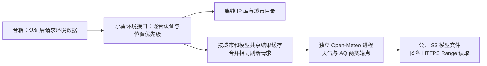

# Issue #43：无密钥天气自建方案与验证准备

日期：2026-11-10，Asia/Shanghai。状态：**Ubuntu 真实自建取数、350/1,000 个热请求批次已测；冷启动与断源重启暴露限制，建议补齐持久结果缓存后继续验证，尚未通过完整上线验收。**

本文件保留首轮方案及当时证据。后续独立出站、持久缓存、完整故障矩阵、新账号语音对照，以及用户最新确认的 **50 路**环境请求计划，以[续验收报告](../verification/2026-11-10-weather43-acceptance.md)和[隔离试验说明](../../deploy/weather43/README.md)为准。

任务：[Issue #43](https://github.com/yanghan24/xiaozhi/issues/43)，父规格 [#40](https://github.com/yanghan24/xiaozhi/issues/40)。本地分支 `codex/43-self-hosted-weather-feasibility`，基于 `aa730ccea7403112f4d0ed35daed3fadb35fd776`。本轮仅在该分支新增文件，供方案评审。

## 1. 仓库与运行环境的理解

- 主线已导入上游小智工程，包含 Java 管理 API、Web 管理端、Python 语音服务以及 Ubuntu 部署、身份与真机验证记录。设备归属和运行管理由小智侧负责，集市提供身份与模型能力，遵循 ADR-0004、0005。
- 原有 `get_weather` 是依赖和风天气的语音插件，不是 #40 要求的无密钥环境服务；既有固件首页的高德定位/天气也不能只靠修改配置完成替换。
- 目前 Ubuntu 部署记录指向 [PR #26](https://github.com/yanghan24/xiaozhi/pull/26) 的 `885918d24d69f0b2ed87114f1937292727111d4e`。本轮通过 GitHub 核对，该 PR 尚未合并，设备控制认证实现不能当作主线已有能力。#43 的模型试验独立进行；后续产品接入须与 #13/#26 的最终认证契约衔接。
- 后端验证只能在 `jt@192.168.168.114` 运行。现有数据库、密钥、语音、证书和 JetLinks 保留状态均需复用与保护。2026-11-06 的资源快照不能证明今天的容量。
- 本轮已使用用户提供的凭据登录 `jt` 并复用现有业务环境。实时盘点为 Ubuntu 20.04.3、8 vCPU/AVX2、约 12.7GiB 可用内存、441GiB 可用磁盘，满足受限试验启动门槛；这些数值本身不是容量结论。

## 2. 建议架构



建议采用 Open-Meteo 官方镜像、固定的 `ncep_gfs013` 天气模型和 `cams_global` 空气质量模型继续隔离验证。自建的是 HTTP 计算与缓存服务，使用 Open-Meteo 公开分发的模型文件；它仍依赖外部模型分发可达性。离线计算完整气象模型不属于本方案。

天气正式试验明确指定 `models=gfs013`；AQ 明确指定 `domains=cams_global`，避免自动选择改变数据来源。ICON 候选在实际镜像中读取 native 网格，首轮响应约 109 秒；GFS 首轮也曾超过 30 秒，故两个候选都不能让音箱同步等待冷模型。当前试验采用 10 个已列出的大陆城市中心坐标，不表示已经完成 IP 定位、中文城市消歧或全部城市覆盖。

Open-Meteo 单独作为容器服务，通过 HTTP 使用，保留原程序和许可；首轮不修改其源码。未来小智环境接口复用项目设备身份，从凭据确定设备后才读取位置。模型原始端口仅监听回环地址，产品接口上线前再经过现有可信 HTTPS 入口和精确路由。该产品接口及固件接入不包含在当前试验脚本中。

### 结果缓存与时间语义

产品阶段建议采用以下规则，作为后续实现输入，当前尚未编码：

1. 每台设备保存 `manual_city`、`auto_city` 和选择版本，手动城市优先。缓存模型数据可以共享，设备位置和认证结果不能跨设备共享。
2. 缓存键包含规范城市/网格 ID、模型、变量集合、有效时间槽。相同键的并发刷新合并为一个任务，使用有界队列和有界磁盘缓存。
3. 设备候选刷新周期为 5 分钟，并加入 ±20% 错峰；服务器按城市刷新。该周期尚待实际测量，不能作为已确认产品参数。
4. 两个分量分别保存 `model_run_at`、`source_published_at`、`valid_at`、`fetched_at`、状态和来源。单次 HTTP 成功或重新读取旧数据不能推进模型起报时间或数据有效时间。
5. 同时依据有效时间和模型发布延迟判断过期。候选发布时效上限为距 `source_published_at` 天气 9 小时、AQ 18 小时，需经连续更新观测校准，不能直接当作起报时间年龄上限；不能仅凭“预报还覆盖今天”断言来源仍在更新。
6. 上游中断时，已有可用结果带过期标记返回；无数据则明确不可用。温湿度、天气和 AQ 可分别失败，不补零、不使用默认城市、不回退到收费或公共托管 API。

| 数据 | 输出与口径 |
| --- | --- |
| 天气 | WMO 天气码；名称由小智侧固定映射，未知码显示未知 |
| 温度 | `temperature_2m`，摄氏度，室外模型估算 |
| 湿度 | `relative_humidity_2m`，%，范围校验 0–100 |
| PM2.5 / PM10 | `pm2_5` / `pm10`，μg/m³，分别保留时间及可用状态 |
| 空气质量精度 | CAMS 全球约 0.4° / 45km 网格；不表示附近监测站、室内传感器或中国 AQI |

空气质量的原始模型时间间隔与 API 插值后的逐小时序列不同，不能把插值解释为新增观测。官方口径见 [AQ 文档](https://open-meteo.com/en/docs/air-quality-api)。

## 3. 数据与许可候选

下表区分已核对的资料与仍需实际验证的内容。程序许可、数据许可分别处理；上游工程的 MIT 许可不能替代新组件的许可。

| 对象 | 已核对的资料 | 实施要求与未知 |
| --- | --- | --- |
| Open-Meteo 程序/镜像 | AGPL-3.0；官方支持自建商业及非商业用途 | 保留版权、许可和对应源码取得方式；若修改，履行网络使用的源码提供要求。以独立进程集成，不能据此直接断言所有许可义务均已处理。见[官方自建说明](https://github.com/open-meteo/open-meteo/blob/c0d2f3eac3650203a1bf4dc515d903642852afb0/docs/getting-started.md) |
| Open-Meteo S3 分发 | AWS 数据登记为 CC-BY-4.0，匿名读取路线存在 | 保存分发日期、模型和来源；显示 Open-Meteo 及实际模型提供方署名。见 [AWS 数据登记](https://registry.opendata.aws/open-meteo/) |
| CAMS 全球 | 用于大陆 PM 浓度候选 | 同时按实际产品许可与 Copernicus 要求署名、标明加工和非观测口径；不能只复制欧洲模型的来源声明。见 [CAMS 全球数据与署名要求](https://confluence.ecmwf.int/pages/viewpage.action?navigatingVersions=true&pageId=601297637) |
| GeoNames 离线城市数据 | 官方 dump 为 CC-BY-4.0，包含坐标、行政代码和别名资料 | 候选使用 `CN.zip`、行政层级和中文别名；每日有增量/导出，可按月校验更新并保留版本、哈希及署名。尚未实测中文覆盖、重名消歧、行政调整。见[官方格式与许可](https://download.geonames.org/export/dump/readme.txt) |
| DB-IP City Lite | CC-BY-4.0，按月提供 CSV/MMDB；MMDB 支持多语名称 | 优先离线候选，不依赖查询 API；网页需来源链接。IPv4/IPv6 的库内容和大陆准确率待取样验证，不能把格式/读取器支持当作覆盖或精度保证。见[下载与条款](https://db-ip.com/db/download/ip-to-city-lite)、[MMDB 格式](https://db-ip.com/db/format/ip-to-city-lite/mmdb.html) |
| IP2Location LITE | 官方下载需注册，条款包含用途、署名、分发及下载限制 | 严格无第三方凭据条件下不作为默认更新路线；不能仅看到“免费”就视为无限制匿名来源。见[官方入口](https://www.ip2location.com/database/lite)、[LITE 条款](https://www.ip2location.com/ip2location_lite_license_agreement.pdf) |
| ip2region | 可作离线读取实现候选 | 本轮未核实全部内置数据的来源与更新许可，不用代码许可证替代数据许可，也不承诺其准确率 |

IP 自动定位仅接受可信入口观测到的设备来源；忽略非可信转发头。内网、保留地址、无命中、VPN/运营商跨城出口和 IPv6 未覆盖情况均需要明确处理；无解时询问城市。不能用服务器出网 IP 替代设备 IP。中文城市映射要求行政区与稳定 ID 消歧，不能仅凭拼音或最近坐标静默决定。

## 4. 本轮实际证据

Ubuntu 详细结果和原始负载记录见[本轮可行性验证报告](../verification/2026-11-10-weather43-feasibility.md)。350 台十城热请求成功 350/350、p95 0.620 秒；1,000 台十城热请求成功 1,000/1,000、p95 1.757 秒。十城中九城首次引入的 350 请求批次成功 350/350、p95 19.661 秒。均为模型引擎短批次，尚非产品接口验收。

天气镜像、所有层及配置已校验 SHA-256 后导入 Ubuntu，不依赖 Docker daemon 的直连网络。试验数据路径为 **Ubuntu 自建 Open-Meteo → 专用 S3 字节转发 → SSH 回环通道 → 开发电脑 Clash → 公开 S3**。转发只读取真实文件与元数据，不提供天气结果、不生成数据、不使用 key。该链路证明开发验证可执行，不能证明服务器脱离开发电脑后的持续可达性；正式环境需要独立、稳定的获准出站通道。

以下 Windows 记录保留为较早的网络准备证据，不能代替上述 Ubuntu 结果。

[匿名源读取原始记录](../verification/evidence/2026-11-10-weather43/windows-sources.json)由本机 Windows 经 Clash `http://127.0.0.1:7890` 执行，TLS 校验启用，无 Authorization 或 API key。时间为 2026-11-10 15:23:13–15:23:20（Asia/Shanghai）：

| 检查 | 实际结果 | 能说明的范围 |
| --- | --- | --- |
| 天气元数据 | `dwd_icon/static/meta.json` HTTP 200，595 字节 | 匿名取得真实模型元信息 |
| AQ 元数据 | `cams_global/static/meta.json` HTTP 200，594 字节 | 匿名取得真实模型元信息 |
| 天气 OM 文件 Range | HTTP 206，读取 4096 字节 | 匿名分块读取可行，未下载整个文件 |
| AQ OM 文件 Range | HTTP 206，读取 4096 字节 | 匿名分块读取可行，未下载整个文件 |
| 发布与更新信息 | 原始 JSON 保留 last-run、availability、interval、data-end、ETag 和 Last-Modified | 单次快照；尚未观测跨周期更新 |
| 官方镜像 manifest | 可解析多架构索引及 linux/amd64 摘要 | 后续已按层验证并导入 Ubuntu，见本轮报告 |
| 工具静态预检 | Python AST、CLI 帮助、独立 Compose 解析通过 | 语法与配置准备，不是后端回归或性能验证 |
| Ubuntu 登录 | 初始 Agent 认证被拒绝，用户补充后已登录 `jt` | 后续资源、真实服务及负载结果见本轮报告 |

Windows Range 读取刻意使用列表首个文件，可能是历史文件，仅验证匿名访问，不把该文件当作当前天气。后续 Ubuntu 已取得完整预报并记录实际模型文件；新 run 更新到应用结果缓存的持续验证仍未完成。

本轮解析的官方镜像索引为：

```text
ghcr.io/open-meteo/open-meteo@sha256:bf94e8b39761b59a91bd04bb926b3834cad00eaf71f1aa64b2fd17fbe987846a
linux/amd64: sha256:5f23284824917315514aa356acf4184961d9be19f72b3c74b119faccdacd527f
```

Ubuntu 实际 image ID 为 `sha256:7b1114b8a78e27fabac5c08a322ceb8d540b0a3c75419941d9e26d54dfc379df`，标签版本 `1.8.0`、OCI revision `b66bc9d58a5427562625383cfbd70ff6856ad4a5`。本轮查阅的更新主线源码 `c0d2f3eac3650203a1bf4dc515d903642852afb0` 不等于该镜像构建提交。

## 5. Ubuntu 隔离试验与资源门槛

[Compose 模板](../../deploy/weather43/compose.yaml)使用独立项目 `xiaozhi-weather43`、新数据目录、回环端口 18084、2 CPU/8GiB 内存上限、禁用额外 swap、有界日志、不自动重启。模型缓存配置为 8GB；缓存和进程内存是两类预算，不能相互替代。该配置是试验限制，不是已证明可服务 350 台的配置。

Open-Meteo 官方给出的资源基线是 8GB 最低内存、推荐 16GB，至少 100GB 存储，偏好高 IOPS SSD。现有 Ubuntu 20.04 记录不符合官方 APT 包仅支持 Ubuntu 22.04 的条件，因此选择容器候选，不改宿主机软件源。[官方说明](https://github.com/open-meteo/open-meteo/blob/c0d2f3eac3650203a1bf4dc515d903642852afb0/docs/getting-started.md)

启动前重新检查：Ubuntu/架构/AVX2、内存、SSD/可用空间、端口、现有容器、语音基线以及 sudo Docker 权限。候选启动门槛为 **MemAvailable ≥10GiB、可用空间 ≥100GiB**；若不足则停止共机试验，提出独立节点资源需求。不要临时缩小资源后宣称符合官方建议。

操作仅针对新建试验目录与新容器；不改业务 `.env`、数据库、产品入口或公网 Nginx，不重启既有服务。先前会话的 localhost 代理不能直接用在 Ubuntu；需要服务器网络代理时核实服务器可达且获准的实际地址，不开放开发电脑代理端口。

准备通过后，手工执行以下示例，目录已有内容时先检查，不能覆盖：

```bash
# 以下为具备独立获准出站通道后的复现模板；本轮临时 relay/离线镜像覆盖见验证报告。
# cwd: 含本分支文件的 Ubuntu 试验 checkout
sudo -n docker ps --format 'table {{.Names}}\t{{.Status}}\t{{.Ports}}'
free -m
df -h .
lscpu
ss -ltn

# 先证实 Ubuntu 自身匿名读取和 TLS 正常，不继承意外代理变量
python3 scripts/weather43/probe_sources.py \
  --output .runtime/weather43/ubuntu-sources-before.json

export OPEN_METEO_IMAGE='ghcr.io/open-meteo/open-meteo@sha256:bf94e8b39761b59a91bd04bb926b3834cad00eaf71f1aa64b2fd17fbe987846a'
sudo -n --preserve-env=OPEN_METEO_IMAGE docker compose \
  -p xiaozhi-weather43 --project-directory "$PWD" \
  -f deploy/weather43/compose.yaml config --quiet
# 如现有 sudo 策略禁止 preserve-env，使用此试验目录独有的非秘密 env 文件；不修改 sudo 策略。
# 权限、资源、端口及新数据目录检查通过后才运行 pull/up。
sudo -n --preserve-env=OPEN_METEO_IMAGE docker compose \
  -p xiaozhi-weather43 --project-directory "$PWD" \
  -f deploy/weather43/compose.yaml pull
sudo -n --preserve-env=OPEN_METEO_IMAGE docker compose \
  -p xiaozhi-weather43 --project-directory "$PWD" \
  -f deploy/weather43/compose.yaml up -d
```

绑定目录需要与镜像内实际 UID/GID 匹配；使用镜像读取结果确定权限，不能为了通过而让模型缓存全局可写。启动失败保留错误，不自动改参数、许可或数据来源。

正式取数前通过 `docker inspect` 记录此容器的固定镜像、命令、网络、资源上限及模型数据挂载；只导出这些白名单字段，不能导出业务容器完整 Env。检查出站目标是公开模型文件而非公共托管预报 API。然后使用 [load_local.py](../../scripts/weather43/load_local.py) 发起天气与 AQ 成对真实请求。

```bash
python3 scripts/weather43/load_local.py --label first-request \
  --output-dir .runtime/weather43/first-request

python3 scripts/weather43/load_local.py --devices 350 --inflight 350 \
  --cities 1 --timeout 30 --label same-city-burst \
  --output-dir .runtime/weather43/350-same-city-burst

python3 scripts/weather43/load_local.py --devices 350 --inflight 350 \
  --cities 10 --timeout 30 --label multi-city-burst \
  --output-dir .runtime/weather43/350-multi-city-burst

python3 scripts/weather43/load_local.py --devices 1000 --inflight 1000 \
  --cities 10 --timeout 30 --label exploratory-burst \
  --output-dir .runtime/weather43/1000-multi-city-burst
```

1,000 台测试前须在**本次压测 shell**执行 `ulimit -n 8192`；新脚本会预检所需文件句柄数。Ubuntu 初始软上限为 1024，本轮首次 1,000 台批次产生压测器自身的 `EMFILE`，已保留失败并提高本次 shell 上限复测，不作为服务器容量失败结论。

负载工具只接受本机回环目标，在 Ubuntu 执行，最多 1,000 个设备请求，每个请求并行取天气与 AQ 共两次 HTTP。不重试、不自动清缓存；每个输出目录必须新建。输出逐请求原始数据、成功/失败/超时计数、包含队列的总延迟、HTTP 延迟、CPU ticks、内存、磁盘和网络计数，及所有运行容器的 Docker stats。宿主机指标包含压测器及其他服务，Docker stats 不可用时明确记错，不能据此证明资源共存。

**工具边界：** 只准备了模型引擎负载探针，尚无产品接口、结果缓存、TTL 失效或请求合并实现；10 城测试也不覆盖 350/1,000 个不同城市。它输出的请求成功不能直接满足 #43 全部验收。缓存层/鉴权层的端到端容量和每项故障恢复证据需要继续实现与采集。

## 6. 固定负载与故障验证计划（完整矩阵尚待补齐）

以下为提案中的负载计划，不表示用户已经批准具体延迟 SLO，也不是本轮测量结果。350/1,000 台的规模已由 #40 确认。正式运行前将参数、版本、资源限制和试验顺序写入 evidence manifest，再按原参数报告失败，不事后放宽门槛。

| 组别 | 350 台目标 | 1,000 台探索 | 必留证据 |
| --- | --- | --- | --- |
| 稳态错峰 | 每台 300 秒一次，持续 30 分钟，同城和 10 城分别执行 | 相同周期与时长 | 350 台 2,100 次 / 1,000 台 6,000 次环境请求；到达数、完成数、各类错误及排队时间 |
| 同时启动 | 350 台同一时点，同城/10 城；冷、热两种状态，各 3 轮 | 1,000 台相同场景 | 每次环境请求含两类数据；合并前后的实际模型读取次数 |
| 城市分散 | 增加至 35 个、随后尽可能接近 350 个不同大陆城市/网格 | 在相同覆盖基础上放大请求数，再增加冷网格 | 实际覆盖数量和网格去重计数；不能将 10 城外推成全国最坏情况 |
| 缓存失效 | 350 个请求在同一结果 TTL 边界到达；保持两类数据独立有效时间 | 同样执行 | 刷新任务计数、旧值/过期标记、失败和恢复后的时间差 |
| 源更新 | 持续观测至少跨两次 AQ 新批次发布，配合天气更新 | 无需重复生成设备请求放大源下载 | 元数据起报时间/ETag/发布时刻变化、实际响应与缓存变化；单次读取不算更新测试 |
| 源不可达/慢响应 | 仅隔离试验容器的出站网络或其专用故障代理 | 条件允许再执行 | 热结果明确过期；冷请求有界失败；源恢复后正确更新，无时间伪造 |
| 重启 | 仅重启试验容器，保留模型缓存和结果缓存各自状态 | 条件允许再执行 | 服务恢复耗时、相同查询、资源、模型时间和错误；不重启 Ubuntu 或语音 |
| 语音共存 | 环境负载前、中、后各跑相同已授权语音基线 | 350 台稳定后再探索 | API/voice 版本与资源、基线延迟/失败、OOM/磁盘、端口和网络隔离；空闲连接数不算语音负载 |

设备数与请求率分别报告。候选 5 分钟刷新条件下，350 台平均约 1.17 次/秒、1,000 台约 3.33 次/秒；集中启动可在同一时点到达全部请求。结果缓存可以降低模型读取数，但实际收益和带宽须测量，不能由这两个平均数推导容量。

候选延迟判据：产品热缓存响应 p95 ≤1秒、冷模型任务 30秒截止，成功请求的字段/单位/模型时间全部正确；350 台稳态和热缓存批次无超时或未解释失败。启动冷缓存可先返回明确的暂不可用/过期状态，单独统计首次新鲜结果就绪耗时，不能把这种返回计入“新鲜数据成功”。这些属于后续产品探针的目标；当前引擎工具仅执行 30秒端点截止，报告全部结果，没有实现产品 SLO 判定。

语音共存门槛建议为无新增错误/OOM、可用内存保留 ≥2GiB、磁盘余量 ≥20%、同样语音基线 p95 相对空载恶化不超过10%；须在实际基线上评审。任何既有服务错误或资源压力触发停止扩压，先保留原始失败及资源，再停止**本次试验容器**。不自动调整语音资源或全机防火墙来让天气测试通过。

故障注入必须局限于独立容器/网络/数据目录。冷模型缓存使用新的试验专用目录；不删现有业务目录、不执行 Docker prune、不 drop 宿主机页缓存、不通过全机断网模拟故障。每种冷缓存状态要在 manifest 明确；脚本的 label 本身不构成冷缓存证明。

## 7. 继续/停止建议与尚缺证据

**建议继续隔离可行性试验，暂缓正式部署选择。** 已有证据支持“无需天气 API key 的真实自建取数与短批次请求成功”，尚不足以断言“当前 Ubuntu 能长期承载 350 台生产负载”或“1,000 台可正式扩容”。

当前主机满足初步启动门槛，已在 2 CPU/8GiB 上限下完成短批次；暂没有必须增加服务器的测量依据。下一步先解决独立出站通道、持久结果缓存与更新/多城长测，再决定共机或独立天气节点。若后续资源不足，独立节点可采用官方推荐的 16GiB 内存作为候选起点，CPU、磁盘和网络额度由测量确定；不把本轮短测变成长期容量保证。

以下任一情况都应停止上线决策，带证据重新评审：Ubuntu 匿名源/TLS/更新不稳定；完整天气或 AQ 实际取数失败；许可/署名或城市库来源不清；350 台冷、多城或过期缓存请求无法满足约定；干扰语音服务；资源/出站成本超预算。不自动更换为付费数据源或公共非商业 API。

| #43 验收项 | 本轮状态 |
| --- | --- |
| Ubuntu 匿名源读取、真实自建天气/AQ、字段单位与时间一致 | 已取得真实天气与 PM 浓度，单位/有效时间检查通过；更新与模型批次对应还需跨周期观测 |
| 程序/数据/城市/IP 候选许可、更新和边界 | 官方资料核对完成；库内容、精度和运行版本许可清单待验证 |
| Ubuntu DNS/TLS、冷热缓存、源更新、重启和不可达 | 通过临时出站链路实测；冷启动和断源重启存在限制，源更新未跨周期验证 |
| 350/1,000 台资源与容量 | 同城/十城短批次已测；全国城市分散、完整冷缓存、结果 TTL 失效及持续负载未完成 |
| 与现有语音服务共存 | 已记录同时运行资源与容器状态；未施加主动语音负载，不能判定完整共存容量 |
| 明确继续/停止及资源建议 | 继续试验、暂缓上线；资源门槛与停止条件如上 |

用户已要求将本阶段工具、方案和报告提交 GitHub 审查，通过面向 `main` 的 PR 由仓库管理员审核后合并。审查重点为证据与结论边界、固定镜像和数据路线、持久结果缓存及后续验证计划；本次阶段性交付不自动关闭 #43，也不改变正式部署必须依据完整验收报告的前置条件。
