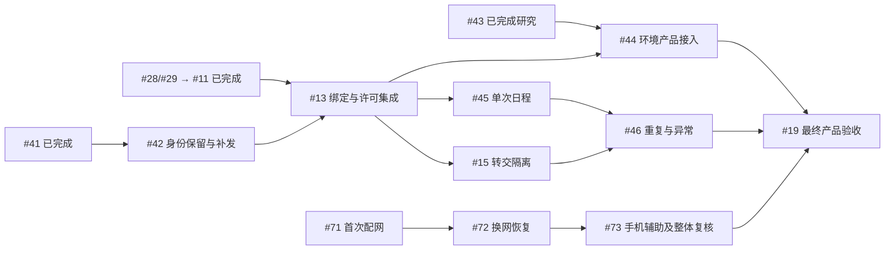

# 实施规格与验收导航

2026-11-11 核对。当前范围和验收以 GitHub Issue 正文为准；执行前读取对应任务、原生依赖及证据版本。本文提供职责和阅读入口，历史报告只证明当时版本与场景。

## 三层验收

| 层次 | 规格与任务 | 证明什么 | 边界 |
| --- | --- | --- | --- |
| 基础服务与设备 | [#2](https://github.com/yanghan24/xiaozhi/issues/2)、#3–#6 | 管理读写、设备协议、基础真机与历史构建重启 | 已关闭；不能代替当前产品版本的完整验收 |
| 正式产品 | [#10](https://github.com/yanghan24/xiaozhi/issues/10)、#11–#18、#39–#46、#70–#73 | 身份、绑定、知识库语音、转交、运营、记录、OTA、日程、环境、烧录及配网 | 完成切片不等于总规格完成 |
| 最终验收 | [#19](https://github.com/yanghan24/xiaozhi/issues/19) | 完整产品恢复、50 路语音、50 路环境请求及上线准备 | 真实依赖、完整负载及设备证据齐备后才能验收；不授权生产发布 |

首批约 350 台是装机规划；50 路环境请求与50 路完整语音是两个独立验收指标。历史 350/1,000 台环境实验保留，不能继续当作本期必过门槛，也不能用环境 HTTP 成功或空闲连接证明完整语音容量。

## 当前职责与关卡

| Issue | 职责 | 已有结果及剩余关卡 |
| --- | --- | --- |
| #2 / #3–#6 | 基础服务、协议与真机 | 已完成；历史重启与当前补充问答各自保留版本范围 |
| #10 | 总规格 | 汇总各切片及 #19，不把基础验收当产品验收 |
| #28 / #29 / #11 | 环境、身份实现、真实身份验收 | 均已关闭；#11 按已确认分层口径收尾，未文档化通知能力等仍保留证据限制 |
| #36 | 身份只读验收工具 | 已关闭；工具输出的证据不足不改写历史现场结论 |
| #12 | MCP 知识库契约 | 核实 ask_knowledge、账号授权、计费、结果和取消语义；默认 Edge TTS |
| #13 | 设备准入、绑定与许可集成 | 复用 #26/#41/#52/#67 已有证据；#42 异常恢复及 A01–A24 全部集成边界仍须完成 |
| #14 | MCP 知识库真实设备语音 | #6 已完成；仍需 #12/#13，后端成功样例不代替实际播放 |
| #15 | 手机授权及本机确认解绑转交 | 按 ADR-0008 区分入口；旧归属内容、页面、请求与第二台隔离须完整验收 |
| #16 | 运营权限 | 首版所有运营角色含超级管理员均禁止完整正文读取/导出 |
| #17 | 文字记录 | 满 30×24 小时不可查、正常 24 小时内清理；正文不备份，不保存录音或跨次续接 |
| #18 | 按设备/批次发布固件 | #6 已完成；仍需 #13、实际镜像/分区/版本回执及升级恢复证据 |
| #39 / #45–#46 | 语音日程 | 单次、重复、10 分钟补播、旧归属隔离与独立备份 |
| #40 / #43–#44 | 室外环境 | #43 已完成研究，#44 仍须认证接口及真实 P4；50 路环境请求冷热各至少 30 分钟 |
| #41 / #42 | 联网交付及身份恢复 | #41 已完成；#42 的恢复出厂、OTA、异常丢失、历史归属比对与补发后重启等未收齐 |
| #70 / #71–#73 | 触屏配网、换网与手机辅助 | 三个切片已发布，按 #71 → #72 → #73 实施；#73 包含最终整体操作复核 |
| #19 | 最终产品验收 | 汇入 #14–#18/#5/#44/#46 及配网 #73；全部适用证据满足后关闭 |

## 产品规则入口

- [产品规则收口](product-rules-2026-11-09.md)：网页闲置、授权失效、50 路完整语音、文字清理及备份。
- [本机退出并解除绑定](device-local-unbind.md)及 [ADR-0008](../adr/0008-device-local-unbind.md)：本机明确确认后释放归属，任意账号可重新扫码绑定；手机页面和旧 sign-out 仍只停用。普通断网、恢复出厂和凭据补发不自动解绑。
- [MCP 知识库范围](mcp-knowledge-scope-2026-11-10.md)：本期知识来源及默认 Edge TTS；智能体接入留待后续。
- [日程、环境及烧录访谈](reminders-weather-discovery-2026-11-10.md)：原决定及后来环境容量调整；新增六项已纳入 2026-12-07 目标，日期不替代验收。
- [配网规格 #70](https://github.com/yanghan24/xiaozhi/issues/70)：30 秒连接/重连、成功才保存、失败保留旧网、10 分钟辅助入口闲置关闭；沿用既有身份与许可规则。
- [ADR-0006](../adr/0006-exclude-conversation-content-from-backups.md)与 [ADR-0007](../adr/0007-back-up-schedules-as-business-data.md)：对话正文不备份；日程独立备份并保留访问/过期及旧归属隔离。

## 依赖导航

图只显示主要路径；执行调度以 GitHub 原生依赖为准，关闭的前置仍可保留边，但不再阻塞。

## 阅读与验证顺序

1. 从对应 Issue 获取范围、验收、未决事项及原生依赖；绑定细节以 #13、配网以 #70 为准。
2. 操作服务前先读[当前部署入口](../deployment/current.md)及其日期证据。后端回归、协议及实机验收在 Ubuntu；开发预检与正式验收按 [CONTRIBUTING.md](../../CONTRIBUTING.md#测试环境)区分。
3. 接口事实查[集市契约核对](../development/ai-market-contract-review-2026-11-06.md)、[身份模块接入](../contracts/customer-identity-integration.md)、[设备控制协议](../contracts/device-binding-v1.md)、[Schema](../contracts/device-binding-v1.schema.json)及[示例](../contracts/device-binding-v1.examples.json)。原始规范通资料仅作历史参考。
4. 追溯基础证据见 [#5 验收](../verification/issue-5-acceptance.md)、[#6 验收](../verification/issue-6-acceptance.md)；身份收尾见[最终报告](../verification/2026-11-11-identity-closeout.md)。后来的关闭不能把原报告的未执行项改成通过。
5. 本次跨文档检查及修正范围见[规格与 PR 审计](spec-pr-audit-2026-11-11.md)。发生变化时直接更新对应规则和导航，保留有日期的历史证据，避免叠加互相冲突的“当前状态”。
