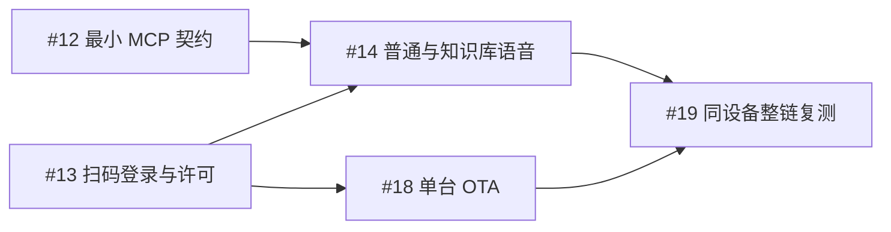

# 实施规格与验收导航

2026-11-13 收缩范围。当前主链以 [#10](https://github.com/yanghan24/xiaozhi/issues/10) 为准，延期工作以 [#88](https://github.com/yanghan24/xiaozhi/issues/88) 为准。执行前读取对应 Issue 正文及原生依赖；历史报告保留其版本与场景边界。

## 本轮主链

一台现有 P4、一个获准测试账号、现有 Ubuntu 服务：扫码登录 → 普通语音回答 → 自然提问自动调用 MCP 知识库并播报 → 单台 OTA → 升级后重复问答。

| 工单 | 交付 | 尚未完成的前置 |
| --- | --- | --- |
| #12 | 受控测试所需的最小 MCP 契约 | 无 |
| #13 | 现有设备扫码登录、绑定/恢复及可用许可 | 无；#4/#11 已关闭 |
| #14 | 普通回答与自动 MCP 工具调用、模型续答、实际播放 | #12、#13 |
| #18 | 指定单台适配固件 OTA、实际版本确认及身份保持 | #13；#6 已关闭 |
| #19 | 同一设备完整复测及可照做的测试记录 | #14、#18；#5 已关闭 |

#12/#13 可开始，#14 的工具调用接线是核心实现缺口。#18 复用现有单台 OTA；所有已完成能力先核对版本及覆盖范围再复用。详细测试步骤只维护在 [#19](https://github.com/yanghan24/xiaozhi/issues/19)。

## Backlog

| 范围 | 工单 |
| --- | --- |
| 解绑转交、运营完善、文字记录 | #15、#16、#17 |
| 日程与提醒 | #39、#45、#46 |
| 天气和空气质量 | #40、#44 |
| 身份异常恢复与维护演练 | #42 |
| 触屏配网、换网恢复、手机辅助 | #70、#71、#72、#73 |
| 多客户契约、全量身份/语音异常矩阵、批量 OTA、50 路语音/环境容量及上线准备 | #88 的扩展要求清单 |

这些任务保持开放并带 backlog 排期标签，退出本轮 ready-for-agent 队列。它们不阻塞主链；其已实现部分可以复用，直接阻断选定设备登录、问答或 OTA 的缺陷仍在主链修复。旧 2026-12-07 全量范围由本次排期替代。

## 阅读顺序

1. 从对应 Issue 获取本轮范围及验收；了解本次取舍或恢复延期范围时读[范围收缩记录](main-chain-scope-2026-11-13.md)。#2/#3–#6、#11/#28/#29、#36/#41/#43 的关闭证据继续按原范围引用。
2. 操作服务及实机前读[当前部署入口](../deployment/current.md)和最新设备报告。PR #87 中 B 的连接及使用失败必须与更早成功记录分别处理；后台 ready 不能代替音箱可用。测试环境按 [CONTRIBUTING](../../CONTRIBUTING.md#测试环境)。
3. 身份及设备接口查[身份模块接入](../contracts/customer-identity-integration.md)、[设备控制协议](../contracts/device-binding-v1.md)、[Schema](../contracts/device-binding-v1.schema.json)和[示例](../contracts/device-binding-v1.examples.json)。MCP 最新观察与候选修复见 [PR #86](https://github.com/yanghan24/xiaozhi/pull/86)；其直接工具调用不等于模型及设备链通过。
4. 既有权限、会话与内容规则查[产品规则](product-rules-2026-11-09.md)、[本机解绑](device-local-unbind.md)及 [ADR-0006](../adr/0006-exclude-conversation-content-from-backups.md)/[0007](../adr/0007-back-up-schedules-as-business-data.md)/[0008](../adr/0008-device-local-unbind.md)。其中扩展验收和历史交付日期按本轮主链/backlog 排期解释，产品保护规则继续适用。
5. 后续恢复日程、环境或配网时，再读[日程与环境访谈](reminders-weather-discovery-2026-11-10.md)、[#70](https://github.com/yanghan24/xiaozhi/issues/70)及 #88 的旧范围快照；历史 50 路容量标准保留在 backlog，单台通过不代表容量或生产上线通过。
