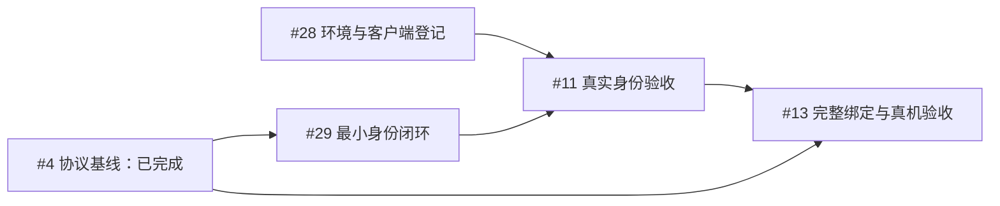

# 实施规格与验收导航

本轮已确认的网页会话、授权失效、容量、记录清理、正文访问、备份和找回规则见 [2026-11-09 产品规则收口](product-rules-2026-11-09.md)；任务状态与依赖仍以 GitHub 为准。

2026-11-06 重整。当前实施要求和验收清单以 GitHub Issue 正文为入口；本文解释任务边界，状态是本次快照，执行前读取 Issue 当前状态及原生依赖。原始协议、访谈和已发生的验收证据分别保留，不复制为另一套规格。

## 三层验收

| 层次 | 任务 | 证明什么 | 不能替代什么 |
| --- | --- | --- | --- |
| 基础服务与设备 | [#2](https://github.com/yanghan24/xiaozhi/issues/2)、[#3](https://github.com/yanghan24/xiaozhi/issues/3)–[#6](https://github.com/yanghan24/xiaozhi/issues/6) | 管理读写、协议、服务重启和上游激活码下的基础真机语音 | 集市客户登录、正式产品鉴权与容量 |
| 正式产品 | [#10](https://github.com/yanghan24/xiaozhi/issues/10)、[#11](https://github.com/yanghan24/xiaozhi/issues/11)–[#18](https://github.com/yanghan24/xiaozhi/issues/18) | 手机绑定、按归属授权的知识库问答/默认 Edge TTS、转交、运营、记录及 OTA | 100 路容量与最终上线准备 |
| 最终验收 | [#19](https://github.com/yanghan24/xiaozhi/issues/19) | 完整产品跨重启恢复、100 路同时语音及发布恢复条件 | 未授权的生产发布 |

#3/#4/#5 已验收，#2 的 B 层仍等 #6。服务器合成音频不等于音箱播放；Edge TTS 已是默认提供者，但服务器合成测试不等于设备播放和完整容量验收；100 个空闲连接不等于 100 路语音对话。

## 当前任务分工

| Issue | 本次整理后的职责 | 仍需满足的条件 |
| --- | --- | --- |
| #2 | 基线父规格：A 已完成、B 待 #6 | 实际设备闭环，不重做已验收的 A 层 |
| #6 | 上游账号/激活码下的真机对话和设备重启 | 样机、可达设备入口、有效 ASR/LLM、现场播放确认；无需等待新二维码固件 |
| #10 | 产品范围、不变量及 #11–#19 的交付边界 | 所有适用子任务与最终验收，不以临时提供者降低要求 |
| #28 | 身份环境、客户端登记与测试条件 | 身份 443 已通，4090 TCP 可达；通知实际登记/发送及第二账号条件仍待核实 |
| #29 | 手机 OIDC 身份、刷新、通知最小闭环 | 已由 PR #31 合并，可控集市回归通过；不等于全部真实身份验收 |
| #11 | 真实集市身份、刷新及通知验收 | 登录、拒绝、刷新、撤销和恢复已通过；有效通知及第二账号等验收未完成，不等待完整设备绑定 |
| #12 | 确认 MCP 知识库调用与授权契约 | 目标为 service-669a396c73 / ask_knowledge；补齐账号授权及异常语义，默认 Edge TTS |
| #13 | 预登记、独立凭据、二维码和归属/授权状态 | 复用 #29 身份模块；#11/#4 依赖保留，完整绑定、许可传播及凭据交付/真机仍须验收 |
| #14 | MCP 知识库与默认 Edge TTS 的设备语音闭环 | #6/#12/#13；后端模型/工具样例已成功，设备日常对话待接入，合成证据不代替真机播放 |
| #15 | 原账号重新认证解绑、转交和旧内容隔离 | #13；补发设备凭据不成为换绑方式，单台解绑不撤销共享授权 |
| #16 | 运营状态与内容访问权限 | 首版所有运营角色含超级管理员均禁止完整正文查看/导出 |
| #17 | 账号/设备文字记录与 30 天清理 | 30×24 小时到期不可查询、24 小时内清理；不备份正文，不保存录音或跨次续接 |
| #18 | 适配固件的单台/批次发布与真实结果 | #6/#13、实际镜像/分区/revision/回执；可改 OTA 地址不等于升级能力 |
| #19 | 完整产品重启、阶梯负载及上线准备 | #14–#18 与 #5，按原生依赖执行；最终证据不由基础测试替代 |

本次重整 #2、#6、#10、#11、#12、#14、#15、#18、#19；#13 已先行整理，作为绑定规则的详细来源。#16/#17 已按 2026-11-09 产品决定补充正文禁读、清理及备份验收。任务状态、标签、父子及阻塞关系保持；不能因为标签存在就忽略未决条件。

## 文档阅读顺序

1. 从对应 Issue 获取当前范围、验收和未决事项；父规格 #10 只汇总跨任务规则，绑定细节以 #13 为准。
2. 实际运行前阅读 [Ubuntu 部署手册](../deployment/ubuntu-isolated-test.md)，换机查[交接说明](../handoff/2026-11-05-ubuntu-server.md)。本机用于编辑、SSH、浏览器，后端与实机测试在 Ubuntu。
3. 接口事实查[集市契约核对](../development/ai-market-contract-review-2026-11-06.md)及[规范通/TTS 资料](../development/ai-market-api.md)，两版原文保留；示例不是实际 Client ID、Secret 或已登记回调。
4. 需要追溯决定时阅读[需求访谈](voice-backend-discovery.md)、[硬件核查稿](../../筑音设备接入资料_核查稿_2026-11-06.md)、[ADR](../adr/)；历史记录不覆盖后来明确的决定。
5. 已通过行为查[基线 A 层验收](../verification/issue-5-acceptance.md)及[2026-11-09 真实身份验收](../verification/2026-11-09-real-market-identity.md)。报告只证明当时版本、环境和测试范围，不改写为新测试。下一轮通知排查见[管理员检查清单](../handoff/2026-11-10-market-logout-notification.md)。

发生事实或范围变化时同步对应 Issue 和相关操作文档；新结论进入现有结构，不再在 Issue 顶部长期叠加互相冲突的“当前状态”。未核实事项保留为关卡，不能为了让规格看起来完整而填入默认事实。

## 身份与绑定实施依赖（2026-11-09）

PR #27 已合并七项产品规则。用户随后授权拆解实施依赖，新增 [#28 环境准备](https://github.com/yanghan24/xiaozhi/issues/28)和 [#29 最小身份闭环](https://github.com/yanghan24/xiaozhi/issues/29)，均为 #10 子任务。GitHub 原生阻塞关系已更新，以下箭头表示前项完成后才能进入后项。

- #28 和 #29 原可并行；目前 #29 已合并，#28 身份出站已通过内网解析打通，仍需集市核实通知登记/发送和第二账号条件。4090 的内网 TCP 连通是旧资源端口的历史证据，不能代替 MCP 知识库 4191 SSE 的连通、鉴权及工具调用验证；当前知识库契约与设备闭环分别由 #12/#14 验收，真实规范通测试继续暂停。
- #29 使用真实小智应用、浏览器、数据库和缓存，仅替换集市边界；从隔离测试数据中的有效设备请求完成身份确认、刷新及通知，不执行最终绑定。不得开放匿名发码、测试后门或绕过客户/设备认证。
- #11 在 #28/#29 完成后用真实集市验证同手机登录、实际授权/Key、刷新、共享撤销及通知；可以复用有效测试请求，不要求 #13 已完成固件二维码和最终绑定。共享撤销实验不成为普通单台退出步骤。
- #13 复用身份模块，继续完成正式设备准入/发码、手机确认归属、单台退出/恢复、跨语音停播及真实手机/设备验收；原 A01–A22 仍是最终集成门槛；接口适配、身份/调用授权分离及刷新未知状态按[身份模块接入约定](../contracts/customer-identity-integration.md)实现。
- 本次文档整理不关闭未完成任务，也不取消 #13 原有 #11/#4 阻塞；#14/#15/#18 及其后续任务继续遵守原生依赖。2026-11-09 当晚用户暂停人工联调，计划次日请管理员检查通知；不把 #29 已实现误写成 #11/#28 已全部验收。

## 固件与服务器协作约定

2026-11-09 新增[二维码绑定与设备控制 v1](../contracts/device-binding-v1.md)，附 [JSON Schema](../contracts/device-binding-v1.schema.json)、[报文示例](../contracts/device-binding-v1.examples.json)和[服务器交接说明](../handoff/device-binding-v1-server.md)。双方按同一版本实现，协议发布不表示功能已完成。公网可使用运维分配的非 443 端口，完整外部地址必须含实际端口；公网设备协议入口已有证据；真实手机/设备、客户接口、#11 实际客户端设置及集市出站仍分别验收。

本期接入对象以[2026-11-10 知识库范围](mcp-knowledge-scope-2026-11-10.md)为准；智能体接入有后续需求再补充。
