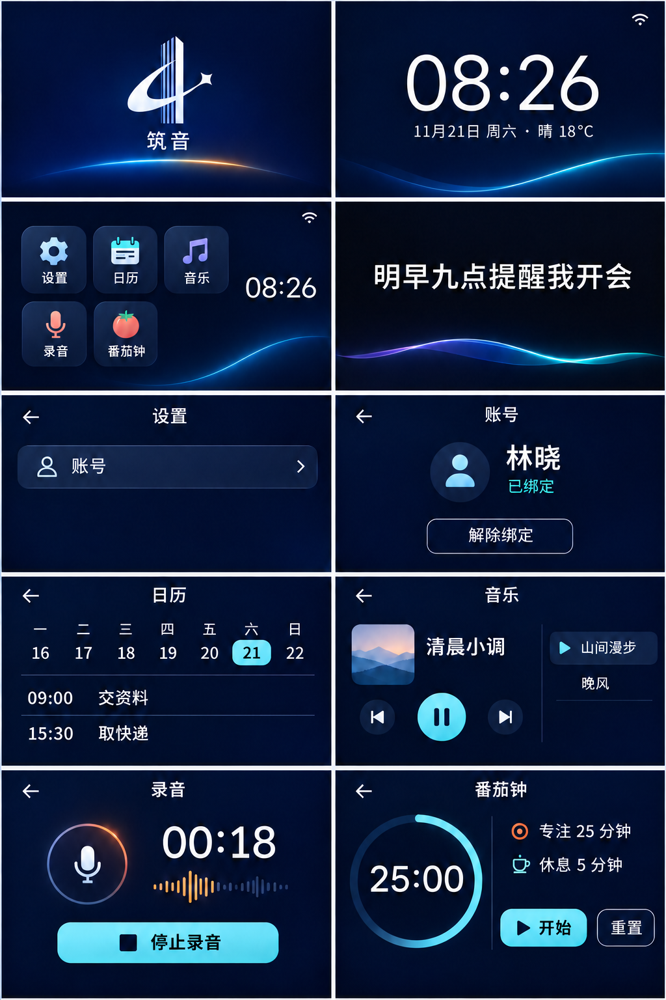

# P4X 4.3 寸界面规范

适用于筑音集市版，设计基准为 **800×480 横屏、深蓝主题、全屏操作**。以下为确认的视觉定稿。图中的设置页来自当时的设计，现有设置与新增状态以本页规则和对应模块为准。

## 页面与交互

| 页面 | 当前规范 |
| --- | --- |
| 开机 | 全屏品牌底图与筑音 Logo，沿用开机页动效和现有系统状态切换。 |
| 首页 | 左侧三列等尺寸、对齐的应用入口。右侧依次居中显示时间、日期及星期、天气。日期和天气沿用屏保日期的颜色，字号约 24 px，两行中心间距 34 px。Wi-Fi 图标位于右上角。 |
| 屏保 | 大时钟、小字日期与天气，右上角显示 Wi-Fi 图标。默认无操作 1 分钟进入，点击结束。可在设置选择 1、3、5 或 10 分钟。 |
| 对话 | 全屏对话，居中转写或回复文字，底部彩色波带。动画随连接、收音、等待和实际播放切换，等待阶段静止。回答字幕最多显示两行，超过两行每 2.5 秒按行更新。 |
| 设置 | 设置首页两列卡片。依次为账号、Wi-Fi、声音和显示、屏保、关于设备。声音和显示使用滑块，账号详情提供积分及解绑确认。 |
| 扫码登录 | 左侧显示二维码，手机打开链接后在原位显示「已扫码」和「刷新二维码」。右侧保留核对码的位置并提示在手机上完成授权。点击刷新后，新二维码和核对码在原位更新。 |
| Wi-Fi | 附近网络列表对齐网络名称、信号与最右侧的锁图标。加密网络使用现有键盘输入密码，开放网络同样需要确认。手机配网页显示实际热点名和访问地址。 |
| 日历 | 打开页面或点「今天」时，显示从周一到周日的完整一周并选中今天。日期条可横向拖动和惯性滑动，停在单个日期格的边界。右上角显示日期条中央日期的年月，今天滑出可见范围时显示「今天」按钮。有事项的日期用圆点标记，点选后在下方查看提醒。登录后所选日期无提醒时，在页面底部的圆角提示框显示语音记事示例。 |
| 音乐、录音、番茄钟 | 各有独立全屏页面。使用统一按钮样式和返回入口。录音和保存阶段遵守当前退出限制。 |
| 底层系统页 | 升级、错误和其他原版系统页沿用现有状态优先级。使用当前开机底图、浅色文字和图标。 |

首页和屏保显示 Wi-Fi 图标。其他全屏应用按业务需要在页面内呈现信息。页面复用公共返回按钮。左边缘向右滑或底边缘向上滑走公共导航返回首页，设置子页的返回按钮回设置。录音等正在执行的操作继续经导航退出守卫判断。

## 组件和资源

- 优先复用 [`SpeakerUi`](../../main/speaker_account/speaker_ui_widgets.h) 的主题色、标题、按钮、卡片、图标和字体。应用在各自模块创建页面，由 [`SpeakerNavigation`](../../main/boards/waveshare/esp32-p4-wifi6-touch-lcd/speaker_navigation.cc) 注册和管理显示。
- 系统状态通过既有 `SetStatus()` 和 `ShowNotification()` 显示。配网结果与业务状态使用现有页面或提示入口。
- 采用设备现有字库。Wi-Fi 键盘使用 20 px，首页时钟、番茄钟和录音计时共用 48 px 数字子集，屏保使用原生大号数字。新布局核对不同字宽、长文本和图标与文字的对齐。
- 首页、屏保、开机的静态背景使用当前的板级素材。时钟、天气、字幕、Logo 和可交互控件由页面绘制。按现有规则解码、复用和释放背景缓冲。控制绘制区域和刷新频率，减少连续整屏重绘和音频争用。
- 设计定稿只用于文档参考。交付界面改动时按 800×480 核对截图、触摸区域、返回交互和对应系统状态，实机确认显示效果和运行性能。
