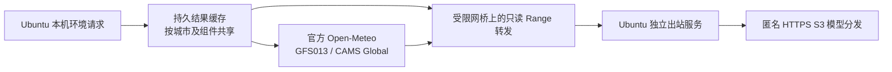

# #43 自建天气与空气质量验收进度（未完成）

关联 [#43](https://github.com/yanghan24/xiaozhi/issues/43)、[#40](https://github.com/yanghan24/xiaozhi/issues/40)，交付 [PR #53](https://github.com/yanghan24/xiaozhi/pull/53)。本记录接续 [PR #49 阶段报告](2026-11-10-weather43-feasibility.md)。已核验统计截至 2026-11-11 00:30（北京时间）。**50 路冷热容量和新账号语音对照已完成；第二次 AQ 更新、连续网络观察和最终原始归档待齐备，暂不据此关闭 #43。**

**当前建议：继续保留隔离试点；暂不正式部署放行或关闭 #43。** 无需天气 API 密钥的真实取数、持久恢复、50 路冷热负载与新账号 40/40 语音均已取得证据；仍待第二次真实 AQ 和连续出站观察。用户将后续环境请求并发改为 **50 路**，并允许有限尝试后以验证失败结束研究。历史 350／1,000 台记录保留；本轮没有追加该规模负载。

## 本地阶段记录与 50 路计划

阶段一已完成：新建唯一临时测试设备，由用户正常登录集市并确认绑定；产品侧许可为 allowed，实际 ASR→模型→TTS→Opus 解码 10/10 成功。首段可解码音频从输入结束计时，p50 6.528 秒、p95 15.709 秒；问答全部结束 p95 41.523 秒。此为服务器真实协议链路，不是实体麦克风／扬声器验证。

提供的测试 Key 直接通过真实 ASR 和流式模型预检；设备产品路径使用正常 OAuth 得到的应用凭据，二者 Key 不同，不能称为完全同一 Key。前后对照记录相同账号主体、授权代次、设备和实际语音源码的 SHA。原账号积分不足及旧失败原件保留。

阶段二于 15:19:46Z 在 Ubuntu 独立启动，16:24:18Z 完成：50 路同城／10 城／50 城突发各三轮；热缓存与完全空模型／结果缓存分别运行 30 分钟，50 请求每 5 秒同时发起，每组 18,000 次，实测在途峰值均为 50。该持续请求频率是本轮明确声明的压力条件，不能与旧版每设备 300 秒请求一次的计划直接比较吞吐。

语音前／热负载中／负载后／冷启动及其后各 10 个串行问答，共 40/40 成功；只有 2 次与实际冷填充完整重叠，其余 8 次在填充后。预先提出的主指标 p95 相对劣化 10% 作为研究比较线，小样本及云端随机性保留。容量仅执行这一完整矩阵，不自动反复重跑求通过；独立项目继续取证，失败、受阻和未运行分别说明。

| 50 路阶段 | 真实请求与结果 | p95 |
| --- | --- | ---: |
| 1／10／50 地点突发，各三轮 | 450/450 fresh，零失败／超时 | 各轮最高 42.94ms |
| 热缓存 30 分钟 | 18,000 fresh，零等待／失败／超时 | 36.277ms |
| 完全冷缓存首次应答 | 50 个 HTTP 202、值为空，等待真实填充 | 34.210ms |
| 冷启动起的 30 分钟 | 17,461 fresh、539 等待，零失败／超时 | 36.352ms |
| 冷填充后最终 50 路 | 50/50 fresh | 32.863ms |

本节点合计 36,550 次，其中 35,961 fresh、589 等待，零 stale／HTTP 失败／超时。独立工具重算所有原始请求的计数和 nearest-rank 分位数，均与 summary 一致；业务 API／语音镜像和启动时间前后一致，监听队列溢出／丢弃增量均为 0。冷夹具 50 个输入地点实际对应天气 48、AQ 47 个网格。详见[阶段数据](evidence/2026-11-11-weather43-acceptance/stage50-summary.json)。

完全冷填充实测 67.589 秒，100 次引擎调用全部成功；同时有 200 次 `SourceUnavailable` 刷新任务失败，不能写成源读取零失败。对应[真实源窗口](evidence/2026-11-11-weather43-acceptance/cold50-source-window-receipt.json)有两次元数据 `ClientConnectorError`（各约 41.74 秒），其余 568 次源读取成功，成功响应约 29.36MB。大量任务受共享元数据失败及退避影响，不等于 200 次独立外部 HTTP 失败。自然故障及恢复完整保留，未注入故障；67.6 秒填充时间包含本次自然网络等待。

| 新账号真实语音阶段 | 成功 | 首段音频 p50／p95 | 完整结束 p95 |
| --- | ---: | ---: | ---: |
| 无主动天气负载前 | 10/10 | 6.528／15.709 秒 | 41.523 秒 |
| 50 路热负载中 | 10/10 | 5.556／9.553 秒 | 20.150 秒 |
| 天气负载后 | 10/10 | 5.547／15.226 秒 | 24.251 秒 |
| 冷启动及其后，实际冷期 2 次 | 10/10 | 6.177／16.368 秒 | 33.218 秒 |

热负载主指标 p95 为基线的 0.608 倍，冷阶段整体为 1.042 倍；预设主指标比较线未触发。辅助的热期首个模型事件 p95 为 7.911 秒，对比基线 6.649 秒增加约 19%；回答长度及云端变化也影响完整结束时间，均保留而不归因于单一资源因素。每阶段仅 10 次，p95 等于最慢样本，不能据此证明统计上的无性能退化。冷阶段整体分位数包含填充后问答，只有 2 次真实冷期重叠，不能外推成 10 次全冷对照或 50 路语音容量。原始重算与 7 个前后授权范围探针见[语音比较](evidence/2026-11-11-weather43-acceptance/voice-comparison.json)。

两组持续负载各有 321 个资源样本：宿主平均忙碌约 3.55%／3.58%，最小可用内存分别 12,879,268／12,816,344 KiB，盘空余至少 442.10／433.48GB。冷引擎未减去文件缓存的 cgroup 峰值 148,602,880B，冷结果缓存 31,342,592B；8GB 模型盘缓存仍实际分配，不从小样本反推更小主机预算。数据为共享宿主采样，全部 CPU／磁盘／网卡活动不能归属于天气独占。

16:24:20Z 已[清理两个唯一临时设备](evidence/2026-11-11-weather43-acceptance/fixture-cleanup.json)及其 3 个请求、17 个令牌、1 个设备页面会话和相关流程；账号授权、共享浏览器会话、业务服务与真实设备保留。

后续先在本地形成大节点与阶段说明，再集中提交、推送任务分支；不直接写入主线、不自动合并。第二次 AQ 必须等待真实发布，无法用回放或改时钟补齐。

## 范围与版本

后端测试实际运行于 Ubuntu 20.04.3、8 vCPU、AVX2、16,394,560 KiB 总内存，试验根目录 `/home/jt/xiaozhi-weather43-acceptance-20261110`。压测器与服务共机，端口绑定回环，未增加公网产品路由。环境容量不代表 350／1,000 路语音并发或终端网络延迟。

| 对象 | 版本与边界 |
| --- | --- |
| 语音对照时的产品 API／语音 | PR #26 部署基线 `885918d24d69f0b2ed87114f1937292727111d4e`；API 镜像 `8de7307427f34c58d75687356ba53b74f42e85fdd0413a9bae10f7e5f46e5566`，语音复用下列既有镜像 |
| 后续观察到的 API 换版 | 13:01:29Z 启动 `ff156e27831230ab81ca5c84aeddda873cb18943286b5c1ce5be5c260d6f8728`，revision [87839aa](https://github.com/yanghan24/xiaozhi/commit/87839aa2da1abd076702d6c191182f30402fbe73)；13:35:52Z 再启动 `8e49c55c7c4f23f2f61b24223fbdc477ceadba4bdb0822c1e84c993bb9156666`，revision `3f963b6d5ce6110b3d68ff473f722f726d3c659e`；两组旧最终回归均因版本变化未通过一致性检查。新账号基线及 50 路实验使用后一镜像 |
| 模型计算 | 官方 Open-Meteo 1.8.0，源码 `b66bc9d58a5427562625383cfbd70ff6856ad4a5`，镜像 ID `7b1114b8a78e27fabac5c08a322ceb8d540b0a3c75419941d9e26d54dfc379df` |
| 模型选择 | GFS013 天气与 CAMS Global PM2.5／PM10；不调用公共托管预报 API，不输出监测站观测或中国 AQI |
| 最终缓存 V4 | 运行源码 SHA-256 `e5f02fa806d8ded433791647f4bd588e9bf070610bbdc2aaeb873b2abe13fb2e`；SQLite WAL/FULL，8 个刷新槽分为天气／AQ 各 4 个 |
| Python 运行时 | 复用既有镜像 `e519f14843fefbeab0e3c966da0733b81be7e1512b1c9774579f5d252a0a67a8`，Python 3.10.22、aiohttp 3.14.5 |
| 独立出站 | Ubuntu 自身 Mihomo v1.19.33 systemd 单元，回环 7890，复用已有配置；不使用开发电脑数据转发 |

转发器只传真实源字节，校验证书，限制固定 S3 域及模型路径，保留 Range／ETag／Last-Modified；不生成模型结果。凭据、代理订阅、模型 Key、SQLite 库与测试设备身份均不进入报告归档。

## 六项验收状态

| 项目 | 当前证据 | 结论 |
| --- | --- | --- |
| 独立联网 | 本机 systemd 出站与真实源读取、服务重启、公开上游拓扑均完成；SSH 中断期间仍真实读取源，长期 Range 取数观察排队中 | 独立路线成立；自然源错误仍有记录 |
| 冷启动与恢复 | 持久结果、TTL、合并刷新、断源、慢源、正常／非正常重启；全冷 1,000 地点、持续负载和无请求预热完成 | 隔离故障矩阵复测通过，保留自然错误及冷填充等待窗口 |
| 模型更新 | 基线后一次 AQ 和一次天气源／缓存更新已核验 | 第二次真实 AQ 新批次待发布与审计 |
| 容量 | 历史较大规模保留；新目标 50 路热／完全冷缓存各 30 分钟、九轮突发和最终就绪均完成，原始重算通过 | 50 路环境请求节点通过，冷填充期间明确返回等待 |
| 语音共存 | 旧失败保留；新账号四阶段共 40/40，实际冷期完整重叠 2 次，业务版本一致 | 主指标比较线未触发；小样本、辅助指标和冷重叠边界详见上文 |
| 许可与定位 | 实际运行许可、数据校验、中文消歧、IPv4／IPv6、离线切换回退 | 候选核实完成；IP 城市精度不足以自动定城 |

## 独立联网与自然网络故障

初始四个已有节点中的两个，对真实 GFS 和 CAMS S3 元数据均失败；另两个均返回 200，单次约 0.67–1.09 秒。Mihomo 当时仍 active、无自动重启或 OOM，不能将上游错误解释成进程退出。历史记录没有保存当时所选节点，因此不倒推具体失败节点。

于 2026-11-10 12:05:54Z 只保留上述两个成功的已有节点，健康探测从通用连通性地址改为真实 CAMS 元数据，60 秒检查、主动检测；原配置私下保留以便回退。未购买代理或将订阅写入 Git。12:48Z 重启自身出站服务后约 23.663 秒完成 DNS／TLS／真实元数据和模型 Range 取数检查，PID 确实变化，服务 active／enabled，17890 临时 SSH 数据端口不存在。两个私有配置上游均解析为公网地址，未公开其域名、地址或凭据。该验证不包括重启整台 Ubuntu，也不证明现有节点始终无故障。

## 缓存和恢复

每个城市保存天气和 AQ 两项 48 小时真实结果；服务恢复后先返回持久数据并标记 stale，后台复核。空结果为 202、`null` 和 loading／unavailable；不会补零、换默认城市或伪称即时预报。

TTL 300 秒只触发检查；相同起报时间且元数据 SHA 完全相同时，保留数据、`fetched_at` 和模型时间，只更新复核时间。新批次发布后等待 600 秒，取引擎结果前后再次比较源元数据。天气与 AQ 分别保留起报时间、源发布时间、当前有效小时、取数时间、复核时间和状态；超龄、源错误、未复核或被新版本替代时为 stale。

| 实验 | 已观察行为 |
| --- | --- |
| 实际 TTL 集中失效 | 350 城的短 TTL 夹具真实到期；350／1,000 请求返回完整数据，同版本复核不修改原始数据与取数时间 |
| 同城合并刷新 | 350／1,000 个并发请求只安排天气与 AQ 各一个刷新任务 |
| 热缓存断源 | 已有结果及时返回并明确 stale，无伪造值 |
| 断源正常重启 | 从持久库恢复，保留原始结果和取数时间，不阻塞等待源 |
| 断源 SIGKILL | 真实异常退出后恢复，SQLite `integrity_check` 为 ok |
| 空结果断源 | 1,000 请求收到等待／不可用而非假预报；无结果为空 |
| 天气单独延迟 40 秒 | V4 天气 stale 时，AQ 约 1.006 秒恢复 fresh；单类故障不会占满另一类全部刷新槽 |
| 慢源任务截止 | 后台任务遵守有界源／引擎超时；用户已有结果的响应不等待慢源 |
| 完整空模型＋空结果 | 1,000 地点初始全部为等待状态；约 345.513 秒填满 2,000 项，随后三轮各 1,000 次全部 fresh |
| 无请求后台预热 | 约 11.043 秒完成 35 地点／70 项真实结果；引擎调用 70 次，环境请求计数为 0 |

第一次恢复实验的单天气慢源测试失败，原始目录 `recovery/` 完整保留。该时段 AQ 实际发生 `ClientConnectorError`；随后同时改进节点健康选择和组件工作槽，再用 `recovery-r2/` 新目录复测，不覆盖失败，也不把历史真实出站错误全归因于工作队列。

R2 全冷填充累计 2,011 次引擎取数链路，其中 11 次失败后重试恢复：8 次等待超时，另 3 次在取数后源元数据复核失败。刷新失败计数 3,820 中有 3,812 次 `SourceUnavailable`（含共享元数据失败后的城市任务退避），不能解释成 3,820 次外部 HTTP 请求。填满缓存并不消除冷启动的约六分钟就绪窗口，部署须先预热再放流。

该冷填充开始时间窗内记录 4,456 次 relay 请求，源响应负载共 154,015,124 字节；存在 13 次真实连接错误和 3 次响应传输错误。另 64 次连接重置可能来自下游超时取消，不能都归为独立源故障。原始窗口请求和摘要校验单独留存；上述计数与用户侧 1,000 次 202 等待响应属于不同层次。

## 环境容量

预先固定持续负载为每台 300 秒一次，运行 1,800 秒；请求同时返回天气与 AQ。每条记录检查城市、字段、单位、数值、当前有效小时和状态；原始记录包含排队时间。表中 p95 为完整本机环境响应。

| 设备／地点 | 时长 | 请求 | fresh | stale | 失败／超时／缺项 | p95 |
| --- | --- | ---: | ---: | ---: | --- | ---: |
| 350／1 | 30 分钟 | 2,100 | 2,100 | 0 | 0／0／0 | 5.184ms |
| 350／350 | 30 分钟 | 2,100 | 1,629 | 471 | 0／0／0 | 5.334ms |
| 1,000／1 | 30 分钟 | 6,000 | 6,000 | 0 | 0／0／0 | 4.751ms |
| 1,000／350 | 30 分钟 | 6,000 | 5,974 | 26 | 0／0／0 | 4.783ms |

总计 16,200 次，其中 15,703 次 fresh、497 次 stale。350 城的 471 次 stale 跨 AQ 源发布与缓存刷新；1,000 台的 26 次 stale 在 10:43–10:44Z 发生，分别涉及 AQ 元数据 TimeoutError／ClientResponseError，保留为实际取源故障。

早期热缓存 350 台批次 p95 1.158 秒，并伴随容器监听队列 90 次溢出／丢弃。监听 backlog 从 128 调至 4,096 后，350／1,000 台 × 1／35／350 城各三轮，共 12,150 次全部 fresh，最大 p95 0.554 秒，350 台最大 p95 0.254 秒，后续溢出／丢弃为零。原始首轮未就绪造成的 350 次失败也保留；正式冷填充以独立 readiness 检查后的批次统计。

1,000 地点的样本有 1,000 个不同输入坐标，实际返回 939 个天气网格、942 个 AQ 网格；GeoNames 包含城市与聚居点，不能称为 1,000 个不同地级市。V4 的该场景 30 分钟共 6,000 次，5,980 fresh／20 stale，零失败／超时／缺项，p95 4.796ms；20 次 stale 来自 12:43:58–12:44:04Z 两类源元数据真实连接错误后的短暂退避，随后恢复，无故障注入。

第一组最终 V4 的六组 350／1,000 台 × 1／35／350 地点突发共 4,050 次全部 fresh，1,000 台最大 p95 0.622 秒；其后 350 台／350 城的 30 分钟共 2,100 次全部 fresh，零失败／超时／缺项，p95 5.358ms。

但这一组前后盘点发现 API 在 13:01:29Z 更换镜像，虽然新旧 `RestartCount` 都为 0，镜像 ID 和启动时间已经改变，因此程序的版本一致性断言失败；原始目录 `final-v4/` 及失败记录保留。已按当时当前部署重新启动 `final-v4-r2/`，结果须在恢复 SSH 后读取。没有回退现有业务换版，也没有把第一组标记为固定环境验收成功。

## 实际语音共存与阻塞

使用既有合成 WAV，通过当前产品授权接口取得自己测试设备的令牌，经 TLS WebSocket 实际运行 ASR→LLM→TTS；每条检查预期识别文本、模型事件、回答文字及可解码 Opus，不用 HTTP 健康检查代替问答。

主延迟预先指定为“输入音频发送结束→首个可解码音频”；完整回答耗时另记，受生成长度影响。每阶段计划 10 次，不重试。Ubuntu 对公网端口 hairpin 不通，连接 LAN 443 并保留公共域名 Host／SNI 和证书校验；不代表物理音箱或蜂窝网络验收。

| 阶段 | 实际完成 | 成功／失败 | 成功样本首音频 p50／p95 |
| --- | ---: | --- | --- |
| 天气负载前 | 10 | 10／0 | 5.639／7.689 秒 |
| 350 台天气负载中 | 10 | 8／2 | 5.207／7.920 秒 |
| 1,000 台天气负载中 | 未运行 | ASR 额度受阻 | 无 |
| 完整冷填充中 | 未运行 | ASR 额度受阻 | 无 |
| 天气负载后 | 未运行 | ASR 额度受阻 | 无 |

中间阶段成功样本 p95 约增加 3%，但不能剔除 20% 失败率后宣布共存通过。两次原始失败在约 93.5 秒后超时，未收到 STT 或音频，服务日志为通用 `Audio transcription unavailable`，没有保存其上游 HTTP 状态。

表中分位数采用 nearest-rank，从真实原始请求重新计算。原工具在偶数样本的 p50 取了上中位数，已修正；原始 summary 及执行过的工具版本保留，`latency-recount.json` 记录差异。预先指定的主指标 p95 和成功／失败计数保持一致，没有重跑受额度阻塞的语音链路。

随后同一授权主体、正常内部模型访问路径的独立真实诊断，使用官方公开测试音频提交 ASR，明确返回 HTTP 400 `InvalidRequest`、消息“积分不足，请充值后重试”。这是后续确认的当前额度状态，不是原两次请求的追溯 HTTP 证明。没有充值、换用他人 Key、推定每天免费额度或假定午夜恢复；后续共存负载暂停，等待用户提供已有免费额度的授权测试账号别名。

期间 350 台天气负载仍完整运行 30 分钟：2,100 次、1,345 fresh／755 stale，HTTP 零失败／超时，p95 5.407ms。最终业务镜像／启动时间／OOM／重启状态及测试设备清理证明待收齐；容器运行状态不能代替缺失语音问答对照，期间 API 的换版另行记录。

## 真实模型更新

首个真实基线为 GFS `2026-11-10 00Z`、CAMS `2026-11-09 12Z`。第一次新 AQ `2026-11-10 00Z` 于 09:51:27Z 发布，长沙结果约 10:02:42Z 提升。相同查询的 46 个重叠有效小时，PM2.5／PM10 均出现变化；源元数据精确 SHA 和原始引擎响应 SHA 对应。天气也已实际提升到 `2026-11-10 06Z`。

第二次 AQ 仍须等待真实发布及本地提升。最终审计应核对两次基线后的 AQ 新批次、至少一次天气批次、相同有效小时的值、600 秒稳定期和各自 stale／fresh 状态，并确认主缓存 350 城的 700 项均已覆盖最新批次。Open-Meteo 的响应没有模型 run 标识，因此该结论依靠源元数据、稳定期、同查询重叠值变化和原始响应共同审计，保留这一可观测性限制。

## 离线城市与 IP 候选

实际 GeoNames 大陆候选 16,056 条，其中 10,326 条有显式中文主名。350／1,000 地点样本的显式中文主名分别 301／707，包含任一汉字别名为 320／811；不能把城市英文名当作已覆盖中文。实际库发现 2,652 个中文歧义别名。

五个跨省中文歧义案例、未知城市不回退默认城市、四个可信代理链、13 个非公开／多播／保留 IPv4 与 IPv6 边界均完成验证。手动城市及省份选择保留为最终兜底。

DB-IP City Lite 2026-11 实际 MMDB 的公开 MD5 校验通过，SHA-256 `5f64491f77c2c78b56cd83a88db4ea6c4666874322da38805498bbb754ccc735`。公开 RIPE 参考元数据筛选并按 IP 去重、剔除港澳台及保守边界框后：

| 候选样本 | 数量 | 返回大陆城市 | 距参考点≤100km | 中位距离 |
| --- | ---: | ---: | ---: | ---: |
| IPv4 | 93 | 91 | 50 | 17.897km |
| IPv6 | 20 | 20 | 3 | 710.139km |

RIPE `country_code=CN` 的四个 anchor 实际位于香港，均被排除。参考点是操作方公开位置，并非测绘真值；便利样本无法代表全国准确率。支持 IPv6 查库与 IPv6 城市准确是两个结论；当前 IP 候选只适合作为可纠正的粗定位。

同一个实际版本的双目录离线更新演练验证了错误摘要／损坏格式拒绝、原子切换、reader 重开一致和旧版回退。GeoNames 日更新需处理删除，DB-IP Lite 月更新需取得新 MMDB；本轮未宣称验证尚未发布的下月数据。

## 资源、成本与部署建议

模型上限 2 CPU／8GiB、8GB 盘缓存；结果缓存 0.75 CPU／256MiB；relay 0.5 CPU／192MiB；出站程序 0.5 CPU／256MiB。上述是隔离预算，不能由较低的瞬时占用反推最小主机。两个 8GiB 模型试验不同时运行。

完整冷填充有 28 个实际资源样本，覆盖约 340 秒：宿主平均忙碌约 3.93%，最小可用内存 12,939,748 KiB，最小磁盘空余约 443GB。物理出口 `ens160` 收到约 173MB、发出约 7MB；实际根盘为 `/dev/sda5`，整盘 `sda` 在该窗口读约 1.31MB、写约 336MB，平均约 52 次 I/O／秒，最大采样区间约 130 次 I/O／秒。全部为共享宿主活动，含压测、其他业务和系统开销，不归因为天气服务独占，也不作为存储硬件性能基准。

Docker CLI 内存会减去 inactive file cache，因此另采原始 cgroup。1,000 地点冷填充的引擎原始峰值约 554MB、结果缓存约 70.6MB；这只是该样本与时间窗，不能据此缩为 1GB 服务器。磁盘缓存逻辑大小与实际分配块、模型 Range 流量与宿主共享网卡流量分别报告。宿主网络／CPU／磁盘含负载生成器和其他业务，采样最大值可能漏掉短尖峰。

[固定版本的官方部署指南](https://github.com/open-meteo/open-meteo/blob/b66bc9d58a5427562625383cfbd70ff6856ad4a5/docs/getting-started.md#hardware-requirements)建议现代 SIMD CPU、至少 8GB 内存（推荐 16GB）和至少 100GB 存储。继续复用当前 8 vCPU／16GiB 主机与上述限额，保留磁盘余量和预热后放流策略；未实测存储 IOPS，不声称是 NVMe 性能。

按用户要求不采购云主机、天气 API、代理订阅或语音充值，新增采购额为 0；使用现有设备、既有网络和免费公开数据。未计价的电力、现有订阅、维护和未来增长仍存在，不编造月费或每千台成本。短时间流量不直接线性外推成完整月流量。

许可及前端应展示的署名见[运行清单](../planning/issue-43-runtime-notices.md)：Open-Meteo AGPL-3.0、Mihomo GPL-3.0、模型／GeoNames／DB-IP CC-BY-4.0，实际 aiohttp 为 Apache-2.0 AND MIT；全部 84 项 Python 包许可元数据与实际 notices 留档，未知元数据不自动判定已满足许可。

## 审阅、复核与回退

最终证据须包含逐请求原始 JSONL、运行源码／镜像／数据校验、失败原件、源更新快照、资源采样及归档校验；`metrics_report.py` 重算原始计数，`summarize_updates.py` 审计真实更新。归档只含允许列表，服务端检查测试身份及节点凭据、本机检查 Git／SSH／代理秘密，压缩包按解压后的成员扫描。

当前新证据保存在上述 Ubuntu 试验根目录。用户恢复 VPN 后已重新取得受信主机密钥的 SSH 访问；管理连接中断期间，服务器观察器仍记录三轮、合计六次 HTTP 200 的真实模型元数据读取。该结果证明不依赖 SSH 控制通道，不等同于已经实测整台开发电脑断电。50 路控制器已在 Ubuntu 独立进程启动，随后按顺序重算原始计数／延迟并观察连续元数据与模型 Range；启动不等于通过。凭据及测试身份不进入归档。

管理员审阅最终证据及未通过项后决定继续或停止，再按仓库流程 squash 合并。不得以脚本已启动、缓存 202 等待状态、业务容器存活或部分语音成功替代全部验收；未满足条件时保持 #43 开启。

回退只停止本次独立 Compose 项目和出站单元，保留持久结果及模型目录，不运行全机清理或 `down -v`，不改变 JetLinks 与原业务状态。测试设备、令牌、会话只按本次唯一身份清理，不删除真实授权。
