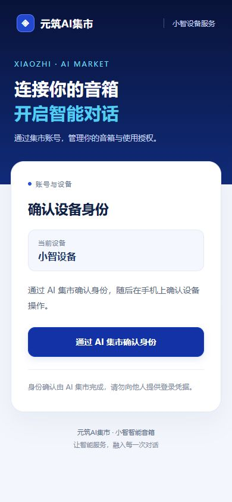

# 手机扫码页视觉更新与部署

2026-11-11（Asia/Hong_Kong）。本次 API 在 10:43 完成切换，随后完成公网验证。部署固定源码 `52e627f41aba6acfc004f89b8d1b02c36b64921b`，基于[音箱设置部署](2026-11-11-speaker-settings-deployment.md)的 `b670a17`；没有合并功能代码到 main。

## 页面变化

参考元筑 AI 集市当前首页的海军蓝、亮蓝、青色和中文字体，统一扫码入口、授权结果、账号与绑定、无效/过期请求及操作错误页面。手机使用品牌区、设备卡片和约 50px 高的主按钮；退出按钮使用独立警示样式。共用 `CustomerPage` 生成页面外壳，原表单地址、字段、CSRF、身份及绑定逻辑保留。

样式内嵌，以精确 SHA-256 CSP 授权；没有 `unsafe-inline`、JavaScript、外部字体或图片请求，不增开资源路由。动态标题与设备名仍转义。所有页面保留 no-store，原先纯文本的无效二维码提示改为 UTF-8 HTML。

截图来自 Ubuntu 隔离数据库中的真实 `CustomerBrowserHarness` 页面，仅测试设备，无真实账号登录。浏览器在 390px 和 320px 宽度检查无横向溢出，按钮高度 50.39px；发现并修正首版标题颜色被通用段落样式覆盖的问题。另检查[生产错误页](evidence/2026-11-11-mobile-binding/error-page.jpg)的实际样式。测试容器和临时 SSH 通道已停止。

## 验证

- 最终固定源码 Ubuntu 全量 Java：342 tests，0 failures/errors/skipped，集成测试运行守卫通过。含绑定/身份、音箱账号和退出 17 项、长期烧录凭据 16 项。
- 公网预检 24、拒绝协议 20、设置与长期凭据 9、HTML/CSP 样式 3，共 56 项全部通过。公网页面的实际 CSS 与 CSP 哈希一致，保留 UTF-8、移动 viewport、no-store 和禁止脚本策略。
- Ubuntu 直接连接公网地址的首轮出现 TCP 超时，24 项中 22 项传输失败，未收到对应 API 错误响应。本机浏览器可正常访问；随后客户端仍在 Ubuntu 执行，经临时 loopback SSH 转发的 HTTP CONNECT 出站代理访问同一公网域名，TLS 证书校验保持开启，56 项通过。首轮失败保留在证据中；没有宣称 Ubuntu 直连网络已恢复。
- 未代用户扫码授权、操作真实设备或进行真机语音测试。页面功能回归来自隔离 HTTP 测试，本轮浏览器只检查视觉与布局。

完整脱敏结果：[evidence.json](evidence/2026-11-11-mobile-binding/evidence.json)。回归日志/XML：`/home/jt/mobile-binding-regression-52e627f/.runtime/pr52/`。

## 部署与恢复

| 项目 | 值 |
| --- | --- |
| API 镜像 | `xiaozhi-product-api:52e627f` |
| 镜像 ID | `sha256:fd7eb5c39a20a44b957bf7b0174c8ff9ea8e3301cc96bd7370e3172833e3316d` |
| 受测与运行 JAR SHA-256 | `d5919252fbe4029bc7e80fba27bb6d09829c86966b528da259a4c07e9d82b741`，一致 |
| 部署快照 | `/home/jt/mobile-binding-deployment-52e627f` |
| 部署前备份 | `/home/jt/pr26-deployment-885918d/private/backups/20261111T024230Z` |
| 部署后备份 | `/home/jt/pr26-deployment-885918d/private/backups/20261111T024309Z` |

仅重建产品 API。语音、管理前端、数据库、Redis 和入口容器保持原身份/启动时间；入口配置内容未变，校验并重载以刷新 API 地址。无新增数据库迁移。保留 `CUSTOMER_OIDC_BALANCE_ENABLED=true`、长期凭据及撤销状态、原 OIDC/设备/加密密钥；JetLinks 仍停止。

必要数据备份包含长期凭据表，排除对话正文与音频，SQLite 副本完整性检查通过。备份同主机保存，未做恢复演练。恢复脚本 `/home/jt/mobile-binding-rollback.sh` 已通过 Bash 语法检查，按私有 sudo runner 执行可回退到 `b670a17`；先拒绝覆盖后续部署，保留数据库、归属、退出和凭据状态，不影响已开通积分配置。部署快照中保留 `compose-before.json` 与 `nginx-before.conf`。

README、AGENTS → 当前部署入口 → 本报告导航已核对。代码 PR 使用已部署设置分支为基线，部署文档另同步主线文档 PR，均未合并。
