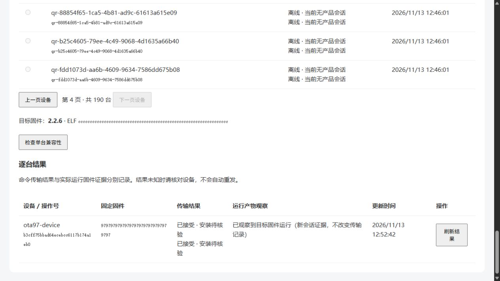

# #97 单台在线 OTA 验证

2026-11-13，任务分支 `codex/97-online-ota-push`，基于 #96 集成提交 `648c49b`。本次只实现现有在线产品会话的后台选择、兼容性预览、明确确认和逐台结果，不增加固件协议、离线队列或空闲调度。配置与恢复边界见 [使用说明](../development/product-ota-push.md)。

## 已验证

| 入口 | 结果 |
| --- | --- |
| Ubuntu Java 全回归、真实 MySQL/Redis/HTTP | 379 项，0 失败、错误或跳过；集成测试守卫通过 |
| Java HTTP → 真实 Python 私有桥接 → WebSocket 模拟设备 | 1 项综合验收通过：会话变化拒绝、未知结果单次发送、未选设备隔离、Java/桥接分别重启后不重发、新会话实际目标观察 |
| Python 桥接 HTTP/设备协议与原维护通道 | 13 + 16 项通过，无跳过；原维护路径保持 |
| 前端最终目录/推送组件测试 | 9 项通过；UI 辅助分支此前全量 82 单元、10 契约、13 快照检查通过 |
| 最终前端生产构建 | 通过；仅既有包体和字体预缓存大小提示 |
| 隔离 TLS Nginx 模板 | 配置检查通过；内部桥接/管理路径 404，下载能力无效时由 Java 返回 404，非 GET 下载 403 |

Java HTTP 覆盖管理员与非管理员权限、严格字段/重复 JSON/超限输入、真实产品档案分页、物理容量与六分区布局、缺失硬件信息、同一实际 ELF 排除、同版本不同 ELF、重复/并发确认的唯一操作、操作级短时 HTTPS 下载、重复/错误签名参数及存储字节变化拒绝、已知发送前失败不补发、未知结果不重发、目标运行观察与原传输状态分离。

逐行为遵循先红后绿：缺失 inventory、preview、operations、download、observation 入口分别触发失败后实现；发送前故障分类先得到错误的 unknown，再修为 not_sent。首轮全回归仅一项失败，原因是其他测试留下产品档案后目标不再位于第一页；测试改为通过公开分页接口查找，最终 379 项全部通过。显式协议夹具也验证了在保留既有测试档案时重复执行。

## 可追溯证据

全部后端与设备协议测试在 Ubuntu `jt@192.168.168.114` 执行，没有在开发电脑运行后端服务。隔离项目 `ota97-api` 使用独立数据库、Redis 和无主机端口的模拟语音桥；Python 独立回归位于 `/home/jt/ota97-voice`。

- 最终 Java XML：`/home/jt/ota97-api/.runtime/final-reports-1794544826`。
- 最终综合协议 XML：`/home/jt/ota97-api/.runtime/protocol-final-reports`。
- 受测并用于隔离页面验收的 JAR：`/home/jt/ota97-api/.runtime/api.jar`，SHA256 `4d79f454ff4bc6c28fa6fb7a8063fd9d3bb3def08e613f6c4142ba12cfa76a13`。
- 后端 runner：`/home/jt/ota97-final-test.sh`、`/home/jt/ota97-protocol-final.sh`；原始日志保留于隔离项目 `.runtime`，不将含合成身份的运行日志提交 Git。

打包阶段使用 skipTests 避免重复执行刚通过的回归，不计为测试跳过。最终 XML 的 skipped 为 0。协议复跑准备期间曾出现上传 root 所有目录失败及临时 runner 替换错误，修正后上述显式协议验收成功；这些环境准备失败不计为产品通过证据。

TLS 路由检查使用隔离 Docker 网络和一天有效的自签名测试证书，仅验证模板路由与 HTTPS 头传递，不代表公网证书验收。测试网络为 `178.10.10.96/28`，不在 Tomcat 默认内部代理范围；首次下载检查正确拒绝为 `HTTPS_REQUIRED`。将隔离 API 的代理信任精确限制到该子网后通过，应用代码和现网代理配置未改变。临时 Nginx 检查容器已停止删除。

## 边界

模拟设备使用当前固件真实 MCP 响应形状和真实 WebSocket 帧，不能证明 P4 的下载、写入、自动重启或身份保持；这些由 #99 验收。新会话读到目标版本/ELF是运行产物观察，不是固件持久安装 ACK，原未知传输结果仍保留。最后发送保护在持久预留后拒绝的窗口也保守标为 unknown，不自动重试。

没有部署到现网、修改真实设备身份/归属/许可、向硬件下发 OTA 或合并主线。隔离页面服务只映射 Ubuntu loopback 18097；桥接端口未映射主机，继续保留供主任务完成页面验收与后续联调。

## 浏览器组件与真实接口联调补充

同日 12:44–12:53，内置浏览器运行原始 `ProductOtaCatalog.vue` 和 `ProductOtaPush.vue` 组件，连接上述 Ubuntu 受测 JAR、真实私有 Python 桥接及 WebSocket 测试设备。页面使用显式隔离环境标识及仅在测试库存在的合成管理员；这不是现网登录验收，也不是完整应用导航验收。

- 190 条合成设备档案跨页显示，第四页可选择在线 `ota97-device`，离线夹具不可选；没有固件时禁止检查/下发。
- 真实 GitHub Release 列表加载成功，但两次浏览器导入请求均返回不可用、目录未新增。本轮真实导入不记通过；#96 独立真实导入的既有通过记录保留其原范围。同一时段 Windows Git 推送也出现连接超时/重置，未通过此现象推断具体服务端失败根因。
- 为继续独立验证推送界面，直接在隔离测试库建立 `TEST-ONLY-browser-protocol-fixture`（3 字节合成镜像，非可烧录固件），通过页面选择、兼容性预览、明确确认，得到 accepted_unconfirmed。不得将该夹具视为生产导入或真实下载/安装证据。
- WebSocket 测试设备计数：所选设备 1 次升级命令，未选设备 0 次。页面刷新未重发；初始保持“安装待核验”。
- 将测试设备配置为新会话及目标版本/ELF 后，页面刷新单独显示目标运行观察，原“已接受”传输记录保留。该重连/产物报告由测试控制接口模拟，不是硬件自动重启。

页面仍有重复状态文案、长标识折行等可读性问题，可在后续多选页面改动中顺便简化；不影响本次状态与单次发送核验。
