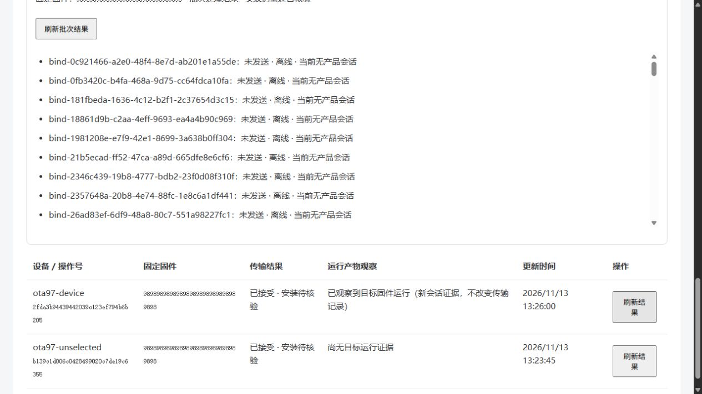

# #98 在线 OTA 多选与全部设备

2026-11-13，任务分支 `codex/98-online-ota-batches`，在 #97 单台保护基础上实现跨页多选、服务器全部在线兼容设备预览、固定批次与逐台结果。最终完整回归前已合入集成提交 `fa21e37`，包含目录导入下载与精确代理超时修复。使用与恢复边界见 [在线 OTA 说明](../development/product-ota-push.md)。

## 验证结果

| 入口 | 结果 |
| --- | --- |
| Ubuntu Java 全回归、真实 MySQL/Redis/HTTP | 385 项，0 失败、错误或跳过；集成测试守卫通过 |
| Java HTTP → Python 私有桥接 → 真实 WebSocket 帧模拟设备 | 3 项通过，无跳过，包含单台既有保护、批次独立结果持久化及处理中断 |
| 前端 | 91 单元、10 契约、13 快照检查通过；最终 15 项目录外推送/批次组件测试复核通过 |
| 前端生产构建 | 通过；仅既有包体/预缓存大小提示 |
| 独立页面后端入口 | Ubuntu loopback `18098` 已启动，未认证设备列表返回 401；管理身份由主任务另行建立 |

HTTP 覆盖服务器全部目标跨分页、预览排除原因、预览后新登记与重连不加入、发送前离线为未发送、同一批次重复确认、重叠批次的设备级唯一发送、未知回执不重发、异步预检/确认回执及 GET 查询、跨页选择请求大小、状态服务不可用的短时关闭。既有单台管理员鉴权、严格 JSON、硬件/分区、同实际 ELF 排除、签名下载与运行产物观察回归继续通过。

协议中断实验创建六个在线模拟目标。四路工作器实际向其中四台发送后，关闭 Java 应用上下文并重建桥接实例，保留真实 MySQL 和桥接 SQLite 日志。重新启动后批次为 `interrupted`，四台为 `result_unknown`，两台为 `not_sent`；重复确认后的设备升级帧总数仍为四。混合批次另验证一台回执丢失、一台已接受的独立结果，重建两端实例后均保持且不重发。这不等同于 Ubuntu 主机断电或 P4 硬件验收。

## 测试驱动与调整

### 浏览器补充验证（13:23–13:26，北京时间）

使用 `2249e3c` 的真实目录/推送 Vue 组件、上述 Ubuntu 管理 API 与 Python/WebSocket 夹具，通过本机隔离页面执行，页面明确标注非物理音箱。合成管理员和测试数据不代表生产登录/导航验收。

- 从设备第 1 页（共 98 台，每页 50 台）点击“检查全部在线兼容设备（所有分页）”，服务器预览找到后续页的两台可推送设备，排除 96 台；其中离线夹具显示无会话，同产物夹具显示无需重装。
- 明确勾选立即中断与重启提示并确认后，两台分别生成独立操作号、显示“已接受 · 安装待核验”。测试端计数分别为 1、1，同产物设备为 0；刷新设备与结果后计数保持。
- 将其中一台夹具改为新会话并报告目标 ELF，再从页面刷新该操作，显示“已观察到目标固件运行（新会话证据，不改变传输记录）”；另一台仍无目标运行证据。
- 本次推送使用明确标为 `TEST-ONLY-batch-protocol-fixture` 的三字节合成目录条目，只验证协议和页面状态，不能用于实际刷机，也不证明真实下载/写入/重启。
- 最终候选通过页面重新尝试导入真实 `12f2ff1` Release 时，GitHub 返回额度限制，页面正确显示“GitHub 请求额度暂时用尽，请稍后再试”。此前 #96 的真实导入成功证据保留，但本次浏览器真实导入没有成功，不把网络预算修复当作成功证据。

上述验证不覆盖后续审查发现的批次预览过期边界；该问题另行修复和回归。没有对生产服务或真实设备执行本轮推送。

- 首个批次 HTTP 用例在缺失批次入口时失败，随后实现固定清单及逐台保护，原单台测试保持通过。
- 状态延迟用例先观察四台查询耗时约 12.77 秒，随后将状态调用改为两秒完整响应期限、最多八路，并在桥接探测不可用时使本页立即安全关闭。
- 异步回执用例先因没有 `preparing` 状态失败，再加入持久预检回执与一次性执行工作器，避免长工具调用受管理代理 30 秒请求超时影响。页面轮询仅 GET，有两分钟总期限和单请求 15 秒期限。
- 跨页长设备 ID 请求先触发原单台 4KiB 限制，再仅对批次预检将请求上限设为 256KiB，仍限制最多 1000 个所选 ID。单台与设备控制请求的原 4KiB 防护保持。
- 异步控制器初次编译出现同签名方法重名，修正后完整回归通过。页面服务启动脚本初次探针依赖缺失的 curl；服务本身已启动，改用 Python 独立确认 401，脚本已修正。

## 可追溯产物与交接

所有后端/协议执行均位于 Ubuntu `jt@192.168.168.114` 的独立项目 `ota98-api`，没有修改 `ota97-api` 或现网服务。

- 完整 Java XML：`/home/jt/ota98-api/.runtime/reports-1794546960`。
- 最终综合协议 XML：`/home/jt/ota98-api/.runtime/protocol-reports-1794546601`。
- 受测 API JAR：`/home/jt/ota98-api/.runtime/api.jar`，SHA256 `e7e04563d205dcb7a4ed3816472860e013cbfdd36e5ef1ff0ec7528861512956`。
- Runner：`/home/jt/ota98-full-test.sh`、`/home/jt/ota98-protocol-test.sh`、`/home/jt/ota98-live.sh`；原始日志与合成身份在私有 `.runtime`，不提交 Git。
- 页面联调用 Compose：`/home/jt/ota98-api/.runtime/live.json`，项目 `ota98-api`。API 仅映射 `127.0.0.1:18098`，语音桥和模拟设备控制端口不映射主机。

打包阶段跳过已经通过的测试，不计为测试跳过；最终 XML 的 skipped 为 0。页面运行使用的就是上述受测 JAR。页面浏览器验收与真实 GitHub 导入由主任务接续记录；此处前端证据为组件交互和生产构建，不冒充已完成浏览器或硬件验收。

本次未部署到现网、未向物理设备下发、未修改设备身份/归属/许可、未合并主线。当前升级工具接受和新会话目标运行观察继续分别记录；P4 下载、写入、自动重启及身份保持仍由指定目标的 #99 验收。
