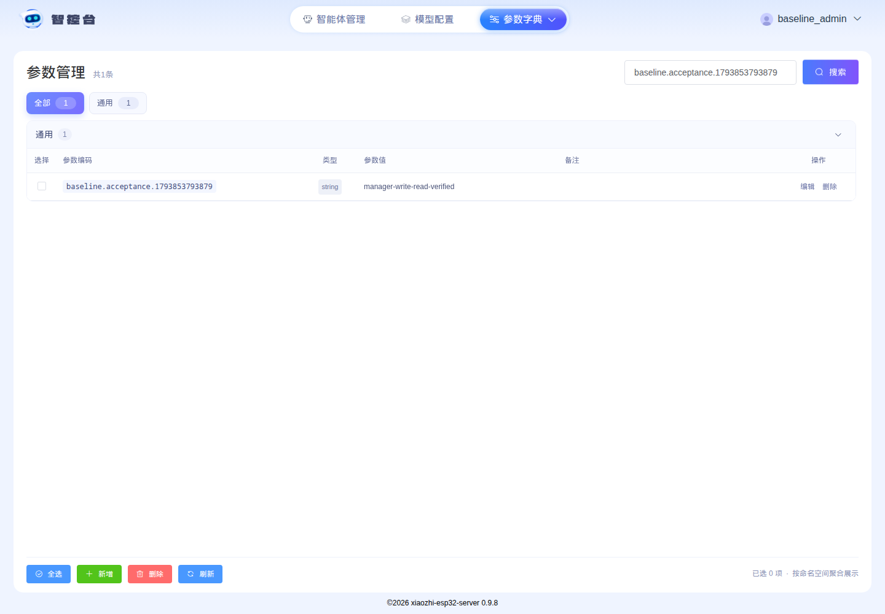

# #3 管理端基线验证记录

验证日期：2026-11-05。任务：[固定上游基线并跑通管理配置读写](https://github.com/yanghan24/xiaozhi/issues/3)。

## 来源和运行条件

- 上游：`xinnan-tech/xiaozhi-esp32-server@c8e60d1325650c8a31d00e36d8528f8bb74aeb11`。
- 任务分支：`feat/3-upstream-manager-baseline`，从 `b5d749f` 建立。源码导入范围及版本选择理由见 [来源记录](../development/upstream-baseline.md)。
- 对导入的 1359 个上游文件执行逐文件 SHA-256 比对，均与干净的指定提交参考检出一致；上游根 README 另外原样保存。应用源码未修改，本项目新增部署配置和验证脚本。
- Fedora 44 / x86_64 / Intel i7-6700HQ / 约 7.7 GiB 物理内存。Docker Engine 29.8.0，Compose v5.5.1。
- 开始时可用内存约 2.2 GiB、磁盘约 322 GiB；构建期间前置检查观测可用内存 2516 MiB、磁盘 318.9 GiB。顺序构建前后端，Java 测试运行前停止本项目管理容器以释放内存。
- 管理项目 `xiaozhi-baseline`，仅发布 `127.0.0.1:18002`。数据库、缓存、上传文件使用新建的专属卷；既有 JetLinks 容器和数据未修改。

## 已执行结果

| 检查 | 实际结果 | 证据 |
| --- | --- | --- |
| 缺少管理服务时 HTTP 检查会失败 | 退出码 1，`Connection refused` | `python3 scripts/check-manager.py` 首次执行 |
| 部署前置条件 | Docker、Compose、必要配置、端口及资源检查通过 | `scripts/preflight-manager.py` |
| API 从源码构建 | 316 个生产 Java 文件及 27 个测试文件编译成功；首次 Maven 构建 7 分 23 秒 | Java 21 / Maven 3.9.9，`mvn package -DskipTests`；测试另行执行 |
| 页面从源码构建 | `npm ci` 安装 1128 个包，生产构建成功 | Node 20.19.0、已导入 package-lock |
| 前端已有测试 | contract 10、unit 70、snapshot 13 全部通过 | Docker 构建中的上游测试命令 |
| 新数据库初始化 | MySQL 新建库和应用用户；Liquibase 变更执行成功 | 下方启动日志摘录 |
| 管理 API 实际连接存储 | 数据源初始化完成，公共配置可读；真实验证码及登录流程成功 | HTTP 检查和浏览器检查 |
| HTTP 页面/API | 页面 HTML、初始化后的公共配置和匿名参数访问拒绝均通过 | `scripts/check-manager.py` 返回 0 |
| 首个测试管理员 | 通过上游注册页面成功创建；后续可访问管理员参数页 | 注册实际执行，图形验证码由页面读取输入 |
| 错误密码 | 使用有效验证码、错误密码，返回 `10004`，不签发 token | [浏览器结果](issue-3-browser-result.json) |
| 正确登录、保存及刷新回读 | 保存 `baseline.acceptance.1793853793879`，刷新后读到 `manager-write-read-verified` | [浏览器结果](issue-3-browser-result.json)及下方截图 |
| Java 全套测试及集成守卫 | 206 条，0 失败、0 错误、0 跳过；集成守卫确认三组共 8 条已执行 | [测试摘要](issue-3-java-tests.txt)，独立项目 `xiaozhi-baseline-tests` |



## 启动日志摘录

以下为实际首次启动的非敏感日志（UTC，移除颜色控制符和容器前缀）：

```text
2026-11-05 03:43:08.387 DruidDataSourceAutoConfigure - Init DruidDataSource
2026-11-05 03:43:08.972 DruidDataSource - {dataSource-1} inited
2026-11-05 03:43:22.293 liquibase - Update command completed successfully.
2026-11-05 03:43:28.750 AdminApplication - Started AdminApplication in 26.105 seconds
PASS: management HTML, initialized API configuration, anonymous access rejection
```

首次数据库初始化完成前的 HTTP 探测曾返回 502；等待 Compose 就绪后同一探测通过。就绪命令设置 360 秒超时，页面与 API 检查分别验证，未把 Nginx 进程存在视为管理链路通过。

## 资源观测

浏览器验收完成后的 `docker compose stats --no-stream` 单次采样：

| 服务 | CPU | Docker 报告的内存使用 |
| --- | --- | --- |
| 管理页面 Nginx | 0.00% | 3.035 MiB |
| 管理 API | 2.32% | 221.6 MiB |
| Redis | 0.48% | 8.664 MiB |
| MySQL | 7.04% | 40.39 MiB |

这是一次低负载观测，不是峰值；Docker 内存显示扣除了部分缓存，也不代表整机全部内存占用。没有持续采集构建峰值，没有执行并发压测。

## 执行中修正与限制

- Nginx 首次下载遇到 Docker Hub token 请求 EOF，重试成功；首次网络依赖仍需可用外网。
- 检查脚本最初生成的纯十六进制密码未满足上游强度规则，注册被拒绝；改为同时包含大小写、数字和符号的随机测试密码后注册成功。未放宽应用密码规则。
- 上游登录表单在提交后延迟刷新验证码。脚本重试时重新加载表单，登录后刷新已认证页面，再进入参数页；避免旧回调干扰快速导航。人工图形验证码仍保留，自动化流程需要输入图片内容。
- Element UI 固定列产生重复 DOM 行，检查脚本改为定位主表格中的行；最终完整流程返回成功。
- Java 测试首次执行为 206 条、1 条错误、0 条跳过。原因是上游测试读取相邻 `manager-web/src/views/roleConfig.vue`，原测试镜像未包含此文件；已为测试镜像补入相邻前端源码，重跑 206 条全部通过，应用运行镜像不受影响。
- 上游构建存在依赖弃用、Java 泛型及前端产物体积警告；未在本任务中升级框架或改写上游业务代码。

运行说明、私有配置生成、启动、停止、恢复、测试环境清理和重复检查命令见 [管理端说明](../development/manager-baseline.md)。真实密码、token、生成的服务密钥及原始运行日志仅保留在本地忽略目录；仓库中只保存上述脱敏结果。

本任务没有运行 Python 语音服务、设备激活、绑定、WebSocket 或真机语音问答；没有验证集市身份、规范通计费、OTA 刷写或 100 路并发。上述范围分别留待后续任务，父规格 #2 的 A、B 两层仍未全部完成。
