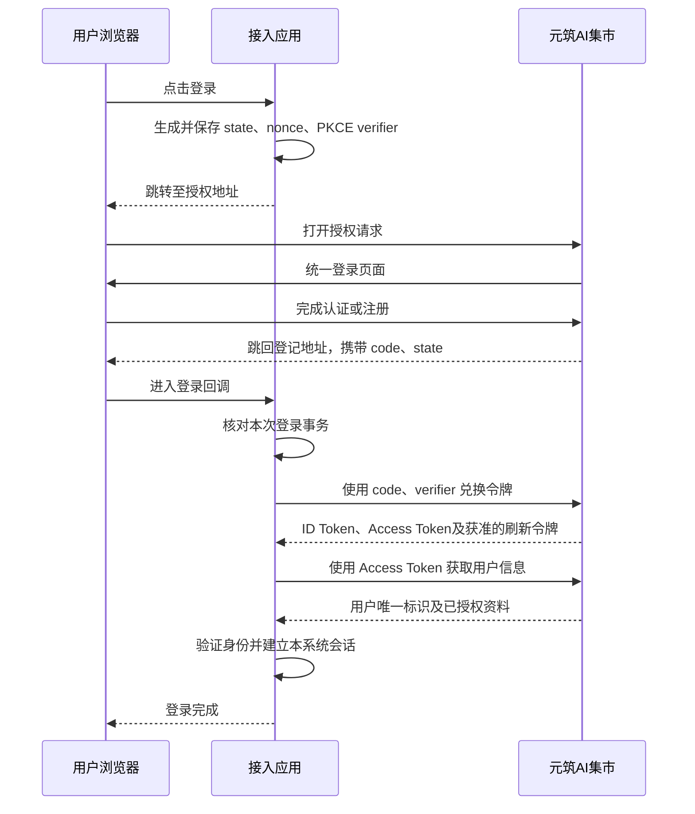

# 元筑AI集市应用接入接口文档

版本：1.0 · 更新日期：2026-11-05

本文面向网站、纯前端应用、桌面客户端和智能设备的开发者，说明如何通过标准 OpenID Connect（OIDC）接入元筑AI集市的账号登录、用户信息和退出登录，并通过独立业务接口查询积分、领取调用凭证。账号密码、微信、集团认证及注册由集市统一登录页承接，可用方式以集市实际开放的配置为准。

正式服务地址：`https://aimarket.hncig.cn`。以下应用域名、Client ID、用户信息及令牌均为示例；大写占位值须替换为本次登录实际取得的值。

## 1. 接入准备

联系集市超级管理员，在“系统管理 → 应用接入”登记应用。提供应用名称、客户端类型、登录回调、所需授权范围，以及适用的退出回调、浏览器来源和注销通知地址。

### 1.1 客户端类型

| 类型 | 适用场景 | 客户端认证 | Client Secret |
| --- | --- | --- | --- |
| 网站后端 `web` | 登录回调和令牌兑换由服务端处理的网站 | `client_secret_basic` | 由后端保管 |
| 纯前端网站 `spa` | 浏览器直接完成令牌兑换的应用 | `none` | 不生成、不填写 |
| 桌面客户端 `native` | 使用系统浏览器登录、通过本机回调接收结果的客户端 | `none` | 不生成、不填写 |
| 智能设备 `device` | 带屏音箱、电视等通过手机扫码授权 | `none` | 不使用 |

网站、纯前端和桌面客户端使用**授权码模式＋PKCE S256**；有 Client Secret 的网站后端也必须使用 PKCE。

设备应用不登记登录回调、退出回调、浏览器来源和注销通知地址。一个 Client ID 标识一个设备应用，不为每台物理设备单独创建 Client ID。

### 1.2 接入配置

| 字段 | 说明与示例 |
| --- | --- |
| Issuer／Authority | 固定为 `https://aimarket.hncig.cn/oidc` |
| Client ID | 标识接入应用，后台自动生成且不可编辑，例如 `app_0123456789abcdef0123456789abcdef`；可以公开 |
| Client Secret | 网站后端的应用密钥，创建或重置时仅展示一次；不得写入网页、前端代码或客户端安装包 |
| 登录回调 `redirect_uri` | 接入系统接收授权结果的地址，例如 `https://portal.example.com/auth/callback` |
| 授权范围 `scope` | 通常填写 `openid profile`；需要联系方式、组织、积分或调用凭证时按下表增加，实际请求不能超出应用登记范围 |
| 浏览器来源 | 仅纯前端应用登记，例如 `https://portal.example.com`，不含路径；端口属于来源的一部分 |
| 退出回调 `post_logout_redirect_uri` | 完成 OIDC 退出后返回的地址，例如 `https://portal.example.com/auth/logged-out` |
| 注销通知地址 | 接入系统接收服务端注销通知的 HTTPS 地址，例如 `https://portal.example.com/oidc/backchannel-logout`；集市服务器须能访问 |

授权范围按实际需要申请；管理员为应用勾选允许范围，应用登录时再请求本次需要的范围，两者都满足才可使用。

| Scope | 用途 |
| --- | --- |
| `openid` | 用户唯一标识，必填 |
| `profile` | 姓名／昵称、用户名、头像、真实姓名、账号类型 |
| `email`、`phone` | 已保存的邮箱、手机号 |
| `organization` | 集团姓名、工号、组织、部门和组织层级 |
| `wechat` | 微信绑定状态 |
| `balance:read` | 调用独立积分查询接口 |
| `credentials:manage` | 调用独立凭证领取、撤销接口 |
| `offline_access` | 用户允许后签发刷新令牌，用于后台自动续期 |

例如读取基本资料和集团组织、查询积分并领取调用凭证且需要自动续期时，请求 `openid profile organization balance:read credentials:manage offline_access`；需要邮箱、手机号或微信绑定状态，再增加相应 scope。

登录和 UserInfo 不创建调用 Key，也不查询积分。业务接口使用本次获准相应 scope 的 Access Token。

网站和纯前端回调必须使用 HTTPS，并与登记值一致，包含路径、端口、查询参数及末尾斜杠；不支持通配地址。登录回调和退出回调分别登记。

桌面客户端可登记 `http://127.0.0.1/auth/callback` 或 `http://[::1]/auth/callback`，实际登录时监听本机随机空闲端口，例如 `http://127.0.0.1:51004/auth/callback`。仅这类回调允许端口变化，IP 和路径仍需匹配；令牌兑换须使用本次授权时携带的完整回调地址。客户端只监听本机回环地址，完成或超时后关闭监听。规则参考 [RFC 8252](https://www.rfc-editor.org/rfc/rfc8252)。

应用配置变更、停用或重置密钥会使该应用的已有授权失效，需要重新发起登录。重置密钥不改变 Client ID。客户端类型创建后不能修改，类型变化需重新登记应用。

## 2. 登录流程与接口地址



图中令牌兑换和用户信息请求由网站后端、纯前端或桌面客户端各自执行，不要求所有应用都部署后端。

| 用途 | 方法 | 正式地址 |
| --- | --- | --- |
| 协议发现 | GET | `https://aimarket.hncig.cn/oidc/.well-known/openid-configuration` |
| 发起授权 | GET，浏览器跳转 | `https://aimarket.hncig.cn/oidc/auth` |
| 兑换令牌 | POST，表单 | `https://aimarket.hncig.cn/oidc/token` |
| 用户信息 | GET | `https://aimarket.hncig.cn/oidc/me` |
| 验签公钥 | GET | `https://aimarket.hncig.cn/oidc/jwks` |
| 发起 OIDC 退出 | GET，浏览器跳转 | `https://aimarket.hncig.cn/oidc/session/end` |
| 设备申请授权 | POST，表单 | `https://aimarket.hncig.cn/oidc/device/auth` |
| 手机核对及确认 | 浏览器打开实际返回链接 | `https://aimarket.hncig.cn/oidc/device` |
| 撤销本人应用授权 | DELETE，独立业务接口 | `https://aimarket.hncig.cn/api/oidc/authorization` |

客户端应从发现文档读取端点，配置的 Issuer 和令牌中的 `iss` 必须一致。正式接入统一使用上述不带端口的地址，不混用内网 IP、旧端口或其他域名。

## 3. 接口说明

本节接口使用 OIDC 原生响应格式，JSON 响应不包裹集市业务接口的 `code/message/data`。协议规则以 [OIDC Core](https://openid.net/specs/openid-connect-core-1_0.html) 和当前集市开放能力为准。

### 3.1 获取协议配置

无需登录。

```bash
curl 'https://aimarket.hncig.cn/oidc/.well-known/openid-configuration'
```

成功返回 HTTP 200。相关字段示例，完整响应还包含其他协议元数据：

```json
{
  "issuer": "https://aimarket.hncig.cn/oidc",
  "authorization_endpoint": "https://aimarket.hncig.cn/oidc/auth",
  "token_endpoint": "https://aimarket.hncig.cn/oidc/token",
  "userinfo_endpoint": "https://aimarket.hncig.cn/oidc/me",
  "jwks_uri": "https://aimarket.hncig.cn/oidc/jwks",
  "end_session_endpoint": "https://aimarket.hncig.cn/oidc/session/end",
  "device_authorization_endpoint": "https://aimarket.hncig.cn/oidc/device/auth",
  "revocation_endpoint": "https://aimarket.hncig.cn/oidc/token/revocation"
}
```

### 3.2 发起授权并接收回调

由浏览器打开 `authorization_endpoint`。接入方须为每次登录生成随机 `state`、`nonce` 和 PKCE verifier，绑定发起登录的浏览器会话或桌面登录事务，验证成功后消费，不跨用户或事务复用。

| 查询参数 | 要求 | 说明 |
| --- | --- | --- |
| `client_id` | 必填 | 后台分配的 Client ID |
| `redirect_uri` | 必填 | 登记的完整登录回调；桌面使用本次实际监听的回环地址 |
| `response_type` | 必填 | 固定 `code` |
| `scope` | 必填 | 通常为 `openid profile`，空格分隔，必须包含 `openid` |
| `state` | 接入方必须使用 | 随机值，回调时与本次保存值严格比较 |
| `nonce` | 接入方必须使用 | 随机值，校验 ID Token 时与本次保存值严格比较 |
| `code_challenge` | 必填 | 根据本次 PKCE verifier 计算 |
| `code_challenge_method` | 必填 | 固定 `S256` |
| `prompt` | 按需 | `login` 要求重新认证；首次请求长期访问时使用 `consent`，并由用户确认 |
| `max_age` | 按需 | 使用 `0` 要求重新认证；常规登录可省略 |

PKCE verifier 应为 43～128 个允许字符组成的随机字符串，challenge 为 `BASE64URL(SHA256(verifier))`，不带填充符。使用 OIDC 客户端库生成和校验即可，详见 [PKCE 标准](https://www.rfc-editor.org/rfc/rfc7636.html)。

网站授权 URL 示例；各参数须正确进行 URL 编码：

```text
https://aimarket.hncig.cn/oidc/auth?client_id=app_0123456789abcdef0123456789abcdef&redirect_uri=https%3A%2F%2Fportal.example.com%2Fauth%2Fcallback&response_type=code&scope=openid%20profile&state=RANDOM_STATE&nonce=RANDOM_NONCE&code_challenge=CODE_CHALLENGE&code_challenge_method=S256
```

认证成功后，浏览器返回接入系统：

```text
https://portal.example.com/auth/callback?code=AUTHORIZATION_CODE&state=RANDOM_STATE
```

| 回调参数 | 含义 |
| --- | --- |
| `code` | 本次一次性授权码，最长 60 秒内兑换，不能重复使用 |
| `state` | 原样返回本次请求值；不匹配时终止登录 |
| `error`、`error_description` | 失败时可能返回；出现错误后不继续兑换授权码 |

集市也可能返回 `iss` 等附加标准参数，应交由 OIDC 库一并处理。无法确定合法回调地址时，集市直接显示错误，不跳转到未登记地址。

接入方通过授权端点进入统一登录页，无需调用集市内部的账号密码、微信二维码或集团认证接口，也不要直接打开 `/auth/login`。已有登录可被核验复用；需要用户重新认证时明确传 `prompt=login`，不要依赖隐藏 iframe 静默登录。

### 3.3 使用授权码兑换令牌

请求 `token_endpoint`，Content-Type 为 `application/x-www-form-urlencoded`，不发送 JSON。

| 表单参数 | 要求 | 说明 |
| --- | --- | --- |
| `grant_type` | 必填 | 固定 `authorization_code` |
| `code` | 必填 | 本次回调收到的授权码 |
| `redirect_uri` | 必填 | 与本次授权请求完全相同 |
| `code_verifier` | 必填 | 本次登录保存的 verifier，不能使用 challenge 代替 |
| `client_id` | 纯前端、桌面必填 | 网站后端通过 HTTP Basic 认证提供 |

**网站后端**：使用 HTTP Basic 发送 Client ID 和 Client Secret，客户端认证方式为 `client_secret_basic`。

```bash
curl --request POST 'https://aimarket.hncig.cn/oidc/token' \
  --user 'CLIENT_ID:CLIENT_SECRET' \
  --header 'Content-Type: application/x-www-form-urlencoded' \
  --data-urlencode 'grant_type=authorization_code' \
  --data-urlencode 'code=AUTHORIZATION_CODE' \
  --data-urlencode 'redirect_uri=https://portal.example.com/auth/callback' \
  --data-urlencode 'code_verifier=CODE_VERIFIER'
```

**纯前端、桌面客户端**：表单发送 Client ID，不发送 Client Secret 或 Basic 认证。

```bash
curl --request POST 'https://aimarket.hncig.cn/oidc/token' \
  --header 'Content-Type: application/x-www-form-urlencoded' \
  --data-urlencode 'grant_type=authorization_code' \
  --data-urlencode 'client_id=CLIENT_ID' \
  --data-urlencode 'code=AUTHORIZATION_CODE' \
  --data-urlencode 'redirect_uri=http://127.0.0.1:51004/auth/callback' \
  --data-urlencode 'code_verifier=CODE_VERIFIER'
```

上述第二例为桌面客户端；纯前端应用将 `redirect_uri` 替换为登记的 HTTPS 回调。

成功返回 HTTP 200，响应示例：

```json
{
  "access_token": "ACCESS_TOKEN",
  "token_type": "Bearer",
  "expires_in": 300,
  "scope": "openid profile",
  "id_token": "ID_TOKEN"
}
```

| 字段 | 用途 |
| --- | --- |
| `id_token` | 带 RS256 签名的身份 JWT，用于校验本次登录身份 |
| `access_token` | 本次短期授权令牌，可用于 UserInfo 及另行获准的扩展接口；不要假定其格式是 JWT |
| `expires_in` | Access Token 剩余有效秒数，以实际响应为准 |
| `scope` | 本次实际授予的范围 |

建立本系统会话之前，使用 OIDC 库验证签名、`iss`、`aud`、`exp` 和本次 `nonce`，并核对回调事务；同时检查适用的其他标准校验项。只解码 JWT 内容不能证明身份。ID Token 的 `aud` 应包含本应用 Client ID；如包含 `sid`，随本地会话保存，供注销通知定位会话。

Access Token 和 ID Token 有效期为 5 分钟。需要自动续期的应用由管理员允许 `offline_access`，并在首次授权请求中申请该范围及 `prompt=consent`；用户确认后，响应增加 `refresh_token`。刷新方式见第 4.4 节。登录、注册或网页会话自然到期，不自动撤销已批准的长期应用授权。令牌不能代替模型 API Key。

### 3.4 获取用户信息与关联账号

携带本次 Access Token：

```bash
curl 'https://aimarket.hncig.cn/oidc/me' \
  --header 'Authorization: Bearer ACCESS_TOKEN'
```

按本次获准的 scope 返回字段，成功状态为 HTTP 200。例如普通微信关联账号申请 `openid profile email phone organization wechat` 后：

```json
{
  "sub": "8d90cfd0-4cf3-45b9-a449-b5411893c6f0",
  "name": "小筑",
  "preferred_username": "user001",
  "nickname": "小筑",
  "picture": "https://aimarket.hncig.cn/uploads/avatar/example.png",
  "account_type": "ordinary",
  "email": "user@example.com",
  "phone_number": "13800000000",
  "organization": null,
  "wechat": {
    "bound": true,
    "official_account_bound": true,
    "mini_program_bound": false
  }
}
```

| 字段 | 所需 scope | 含义 |
| --- | --- | --- |
| `sub` | `openid` | 稳定的集市用户唯一标识 |
| `name`、`preferred_username` | `profile` | 显示名（优先昵称，否则用户名）、集市用户名 |
| `nickname`、`picture`、`real_name` | `profile` | 已保存的昵称、可访问头像地址、真实姓名；未填写时省略 |
| `account_type` | `profile` | `group` 集团账号，`ordinary` 普通账号；微信登录属于普通账号体系 |
| `email`、`phone_number` | `email`、`phone` | 已保存的邮箱、手机号；未填写时省略，不返回未经证实的已验证标识 |
| `organization` | `organization` | 集团资料对象；普通账号或缺少集团关联时为 `null` |
| `wechat` | `wechat` | 是否存在微信绑定、公众号绑定、小程序绑定；不是本次登录方式 |

`account_type`、`real_name`、`organization`、`wechat` 为集市扩展字段，其余上述资料字段沿用 OIDC 标准含义。

集团账号的 `organization` 示例：

```json
{
  "person_name": "张三",
  "work_number": "20260001",
  "organization": {"id": "a3db629c-0fb6-4f7b-822d-b22d09a24ca1", "code": "O001", "name": "示例公司", "kind": "organization"},
  "department": {"id": "d2378cbb-8af8-4a13-9a41-6eb9aa076a36", "code": "D001", "name": "信息部", "kind": "department"},
  "path": [
    {"id": "a3db629c-0fb6-4f7b-822d-b22d09a24ca1", "code": "O001", "name": "示例公司", "kind": "organization"},
    {"id": "d2378cbb-8af8-4a13-9a41-6eb9aa076a36", "code": "D001", "name": "信息部", "kind": "department"}
  ]
}
```

`organization` 和 `department` 分别为所属路径中最近的组织、部门，缺少时为 `null`；`path` 从顶层到当前归属节点，`kind` 可为 `organization`、`department`、`virtual`。组织读取集市已有同步数据，不在请求时查询集团中台。

只申请 `openid` 时仅返回 `sub`。未获准的范围不返回相应字段；UserInfo 不返回积分、调用 Key、密码、微信 OpenID／UnionID、微信令牌或后台角色权限。

UserInfo 的 `sub` 必须与已验证 ID Token 中的 `sub` 一致。使用 **`issuer + sub`** 关联本系统账号，不通过姓名或用户名自动合并身份。首次登录后是否建立本系统账号及分配何种业务权限，由接入应用决定；集市后台管理身份不自动赋予接入系统管理员权限。

接入方自行管理本系统会话。令牌过期不等于业务系统的本地会话自动结束；需要感知统一退出的系统应实现第 5 节注销通知，并按自身业务要求设置本地会话期限。

### 3.5 获取验签公钥

从发现文档的 `jwks_uri` 获取公钥，不需要 Client Secret：

```bash
curl 'https://aimarket.hncig.cn/oidc/jwks'
```

返回 HTTP 200，结构为 `{"keys":[...]}` 的 JWK Set。OIDC 库应按令牌头部 `kid` 选择公钥并验证 RS256 签名；公钥可缓存，遇到未识别的 `kid` 时按库的规则重新获取。服务端私钥不提供给接入方。

## 4. 网站和客户端接入示例

优先使用成熟 OIDC 客户端库。Java、Python 等后端按同一协议配置即可，不要求使用 JavaScript。以下为接入代码示例，需配置自己的 Client ID、回调、依赖和会话存储。

### 4.1 网站后端

使用 `openid-client` 6.x。将 Issuer、Client ID、Client Secret 和 HTTPS 回调配置为环境变量；Client Secret 仅保存在后端。

```js
// 网站后端示例，使用 openid-client 6.x；安装到接入系统，不安装到集市。
// flow 必须保存在服务端会话中，并绑定发起登录的浏览器，最长保留 5 分钟。
import * as oidc from "openid-client";

const issuer = new URL(process.env.OIDC_ISSUER || "https://aimarket.hncig.cn/oidc");
const clientId = process.env.OIDC_CLIENT_ID;
const secret = process.env.OIDC_CLIENT_SECRET;
const redirectUri = process.env.OIDC_REDIRECT_URI;
if (!clientId || !secret || !redirectUri) throw new Error("请填写应用编号、后端密钥和登记的 HTTPS 回调");
const config = await oidc.discovery(issuer, clientId, { client_secret: secret }, oidc.ClientSecretBasic(secret));

export async function beginLogin() {
    const flow = { verifier: oidc.randomPKCECodeVerifier(), state: oidc.randomState(), nonce: oidc.randomNonce(), createdAt: Date.now() };
    const url = oidc.buildAuthorizationUrl(config, {
        response_type: "code", redirect_uri: redirectUri, scope: "openid profile offline_access", prompt: "consent",
        state: flow.state, nonce: flow.nonce,
        code_challenge: await oidc.calculatePKCECodeChallenge(flow.verifier), code_challenge_method: "S256",
    });
    return { url, flow }; // 服务端保存 flow，再把浏览器重定向到 url。
}

export async function finishLogin(currentCallbackUrl, flow) {
    if (!flow || Date.now() - flow.createdAt > 300_000) throw new Error("登录事务已过期");
    const url = new URL(currentCallbackUrl);
    const expected = new URL(redirectUri);
    if (url.origin !== expected.origin || url.pathname !== expected.pathname) throw new Error("回调地址不匹配");
    // 调用前从本次浏览器的服务端会话中取出并消费 flow，避免重用。
    const tokens = await oidc.authorizationCodeGrant(config, url, {
        pkceCodeVerifier: flow.verifier, expectedState: flow.state, expectedNonce: flow.nonce, idTokenExpected: true,
    });
    const claims = tokens.claims();
    const profile = await oidc.fetchUserInfo(config, tokens.access_token, claims.sub);
    // 使用 issuer + subject 绑定业务账号并新建业务会话；在后端安全保存 tokens（含刷新令牌）供第 4.4 节使用，不发给浏览器。
    return { profile: { issuer: claims.iss, subject: claims.sub, name: profile.name, username: profile.preferred_username }, tokens }; // 仅返回给本应用后端调用方，不能直接作为网页响应。
}
```

网站后端将登录事务保存在本系统服务端会话，绑定发起浏览器；回调完成后消费该事务，并使用 HttpOnly 会话 Cookie 建立业务会话。

### 4.2 纯前端网站

使用 `oidc-client-ts`，在后台登记本应用的 HTTPS 来源和回调地址，不配置 Client Secret。

```ts
// 纯前端示例，使用 oidc-client-ts。把本应用的 HTTPS 来源及两个回调登记到集市。
import { UserManager, WebStorageStateStore } from "oidc-client-ts";

export const identity = new UserManager({
    authority: "https://aimarket.hncig.cn/oidc",
    client_id: "替换为后台登记的应用编号",
    redirect_uri: `${window.location.origin}/auth/callback`,
    post_logout_redirect_uri: `${window.location.origin}/auth/logged-out`,
    response_type: "code", scope: "openid profile offline_access", prompt: "consent",
    disablePKCE: false, loadUserInfo: true,
    automaticSilentRenew: true, monitorSession: false, // 有 refresh_token 时由库后台续期，不依赖隐藏网页。
    stateStore: new WebStorageStateStore({ store: window.sessionStorage }),
    userStore: new WebStorageStateStore({ store: window.sessionStorage }),
});

export const login = () => identity.signinRedirect();
export async function completeLogin() {
    // 仅在 /auth/callback 执行；state、nonce 和 PKCE 由库管理。
    const user = await identity.signinRedirectCallback();
    window.history.replaceState(null, "", "/auth/callback");
    return { issuer: user.profile.iss, subject: user.profile.sub, name: user.profile.name };
}
export const logoutLocally = () => identity.removeUser();
export const logoutFromIdentityProvider = () => identity.signoutRedirect();
// 只在 /auth/logged-out 退出回调页执行：
export const completeLogout = () => identity.signoutRedirectCallback();
```

### 4.3 桌面客户端

使用 Node.js、`openid-client` 6.x 和 `open`。在后台登记为桌面客户端，回调填写 `http://127.0.0.1/auth/callback`；实际登录使用本机随机空闲端口。

```js
// 桌面示例：Node.js，使用 openid-client 6.x 和 open；只打开系统浏览器，不嵌入密钥。
// 后台登记为桌面客户端，回调填写 http://127.0.0.1/auth/callback。
import { createServer } from "node:http";
import * as oidc from "openid-client";
import open from "open";

export async function login(clientId) {
    const config = await oidc.discovery(new URL("https://aimarket.hncig.cn/oidc"), clientId, undefined, oidc.None());
    const verifier = oidc.randomPKCECodeVerifier(), state = oidc.randomState(), nonce = oidc.randomNonce();
    return new Promise((resolve, reject) => {
        let consumed = false;
        const server = createServer(async (req, res) => {
            const callback = new URL(req.url || "/", `http://127.0.0.1:${server.address().port}`);
            if (req.method !== "GET" || callback.pathname !== "/auth/callback") { res.writeHead(404).end(); return; }
            if (callback.searchParams.get("state") !== state || consumed) { res.writeHead(400).end("Invalid login transaction"); return; }
            consumed = true;
            try {
                const tokens = await oidc.authorizationCodeGrant(config, callback, { pkceCodeVerifier: verifier, expectedState: state, expectedNonce: nonce, idTokenExpected: true });
                const claims = tokens.claims();
                res.setHeader("Content-Type", "text/plain; charset=utf-8");
                res.setHeader("Cache-Control", "no-store");
                res.end("登录完成，可以关闭此页面并返回应用。");
                resolve({ profile: { issuer: claims.iss, subject: claims.sub, name: claims.name }, tokens, config });
            } catch (error) { res.writeHead(400).end("Login failed"); reject(error); }
            finally { clearTimeout(timer); server.close(); }
        });
        const timer = setTimeout(() => { server.close(); reject(new Error("登录超时")); }, 300_000);
        server.once("error", error => { clearTimeout(timer); reject(error); });
        server.listen(0, "127.0.0.1", async () => {
            try {
                const redirectUri = `http://127.0.0.1:${server.address().port}/auth/callback`;
                const url = oidc.buildAuthorizationUrl(config, { response_type: "code", redirect_uri: redirectUri, scope: "openid profile offline_access", prompt: "consent", state, nonce, code_challenge: await oidc.calculatePKCECodeChallenge(verifier), code_challenge_method: "S256" });
                await open(url.href);
            } catch (error) { clearTimeout(timer); server.close(); reject(error); }
        });
    });
}
```

桌面客户端将事务保存在本机，收到回调后核对来源路径及 state，再兑换令牌。三类应用都应为登录事务设置过期时间，建议不超过 5 分钟；回调处理完成后清理地址栏中的 code 等临时参数。

### 4.4 后台自动续期

管理员允许并在首次授权请求中加入 `offline_access`，用户确认后签发刷新令牌。访问令牌有效期 5 分钟；刷新令牌每次使用后换新，连续 30 天未刷新才失效，成功刷新后重新计 30 天。持续刷新没有固定的累计登录期限。不要并行刷新同一张刷新令牌，也不要在成功后再次使用旧值；旧值重放会撤销关联授权。

公开客户端（桌面、纯前端、智能设备）：

```bash
curl --request POST 'https://aimarket.hncig.cn/oidc/token' \
  --header 'Content-Type: application/x-www-form-urlencoded' \
  --data-urlencode 'grant_type=refresh_token' \
  --data-urlencode 'client_id=YOUR_CLIENT_ID' \
  --data-urlencode 'refresh_token=REFRESH_TOKEN'
```

网站后端使用同一请求，并通过 HTTP Basic 提交 Client ID 和 Client Secret。成功响应含新的 `access_token`、`expires_in`、`refresh_token`，可能包含新 `id_token`；必须保存新刷新令牌及对应到期时间；保存失败时处理保存错误，不回退使用旧值。纯前端第 4.2 节由库处理刷新；网站后端和桌面可使用以下共享示例：

```js
import * as oidc from "openid-client";

// config 沿用第 4.1 或 4.3 节的 openid-client 配置。
// initialTokens 是首次授权或设备授权的令牌响应；正式应用须安全持久化状态。
export function manageTokens(config, initialTokens, persist) {
    let saved = { ...initialTokens, expiresAt: initialTokens.expiresAt ?? Date.now() + initialTokens.expires_in * 1000 };
    let refreshing;
    return async function accessToken() {
        if (Date.now() < saved.expiresAt - 15_000) return saved.access_token;
        if (!saved.refresh_token) throw new Error("需要重新授权");
        if (!refreshing) {
            refreshing = oidc.refreshTokenGrant(config, saved.refresh_token)
                .then(async next => {
                    if (!next.refresh_token) throw new Error("未收到新的刷新凭证");
                    const updated = { ...next, expiresAt: Date.now() + next.expires_in * 1000 };
                    saved = updated; // 内存立即替换，保存失败时也不能再次使用旧刷新令牌。
                    await persist(updated); // 成功保存完整状态后，再向本次调用返回访问令牌。
                    return updated.access_token;
                })
                .finally(() => { refreshing = undefined; });
        }
        return refreshing;
    };
}
```

`invalid_grant` 表示刷新凭证过期、已使用、被撤销或与应用不匹配，应重新授权；网络或 HTTP 5xx 暂时错误不等于用户退出，不要因此清除模型 Key。刷新响应丢失时，不要无限重复提交旧刷新令牌。模型请求本身不刷新登录票据，也不需要为了调用模型反复领取 Key。

| 项目 | 有效期和影响 |
| --- | --- |
| 登录交互／授权码 | 5 分钟／1 分钟；授权码只能兑换一次 |
| Access Token／ID Token | 5 分钟；不是应用本地登录状态的倒计时 |
| Refresh Token | 连续 30 天未刷新失效；成功刷新后重新计时 |
| OIDC 浏览器会话 | 最长 8 小时；不作为后台授权或调用 Key 的截止时间 |
| 独立应用授权和模型 Key | 无固定到期时间，仍校验账号、应用、授权、Key、资源权限和积分 |
| Client Secret | 无固定到期时间，管理员重置后旧值失效 |

集团网页登录原有 8 小时、普通及微信登录原有新凭证 30 天配置保留；这些网页登录凭证自然到期不自动终止已批准的独立应用授权。刷新令牌闲置到期也不自动撤销模型 Key。退出与撤销按第 5、7.4 节处理。

## 5. 退出登录与注销通知

### 5.1 退出当前应用

只清理本地会话并不撤销集市授权。如果退出时要终止该应用的集市调用能力，先按第 7.4 节撤销授权，再清理本地会话、Cookie、令牌和 Key；纯前端最后调用 `identity.removeUser()`，网站后端销毁业务会话。

### 5.2 发起 OIDC 退出

让浏览器打开发现文档的 `end_session_endpoint`，由集市显示退出确认页：

| 参数 | 说明 |
| --- | --- |
| `id_token_hint` | 使用本应用此前取得的 ID Token；建议始终携带 |
| `post_logout_redirect_uri` | 已登记的退出回调，完成后返回该地址 |
| `state` | 独立生成并保存的退出事务随机值，在退出回调中验证 |

```text
https://aimarket.hncig.cn/oidc/session/end?id_token_hint=ID_TOKEN&post_logout_redirect_uri=https%3A%2F%2Fportal.example.com%2Fauth%2Flogged-out&state=LOGOUT_STATE
```

完成退出并返回后，接入方仍需清理自己的会话。纯前端可使用 `identity.signoutRedirect()` 发起，退出回调执行 `identity.signoutRedirectCallback()`。

OIDC 退出结束浏览器协议会话，不自动撤销独立长期授权、后台刷新令牌或模型 Key，也不自动执行集市网站账号退出或集团 4A 全局注销。终止应用调用权限须另行撤销应用授权。再次登录时若仍存在有效来源身份，可能继续使用该身份；如需重新认证，下一次授权请求使用 `prompt=login`。退出回调应严格匹配登记地址，详见 [RP-Initiated Logout](https://openid.net/specs/openid-connect-rpinitiated-1_0.html)。

### 5.3 接收服务端注销通知

需要同步结束本地会话的应用，登记 HTTPS 注销通知地址。OIDC 浏览器退出或管理员变更、停用应用等需要通知的操作，由集市向该地址发送：

```http
POST /oidc/backchannel-logout HTTP/1.1
Host: portal.example.com
Content-Type: application/x-www-form-urlencoded

logout_token=SIGNED_LOGOUT_TOKEN
```

`logout_token` 为带签名的 JWT，包含 `iss`、`aud`、`iat`、`exp`、`jti`、`events` 和会话相关的 `sub`／`sid`。按 [Back-Channel Logout](https://openid.net/specs/openid-connect-backchannel-1_0.html) 验签，核对签发方、接收应用、时间及注销事件，拒绝带 `nonce` 的通知，并按 `jti` 幂等处理。事件字段为：

```json
{
  "http://schemas.openid.net/event/backchannel-logout": {}
}
```

按已验证的 `sid` 清理匹配会话；无 `sid` 而有 `sub` 时，按标准处理该用户在本应用的会话。接入方需在建立会话时保存相关关联，不能收到通知后仅按姓名删除登录状态。

通知处理成功返回 HTTP 200 或 204，不需要集市业务 JSON 包装。通知失败或未接入通知时，不能保证本地会话立即注销；接入方仍需管理会话期限，并在授权失效时重新认证。

## 6. 常见错误与处理

令牌及 UserInfo 错误通常以 OAuth JSON 返回，例如：

```json
{
  "error": "invalid_grant",
  "error_description": "authorization code already consumed or expired"
}
```

| 错误 | 常见位置与原因 | 接入方处理 |
| --- | --- | --- |
| `invalid_request` | 缺少参数、格式不正确或缺少 PKCE | 按接口参数和编码要求修正请求 |
| `invalid_client` | Client ID、Secret 或客户端认证方式不正确；应用不可用 | 核对应用类型、凭证及启用状态；不要给纯前端或桌面增加 Secret |
| `invalid_grant` | 授权码过期、重复兑换、verifier 不匹配，或应用授权已失效 | 清理该次登录事务，重新发起授权，不重复使用旧 code |
| `invalid_scope` | 请求了未开放或未获准的范围，包括未登记的 `offline_access` | 使用管理员登记的范围 |
| `invalid_token` | UserInfo 使用的令牌过期或应用授权已失效 | 有有效刷新令牌时后台换新；授权撤销或刷新失效时重新授权，不用 ID Token 代替 |
| `login_required`、`interaction_required` | 无法在不展示页面的条件下完成认证 | 改为可交互的浏览器授权 |
| `access_denied` | 用户取消或拒绝本次授权 | 返回应用，允许用户主动重试 |
| `server_error`／HTTP 5xx | 认证服务暂时不可用 | 展示稍后重试提示，不当作用户输错密码 |

授权错误可能出现在回调的 `error` 参数，或者由集市直接显示。回调地址不匹配时先核对登记值，不通过放宽跳转地址校验来绕过。业务逻辑按 `error` 字段处理，不依赖可能变化的 `error_description` 文案。

Client Secret、授权码和完整令牌不要写入普通日志。网站后端的令牌保留在后端；纯前端和桌面按各自运行环境妥善保存，并在退出后清理。

## 7. 独立业务接口

以下接口分别提供积分与调用凭证，不属于 OIDC 原生端点。使用本次登录取得且获准对应范围的 Access Token，不使用 ID Token、Client Secret 或网站登录 JWT。用户和应用由令牌确定，不提交 `userId`、`clientId`。

成功响应采用集市的 `code/message/data/timestamp` 格式（`code=20000`）；响应不缓存。纯前端跨域请求使用 Bearer 请求头，不携带集市 Cookie。

### 7.1 查询本人积分

需 `balance:read`，使用实时可用积分口径，单位为积分，允许负余额。

```bash
curl 'https://aimarket.hncig.cn/api/application-balance' \
  --header 'Authorization: Bearer ACCESS_TOKEN'
```

```json
{
  "code": 20000,
  "message": "ok",
  "data": {"subject": "8d90cfd0-4cf3-45b9-a449-b5411893c6f0", "balance": 1000},
  "timestamp": 1793836800000
}
```

### 7.2 领取或撤销调用凭证

需 `credentials:manage`。按当前用户和当前接入应用自动创建、复用专用 Key，无需用户手动创建，不使用其他应用的 Key。

```bash
curl --request POST 'https://aimarket.hncig.cn/api/application-credentials' \
  --header 'Authorization: Bearer ACCESS_TOKEN'
```

成功返回 HTTP 201：

```json
{
  "code": 20000,
  "message": "ok",
  "data": {
    "id": "9e647bca-05d5-4a81-a2db-23032aa8f481",
    "subject": "8d90cfd0-4cf3-45b9-a449-b5411893c6f0",
    "client_id": "app_0123456789abcdef0123456789abcdef",
    "base_url": "https://aimarket.hncig.cn",
    "api_key": "sk-EXAMPLE",
    "expires_at": null
  },
  "timestamp": 1793836800000
}
```

`base_url` 为集市根地址；`api_key` 用于资源调用。`expires_at: null` 表示无固定到期时间，不要将其当成已过期。Key 关联独立应用授权，不受五分钟 Access Token、八小时网页会话或原始集团登录凭证的自然到期影响。账号、应用、授权或 Key 撤销停用后，后续新请求会被拒绝；权限和积分继续按原规则校验。Key 不写入普通日志、URL 或公开页面。

主动撤销当前应用中本人的 Key，成功返回 HTTP 200，`data` 为 `{"revoked":true}`：

```bash
curl --request DELETE 'https://aimarket.hncig.cn/api/application-credentials' \
  --header 'Authorization: Bearer ACCESS_TOKEN'
```

撤销后旧 Key 不可用；再次获准领取会创建新 Key。若撤销返回服务异常，停止使用该 Key，可重试同一撤销接口。其他应用的 Key 不受影响。

### 7.3 使用凭证调用集市资源

```bash
curl 'https://aimarket.hncig.cn/v1/models' \
  --header 'Authorization: Bearer API_KEY'
```

| 资源 | 接入方式 |
| --- | --- |
| 模型 | 使用模型详情给出的现有调用入口和请求格式，以专用 Key 填写 `Authorization: Bearer API_KEY` |
| 元筑智能体原生 API | 使用智能体 API 接入说明给出的集市地址，以同一 Key 调用 |
| 元筑智能体封装 MCP | 使用智能体 MCP 配置中的地址和 Streamable HTTP 传输，以同一 Key 设置授权请求头 |
| 同步的独立 MCP | 当前尚无完整执行链路，本接口不使其自动可调用 |

调用时继续执行原有资源开放、账号访问范围和积分校验，按当前用户计费；登录成功或拿到 Key 不会自动获得后台权限或全部资源权限。应用 Key 不使用特定产品的模型同步名单。

业务接口的错误遵循 HTTP 状态及集市 `code/message/data` 响应：401 表示令牌或授权无效；403 表示应用、账号不可用或权限不足；服务不可用时返回相应服务错误。资料、余额和凭证分别调用，不要求只登录的系统接入全部业务接口。

### 7.4 撤销本人在当前应用的授权

携带该应用用户的有效 Access Token（至少包含 `openid`）：

```bash
curl --request DELETE 'https://aimarket.hncig.cn/api/oidc/authorization' \
  --header 'Authorization: Bearer ACCESS_TOKEN'
```

成功返回 HTTP 200，集市业务响应中的 `data` 为 `{"revoked":true}`。该用户在当前应用的相关令牌、刷新令牌和调用 Key 随即不可再用于新请求；其他应用不受影响，已受理请求继续完成及结算。当前 Key 按用户和应用共享，撤销会影响该用户在同一应用的其他终端。再次使用需重新授权。

`DELETE /api/application-credentials` 只撤销调用 Key，`DELETE /api/oidc/authorization` 撤销应用授权及关联凭证；两者用途不同。不要只调用 OIDC 浏览器退出或清除本地缓存就认为 Key 已被撤销。

## 8. 智能设备扫码接入与案例

适用于带屏音箱、电视等设备，采用 OAuth 2.0 设备授权（RFC 8628）。管理员登记 `device` 应用并允许所需范围；设备不保存 Client Secret，不登记回调地址，不需要公网地址、开放端口或另建扫码中转后台。手机登录复用集市页面，用户核对设备上的码并明确允许或拒绝。

### 8.1 申请二维码信息

```bash
curl --request POST 'https://aimarket.hncig.cn/oidc/device/auth' \
  --header 'Content-Type: application/x-www-form-urlencoded' \
  --data-urlencode 'client_id=YOUR_DEVICE_CLIENT_ID' \
  --data-urlencode 'scope=openid profile offline_access balance:read credentials:manage'
```

成功响应（HTTP 200）：

```json
{
  "device_code": "DEVICE_CODE",
  "user_code": "ABCD-EFGH",
  "verification_uri": "https://aimarket.hncig.cn/oidc/device",
  "verification_uri_complete": "https://aimarket.hncig.cn/oidc/device?user_code=ABCD-EFGH",
  "expires_in": 600,
  "interval": 5
}
```

设备将实际返回的 `verification_uri_complete` 生成二维码，同时展示 `user_code`。`device_code` 仅设备保存，不放进二维码或提供给用户。二维码有效期 10 分钟，包括手机登录和确认；不是模型 Key 的使用期限。

### 8.2 查询结果并领取令牌

每次等待至少 `interval` 秒，再调用发现文档的 `token_endpoint`：

```bash
curl --request POST 'https://aimarket.hncig.cn/oidc/token' \
  --header 'Content-Type: application/x-www-form-urlencoded' \
  --data-urlencode 'grant_type=urn:ietf:params:oauth:grant-type:device_code' \
  --data-urlencode 'client_id=YOUR_DEVICE_CLIENT_ID' \
  --data-urlencode 'device_code=DEVICE_CODE'
```

| 响应 | 设备处理 |
| --- | --- |
| HTTP 200，返回令牌 | 保存令牌并停止查询；同一次设备授权不能重复领取 |
| `authorization_pending` | 用户尚未完成，按当前间隔继续查询 |
| `slow_down` | 当前及后续查询间隔增加 5 秒 |
| `access_denied` | 用户拒绝，停止查询，由用户决定是否重新登录 |
| `expired_token`、`invalid_grant` | 本次请求已过期、已使用或失效，停止查询，需要用户重新发起 |
| `invalid_client` 或应用停用 | 停止查询并核对应用配置 |

连接超时按标准降低查询频率，不无限快速重试。设备申请与核对入口有单 IP 每分钟 120 次的防滥用限制；同一设备码另行检查轮询间隔。手机端继续使用现有登录验证，不要求设备执行浏览器人机验证。

成功响应与授权码兑换同为原生令牌格式；申请并获准 `offline_access` 时包含 `refresh_token`。用户信息、积分和调用 Key 分别按第 3.4、7.1、7.2 节取得。设备后续自动续期使用第 4.4 节规则，不再受手机浏览器会话自然到期限制。

### 8.3 Node.js 设备示例

Node.js 22，接入系统安装 `openid-client@6` 和 `qrcode`。保存为 `device-login.mjs`，配置设备应用的 `OIDC_CLIENT_ID` 后运行 `node device-login.mjs`。二维码写入当前目录 `device-login.png`，实际音箱可将同一链接交给自身屏幕二维码组件展示。

```js
import * as oidc from "openid-client";
import QRCode from "qrcode";

const issuer = new URL("https://aimarket.hncig.cn/oidc");
const clientId = process.env.OIDC_CLIENT_ID;
if (!clientId) throw new Error("请配置设备应用的 Client ID");
const config = await oidc.discovery(issuer, clientId, undefined, oidc.None());
const request = await oidc.initiateDeviceAuthorization(config, {
    scope: "openid profile offline_access balance:read credentials:manage",
});
await QRCode.toFile("device-login.png", request.verification_uri_complete);
console.log("请用手机扫码并核对授权码：", request.user_code);

// SDK 处理等待、减速、拒绝和过期，不需要自写另一套查询协议。
const tokens = await oidc.pollDeviceAuthorizationGrant(config, request);
const profile = await oidc.fetchUserInfo(config, tokens.access_token, tokens.claims().sub);
console.log("登录成功：", profile.name);
// 将 tokens 安全保存在设备密钥存储中；续期使用第 4.4 节，不记录完整令牌。

const response = await fetch("https://aimarket.hncig.cn/api/application-credentials", {
    method: "POST",
    headers: { Authorization: `Bearer ${tokens.access_token}` },
});
const result = await response.json();
if (!response.ok || result.code !== 20000) throw new Error(result.message || "领取调用凭证失败");
const { api_key, base_url } = result.data;
// 使用 api_key 调用模型详情给出的接口；不要将 Key 输出到屏幕或日志。
console.log("已取得调用凭证，可以开始使用。");
```

设备开发者负责二维码展示、保存凭证、自动续期及退出；用户身份和授权结果由集市确定，不让设备自行提交目标用户 ID。当前 Key 按用户和应用共享，撤销此应用授权会影响同账号下使用该应用的其他设备；不包含按硬件序列号认证或单台设备管理功能。

## 9. 标准参考

- [OpenID Connect Discovery](https://openid.net/specs/openid-connect-discovery-1_0.html)：发现文档和端点配置。
- [OpenID Connect Core](https://openid.net/specs/openid-connect-core-1_0.html)：授权码、身份令牌和 UserInfo。
- [设备授权 RFC 8628](https://www.rfc-editor.org/rfc/rfc8628.html)：设备申请、手机扫码确认及结果查询。
- [刷新令牌保护 RFC 9700](https://www.rfc-editor.org/rfc/rfc9700.html#section-4.14)：轮换、重放和闲置过期。
- [PKCE RFC 7636](https://www.rfc-editor.org/rfc/rfc7636.html)：授权码与本次登录事务绑定。
- [原生应用 RFC 8252](https://www.rfc-editor.org/rfc/rfc8252)：系统浏览器和本机回调。
- [RP-Initiated Logout](https://openid.net/specs/openid-connect-rpinitiated-1_0.html)、[Back-Channel Logout](https://openid.net/specs/openid-connect-backchannel-1_0.html)：退出及通知处理。
